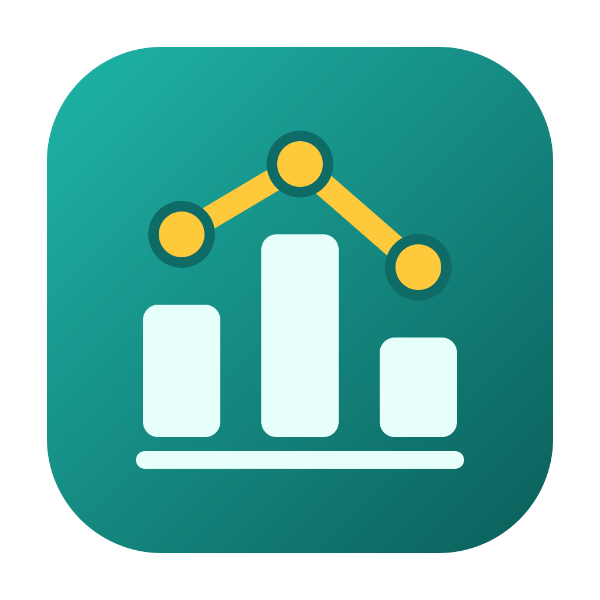
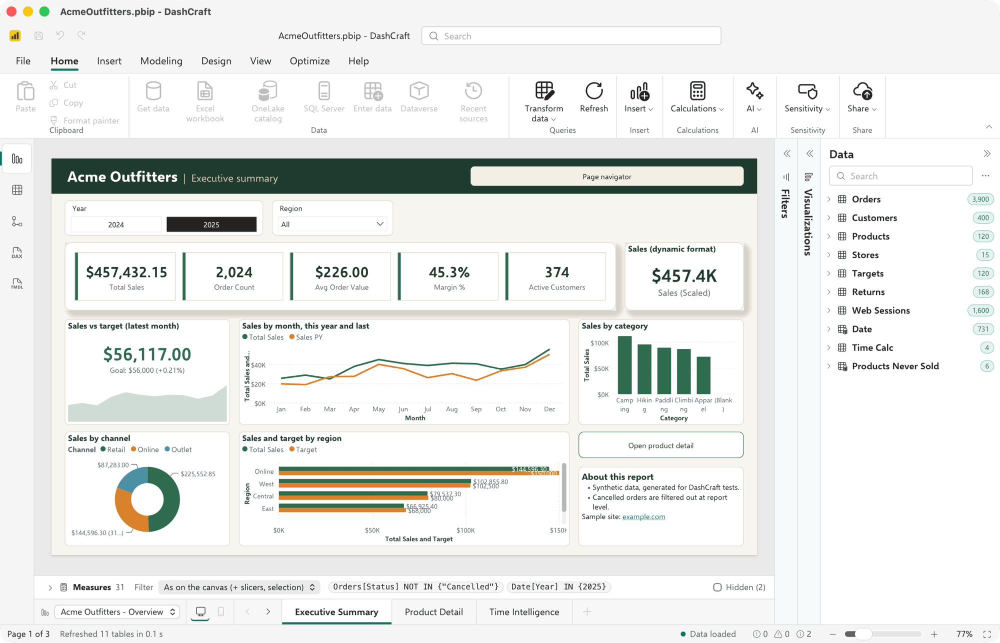
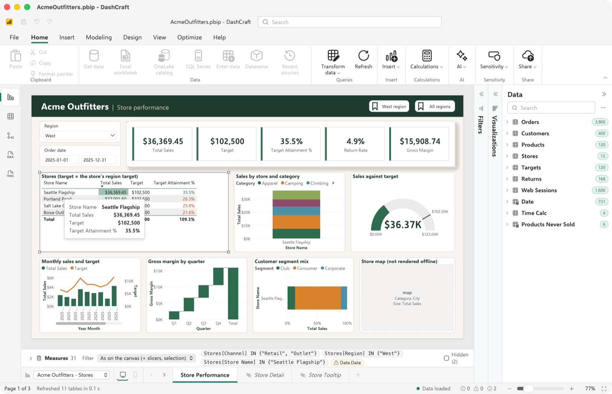
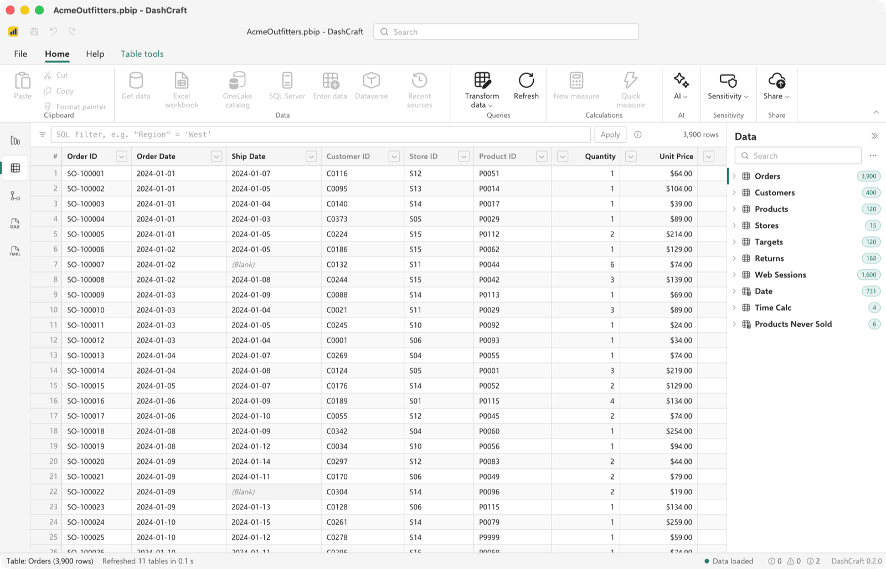
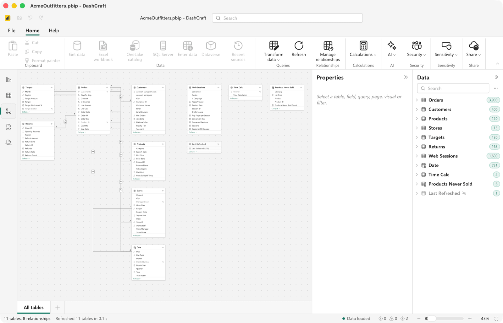
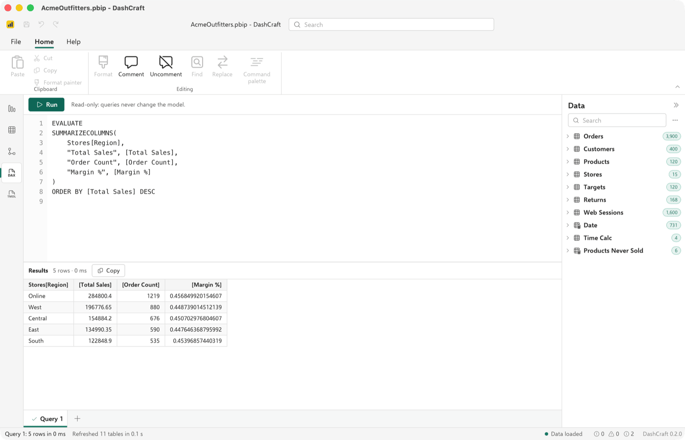

<p align="center">
  
</p>

<h1 align="center">DashCraft</h1>

<p align="center">
  <b>Open Power BI files anywhere, offline, in a native app and CLI written in Rust.</b><br>
  PBIP, PBIX and PBIT reports with their data, DAX and Power Query M engines, and interactive report pages,<br>
  on macOS, Windows and Linux. No Power BI Desktop, no Windows VM, no sign-in.
</p>

<p align="center">
  <a href="https://github.com/Jxck-S/dashcraft/actions/workflows/ci.yml"></a>
  
  
  
  
</p>

<br>

<p align="center">
  
  <br>
  <sub>The Executive Summary page of the synthetic Acme Outfitters example, rendered and evaluated entirely by DashCraft.</sub>
</p>

<p align="center">
  <a href="#features">Features</a> ·
  <a href="#built-for-agents">Agents</a> ·
  <a href="#under-the-hood">Under the hood</a> ·
  <a href="#get-started">Get started</a> ·
  <a href="#status">Status</a> ·
  <a href="#documentation">Documentation</a>
</p>

<br>

<table>
  <tr>
    <td width="25%" valign="top">
      <h3>Familiar layout</h3>
      The ribbon, view rail, Filters, Visualizations and Data panes and page tabs sit where Power BI Desktop puts them. Commands DashCraft can't run yet are shown, disabled.
    </td>
    <td width="25%" valign="top">
      <h3>Real engines</h3>
      Its own DAX and Power Query M engines, a clean-room VertiPaq decoder and an Arrow + DataFusion storage engine load and evaluate the model offline.
    </td>
    <td width="25%" valign="top">
      <h3>Interactive reports</h3>
      Slicers, cross-filtering, tooltips, scrolling tables and expandable matrices, drawn by built-in Rust visuals with bundled fonts, identically on every OS.
    </td>
    <td width="25%" valign="top">
      <h3>Agent-ready</h3>
      Every capability is a typed command, so the app, the CLI, a JSON-RPC server and an MCP server for AI agents all run the same code.
    </td>
  </tr>
</table>

<br>

## Features

Every screenshot is the real app on the synthetic Acme Outfitters example in this repository.

<table>
  <tr>
    <td width="50%" valign="top">
      
      <br>
      <b>Interact with the report.</b> Slicers, cross-filtering per the report's interactions, tooltips, Back and page-navigation buttons, and "View as" a role to check row-level security.
    </td>
    <td width="50%" valign="top">
      
      <br>
      <b>See the data.</b> M queries refresh offline, PBIX data decodes from VertiPaq, and a virtualized grid sorts, filters with SQL and exports to CSV or Parquet.
    </td>
  </tr>
  <tr>
    <td width="50%" valign="top">
      
      <br>
      <b>Understand the model.</b> Tables, relationships, measures, calculation groups, roles and descriptions, as a diagram and as a tree, with a 17-rule broken-reference linter.
    </td>
    <td width="50%" valign="top">
      
      <br>
      <b>Query with DAX.</b> 294 DAX functions with filter and row context, calculation groups and many-to-many relationships; run <code>EVALUATE</code> queries in the DAX query view.
    </td>
  </tr>
</table>

<br>

| Opens | Notes |
|---|---|
| PBIP projects (TMDL or `model.bim`; PBIR or PBIR-Legacy) | Model, data through M refresh or `.pbi/cache.abf`, every report page |
| PBIX and PBIT files | Model, embedded VertiPaq data (PBIX), every report page |
| `.bim`, TMDL folders, `.abf`, Power Pivot workbooks, `.vpax`, `.pq`/`.pqt`, dataflows, `.rdl`, `.pbids` | Model, data or outline, depending on the format |

Everything else, from the per-visual support matrix to the DAX and M coverage, is in
**[docs/FEATURES.md](docs/FEATURES.md)**; the full format matrix is in [FORMATS.md](FORMATS.md).

## Built for agents

Every capability is a command in one registry (`doc.open`, `measures.values`, `dax.query`,
`render.page`, `security.viewAs`, …) with JSON Schemas for its parameters and results. The CLI, the
app, a JSON-RPC server and an MCP server are thin adapters over it.

```sh
# Every measure's value on a report, as JSON
dashcraft run measures.values --doc model.pbip -p report=Overview

# Render every page of a report to PNG
dashcraft render report.pbix --all-pages --out-dir pages/

# The command catalog with its schemas
dashcraft commands --json --schemas

# Let an AI agent use DashCraft over MCP, confined to read and write roots
dashcraft mcp --read-root ./reports
```

AI features are opt-in and off by default: with AI off, DashCraft makes no network requests at all
([docs/AI.md](docs/AI.md)). The MCP server is described in [docs/MCP.md](docs/MCP.md), every CLI
flag in [docs/CLI.md](docs/CLI.md).

## Under the hood

- **Pipeline:** containers → format readers → a TOM-like model → session (M refresh, VertiPaq
  decoding, DAX) → visual queries → Power BI-shaped DataViews → visuals → scene graph → SVG and
  PNG ([docs/ARCHITECTURE.md](docs/ARCHITECTURE.md)).
- **Layered crates:** 15 crates, layering enforced in CI by `cargo xtask layers`; UI-toolkit crates
  stay in the app, network crates in the opt-in AI layer.
- **Built to edit:** lossless TMDL, TMSL and PBIR readers and writers and undoable document
  commands, the groundwork for Power BI Desktop-style editing.
- **Untrusted input:** parsers never panic, `unsafe` is denied, archives are capped and guarded
  against zip-slip, 14 fuzz targets run nightly, and embedded scripts and custom visuals are never
  executed ([docs/SECURITY.md](docs/SECURITY.md)).
- **Deterministic and fast:** bundled fonts only, the same bytes on every OS; performance budgets
  checked by `cargo xtask perf` ([docs/perf.md](docs/perf.md)).
- **Clean-room:** implemented from public documentation and observed behaviour, with no Microsoft
  code, icons or assets ([ADR-0003](docs/adr/0003-vertipaq-xpress9-cleanroom.md)).

## Get started

```sh
git clone https://github.com/Jxck-S/dashcraft
cd dashcraft
cargo build --release -p pbiview-cli                     # the dashcraft CLI
target/release/dashcraft inspect path/to/report.pbix

cd app && npm install
npm run tauri dev -- -- path/to/report.pbix              # the desktop app
```

Try it on the example in this repository: open
`reference/examples/acme-outfitters/AcmeOutfitters.pbip` with
`DASHCRAFT_BLOB_MAP=reference/examples/acme-outfitters/blob-map.json` set, so its data loads
offline. Prerequisites, every build and test command and the test-data rules:
[docs/DEVELOPMENT.md](docs/DEVELOPMENT.md). Using the app and the CLI:
[docs/USER-GUIDE.md](docs/USER-GUIDE.md). Contributors and AI agents: start with
[AGENTS.md](AGENTS.md).

Installers for macOS, Windows and Linux are built by the release workflow
([docs/packaging.md](docs/packaging.md)); they are unsigned until signing certificates exist.

## Status

> [!IMPORTANT]
> DashCraft is a **read-only viewer** today. It opens, refreshes, queries and renders Power BI
> files, but it does not edit or save reports yet. The goal is a full Rust reimplementation of
> Power BI Desktop: report and model editing, Power Query, Save and undo.

- **Released:** v0.1.0 (Data Explorer) and v0.2.0 (Report Renderer, remaining formats,
  installers); later work is in `main` under `[Unreleased]` in the [CHANGELOG](CHANGELOG.md).
- **Where it stands:** each area is scored 0–5 against Power BI Desktop in
  [docs/GAPS.md](docs/GAPS.md). The viewer scores 3–5; editing, modeling and Power Query, 0–1.
- **Where it is going:** milestones M6 to M31, from editable documents to 1.0, in
  [docs/DESKTOP-PLAN.md](docs/DESKTOP-PLAN.md); releases, acceptance criteria and the next items in
  [docs/ROADMAP.md](docs/ROADMAP.md).

## Documentation

| | |
|---|---|
| Using DashCraft | [User guide](docs/USER-GUIDE.md) · [Features](docs/FEATURES.md) · [CLI](docs/CLI.md) · [Commands](docs/COMMANDS.md) · [MCP](docs/MCP.md) · [AI](docs/AI.md) |
| Support matrices | [Formats](FORMATS.md) · [Visuals](docs/VISUALS.md) · [DAX functions](crates/pbi-dax/FUNCTIONS.md) · [Lint rules](crates/pbi-core/src/lint/RULES.md) |
| Project | [Roadmap](docs/ROADMAP.md) · [Desktop plan](docs/DESKTOP-PLAN.md) · [Gaps](docs/GAPS.md) · [Changelog](CHANGELOG.md) · [Dev log](docs/DEVLOG.md) |
| Contributing | [AGENTS.md](AGENTS.md) · [Development](docs/DEVELOPMENT.md) · [Architecture](docs/ARCHITECTURE.md) · [Decisions](docs/adr/README.md) · [Performance](docs/perf.md) · [CI](docs/ci.md) · [Packaging](docs/packaging.md) · [Security](docs/SECURITY.md) |
| App and data | [App](app/README.md) · [Desktop UI reference](app/docs/desktop-ui-reference.md) · [Test fixtures](reference/README.md) · [VertiPaq notes](crates/pbi-vertipaq/FORMAT-NOTES.md) |

## License and notices

DashCraft is open source under the [MIT License](LICENSE). Bundled assets: the Selawik and Carlito
fonts (SIL OFL 1.1, unmodified) and Fluent UI System Icons (MIT); no Power BI icons, images or CSS.
The XPress9, ABF and VertiPaq decoders are clean-room implementations; shipping PBIX data decoding
in a release needs the legal review recorded in [ADR-0003](docs/adr/0003-vertipaq-xpress9-cleanroom.md).
Third-party attributions: [THIRD_PARTY_NOTICES.md](THIRD_PARTY_NOTICES.md).

DashCraft is an independent project, not affiliated with, endorsed or sponsored by Microsoft.
"Power BI" and "Microsoft" are trademarks of Microsoft, used only to say which files DashCraft
opens. It is not affiliated with storytold/ArtCraft or with other products named "DashCraft". See
[NOTICE](NOTICE) and [ADR-0009](docs/adr/0009-naming-dashcraft.md).
