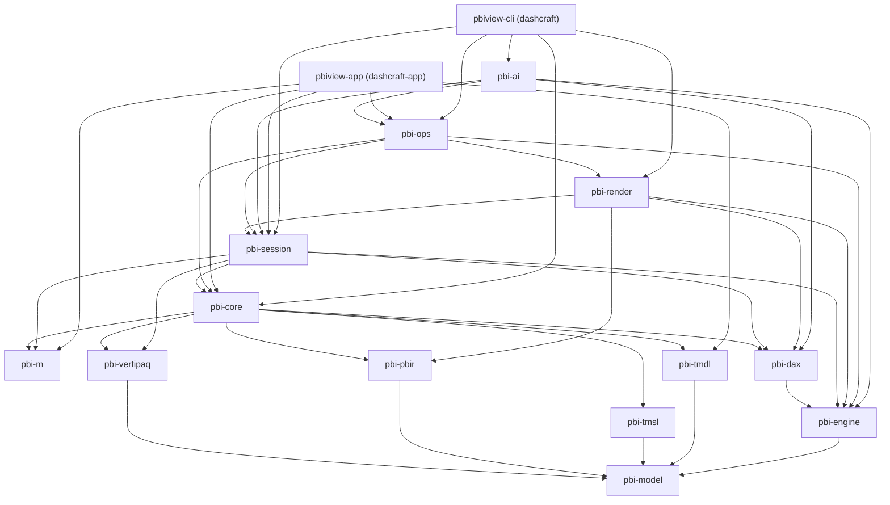

# DashCraft

**DashCraft** (formerly pbiview) is a cross-platform (macOS, Windows, Linux) desktop app and command-line tool (`dashcraft`) that opens Power BI files **offline**: no Power BI Desktop, no Windows VM, no Fabric login. It reads PBIP, PBIX, PBIT and related formats, loads their data, evaluates DAX and Power Query M, and renders report pages with filters, slicers and cross-filtering.

The architecture is designed so it can later grow into a Rust reimplementation of Power BI Desktop ([ADR-0004](docs/adr/0004-desktop-ready-architecture.md)). Today it is a read-only viewer.

DashCraft is an independent project, not affiliated with, endorsed or sponsored by Microsoft; "Power BI" and "Microsoft" are Microsoft trademarks, used only to say which files it opens. It is not affiliated with storytold/ArtCraft or with other products named "DashCraft". See [NOTICE](NOTICE) and [ADR-0009](docs/adr/0009-naming-dashcraft.md) (the name).

## Status

| Phase | Scope | State |
|---|---|---|
| Phase 1: Data Explorer | Readers, model tree, M and DAX engines, data grid, exports, linter, CLI | Released as **v0.1.0** |
| Phase 2: Report Renderer | Visual queries, built-in visuals, SVG/PNG output, `dashcraft render`, golden-image tests, interactive canvas in a Power BI Desktop-style app | Released as **v0.2.0** (see [CHANGELOG.md](CHANGELOG.md)) |
| M5: polish and packaging | [FORMATS.md](FORMATS.md) §5 formats, docs, installers | Done in v0.2.0: formats, docs, installers and the release workflow ([docs/packaging.md](docs/packaging.md)); builds are unsigned until signing certificates exist |
| Next (unreleased) | Command registry (`pbi-ops`), `run`/`serve`, MCP server for AI agents, opt-in AI layer (CLI and app), the app on the registry, performance budgets (`cargo xtask perf`: all 8 scenarios within target, [docs/perf.md](docs/perf.md)), the DashCraft name, scatter/funnel/gauge/treemap/waterfall visuals, conditional formatting, calculation groups, many-to-many relationships, row-level security, 294 DAX functions | In `main` ([CHANGELOG.md](CHANGELOG.md) `[Unreleased]`, [docs/ROADMAP.md](docs/ROADMAP.md)) |

Original acceptance criteria:

| # | Criterion | Result |
|---|---|---|
| 1 | Opens PBIX, PBIP (one semantic model with several `*.Report` folders) and PBIT files on macOS, Windows and Linux | Covered by tests on the CI matrix (macOS arm64, Windows x64, Ubuntu) using the synthetic example and the public Microsoft samples |
| 2 | `inspect --json` lists every object; CSV-backed partitions load with the expected row counts | Done (`insta` snapshots; `pbi-session` acceptance tests against the example's expected values) |
| 3 | `render --png` within SSIM tolerance of the service exports; card values match the expected values | Card values: all 39 of the example's expected values are asserted on the rendered pages. SSIM: the per-region comparison (threshold 0.85, no exceptions) runs only against optional local golden images, and none are committed, so it is not verified yet; render snapshots of every example page catch regressions ([details](docs/VISUALS.md#render-verification)) |
| 4 | TMDL and PBIR round-trips, XPress9 known-good blob, one test per DAX function | Done |
| 5 | CI matrix with fmt, clippy `-D warnings`, tests; signed release artifacts | CI done ([docs/ci.md](docs/ci.md)); release workflow builds unsigned until signing secrets exist |
| 6 | No script execution, untrusted-input hardening, fuzzing, no telemetry | Done (14 `cargo-fuzz` targets, nightly) |

Screenshots are not committed yet. Build the app and open a file (for example the Acme Outfitters example in `reference/examples/acme-outfitters/`) to see it.

## Quick start

Prerequisites: the Rust toolchain pinned in `rust-toolchain.toml` (installed automatically by `rustup`). The app also needs Node 20.19+ or 22.12+ and npm, plus WebKitGTK on Linux ([app/README.md](app/README.md#linux-system-dependencies)).

```sh
# CLI
cargo build --release -p pbiview-cli                   # target/release/dashcraft (and the pbiview alias)
target/release/dashcraft inspect path/to/report.pbip
target/release/dashcraft refresh model.pbip --blob-map blob-map.json
target/release/dashcraft render model.pbip --blob-map blob-map.json --png target/tmp/page.png

# Try it on the synthetic example in this repository
target/release/dashcraft measures reference/examples/acme-outfitters/AcmeOutfitters.pbip \
  --blob-map reference/examples/acme-outfitters/blob-map.json --report Overview

# Desktop app
cd app && npm install
npm run tauri dev -- -- path/to/report.pbix            # development build with a file open
npm run tauri -- build                                 # release binary and installers for this OS
```

`dashcraft open <path>` starts the installed app on a file. `pbiview`, the former name, is kept as an alias of the `dashcraft` binary, and the former `PBIVIEW_*` environment variables still work ([ADR-0009](docs/adr/0009-naming-dashcraft.md)). See the [user guide](docs/USER-GUIDE.md) for the app and CLI recipes, and [docs/CLI.md](docs/CLI.md) for every flag and JSON schema.

## Features

**Data Explorer (Phase 1)**

- Content-based format detection; safe readers for PBIP (TMDL or `model.bim`, PBIR or PBIR-Legacy), PBIX (PBIR or legacy `Layout`, embedded VertiPaq data), PBIT and the other formats below.
- Model tree: tables, columns (display and source names), measures with DAX, calculated columns and tables, relationships, M partitions and parameters, hierarchies, roles, `///` descriptions.
- Data offline: M partitions run in DashCraft's own M engine (`AzureStorage.Blobs` through a local blob map), PBIX/ABF/Power Pivot data is decoded from VertiPaq, a PBIP's `.pbi/cache.abf` loads without M; "Load CSV manually…" as a fallback.
- DAX engine for measures, calculated columns and tables, and `EVALUATE` queries: 294 functions, calculation groups (`SELECTEDMEASURE` & co., dynamic format strings), many-to-many relationships, and row-level security applied per role ("View as" a role and user).
- Virtualized data grid with sort, SQL filter and column statistics; "Parse people field" derived columns.
- Exports: table to CSV (formula-injection guard on request) or Parquet; model to JSON or a Markdown data dictionary.
- Broken-reference linter (17 rules), including stale `queryRef`s.

**Report Renderer (Phase 2)**

- Each visual's `queryState`, report/page/visual filters, slicer selections and cross-filter selections become a DAX `SUMMARIZECOLUMNS` query; results are Power BI-shaped DataViews.
- Built-in Rust visuals draw into a scene graph, serialized to deterministic SVG (app) and PNG (CLI, tests) with bundled fonts.
- Themes (base + custom, `ThemeDataColor`, `visualStyles`, text classes), page display options, z-order, groups and container chrome.
- Conditional formatting of tables and matrices (color scales, rules, field values, data bars, icons) and of chart colors; dynamic format strings per cell.
- Service rendering quirks emulated ([docs/VISUALS.md](docs/VISUALS.md)); renders are checked by snapshots and expected values of the Acme Outfitters example, and against Power BI exports only where optional local golden images exist ([render verification](docs/VISUALS.md#render-verification)).

**Desktop-style app** ([app/README.md](app/README.md))

- Power BI Desktop's layout: ribbon, view rail (Report, Table, Model, DAX query, TMDL), Filters / Visualizations / Data panes, page tabs, status bar. Editing commands are shown disabled.
- Interactive report canvas: slicers (single and multi-select, dropdowns, search), cross-filtering per `visualInteractions`, tooltips, table and matrix scrolling, matrix expand/collapse, Back and page-navigation buttons.
- Opt-in AI, off by default ([docs/AI.md](docs/AI.md)): Options → AI (providers, keys in the OS keychain, consents), a consent dialog showing the exact request, **Explain with AI** for measures and **Suggest a measure** (never applied to the model).

**CLI** (`dashcraft`): `inspect`, `detect`, `open`, `convert`, `lint`, `refresh`, `measures`, `export`, `render`, plus the command registry (`commands`, `run`, `serve`), the MCP server for AI agents (`mcp`) and `ai login`/`logout` (reference below).

## Supported formats

Detection uses content (ZIP entries, JSON keys, `$schema`, encodings), not just the extension. Full matrix with detection signals, reader modules, fixtures and gaps: [FORMATS.md](FORMATS.md).

| Format | Model | Data | Report rendering |
|---|---|---|---|
| PBIP project (TMDL or `model.bim`; PBIR or PBIR-Legacy) | Full | M refresh (offline subset), or `.pbi/cache.abf` | Full (`byPath`); `byConnection` shown as remote |
| PBIX | Full (from `DataModel`) | Embedded VertiPaq data | Full (PBIR or legacy `Layout`) |
| PBIT | Full (`DataModelSchema`) | M refresh | Full |
| Standalone `.bim`, TMDL folder | Full | M refresh | n/a |
| `.abf` backup | Full | Embedded VertiPaq data | n/a |
| Excel workbook with Power Pivot (`.xlsx`/`.xlsm`) | Full | Embedded VertiPaq data | n/a |
| `.vpax` (VertiPaq Analyzer) | Model + size/cardinality statistics | none | n/a |
| `.pq`/`.m`, `.pqt`, dataflow `model.json`, Dataflow Gen2 | M queries (CDM entities as tables) | M refresh where sources are offline-capable | n/a |
| `.rdl` paginated report | Outline (data sources, datasets, parameters, items) | none | not rendered |
| `.pbids` | Connection details | none | n/a |
| `.pbiviz`, `.mez`/`.pqx` | Metadata / listing only, **never executed** | none | `.pbiviz` visuals: placeholder |

## Supported visuals

Levels: **Full** — the common formatting objects are honoured and the layout follows the service; **Partial** — renders the common options, notable gaps listed; **Placeholder** — a box with the visual type and its bound fields (the query still runs). Per-visual details, honoured formatting objects and known differences from the service: [docs/VISUALS.md](docs/VISUALS.md).

| Visual type | Level | Notable options and limits | Interaction (app) |
|---|---|---|---|
| `textbox` | Full | Text runs (font, size, weight, style, decoration, color, links), alignment, bullet/number lists, scrollbar on overflow | none |
| `shape`, `basicShape` | Full | 22 shape kinds (rectangles, ovals, lines, polygons, arrows, stars, tabs, …), fill, outline, rotation, text | none |
| `actionButton` | Full | Shape, vector icon (back, arrows, info, help, Q&A, bookmark, reset, filter, clear, apply), text; actions Back, page navigation, bookmark, drillthrough, Web URL, Q&A, apply/clear all slicers | Back, page navigation and Clear all slicers run; Web URL shown with Copy link, never opened; bookmark, drillthrough, Q&A "not available" |
| `pageNavigator`, `bookmarkNavigator` | Partial | Drawn as one labelled button (no page/bookmark list) | none |
| `cardVisual` (new card) | Full | Tiles grid, value/label styles, inner tile border, label clipping below ~100 px, reference labels, accent bar | none |
| `card`, `multiRowCard` | Full | Legacy card value + category label; multi-row card blocks with accent bar | none |
| `kpi` | Partial | Indicator, goal and status color, trend area | none |
| `slicer` | Full (list, dropdown, tile); Partial (range, relative date) | Header, search box, Select all, single/multi-select, scrollbar | Select, Ctrl+click, Select all, dropdown popup, search, scroll, clear; range sliders not interactive |
| `advancedSlicerVisual` (button slicer) | Partial | Drawn as tiles | Tile selection |
| `tableEx`, `table` | Full | Auto-sized columns, word wrap, banding, grid lines, totals, column widths and per-column formatting, sort arrows; conditional formatting (background and font color, data bars, icons) | Row click cross-filters; scroll; tooltips |
| `pivotTable`, `matrix` | Full | Stepped or tabular rows, subtotals, grand total, column hierarchies, `+`/`−` buttons, persisted expansion; conditional formatting as tables | Row click cross-filters (row path); expand/collapse; scroll; tooltips |
| `pieChart`, `donutChart` | Full | Leader-line labels with the service's placement and truncation, legend, `dataPoint` colors, inner radius | Slice click cross-filters; tooltips |
| `clusteredBarChart`, `barChart`/`stackedBarChart`, `hundredPercentStackedBarChart` and the `…ColumnChart` equivalents | Full | Axes with nice ticks, gridlines, titles, data labels, legend, category scrolling | Bar click cross-filters; tooltips |
| `lineChart`, `areaChart`, `stackedAreaChart` | Full | Categorical or continuous (date/number) axis, markers, line styles | Point click cross-filters; tooltips |
| `lineClusteredColumnComboChart`, `lineStackedColumnComboChart` | Full | Columns on `Y`, lines on `Y2` with a secondary axis | Bar and point clicks cross-filter |
| `scatterChart` | Partial | Points per Details × Legend value, numeric X/Y axes, bubbles sized by `Size`, marker shapes, labels; first play-axis frame only, no Analytics pane | Point click cross-filters; tooltips (Details, Legend, X, Y, Size) |
| `funnel` | Full | Centred bars in query order, data labels, conversion-rate labels | Bar click cross-filters; tooltips |
| `gauge` | Full | 180° arc, minimum/maximum (default maximum = 2 × value), target needle, callout value | Tooltip (no category, no cross-filter) |
| `treemap` | Full | Squarified groups and details, theme colors, labels | Tile click cross-filters; tooltips |
| `waterfallChart` | Full | Increase/decrease/total colors, connectors, total column, breakdown top N + Other | Column click cross-filters; tooltips |
| Anything else (`image`, maps, `ribbonChart`, AI visuals, R/Python, custom `.pbiviz` visuals, …) | Placeholder | Visual type and bound fields | none |

**Conditional formatting** (tables, matrices, and the colors of bar, column, pie, donut, treemap, scatter and funnel charts without a legend field): color scales with 2 or 3 colors, rules, field values, data bars and built-in icons; unsupported variants (headers, titles, cards, per-legend chart colors, URL icons, …) render unformatted with a warning ([details](docs/VISUALS.md#conditional-formatting)). Measures with dynamic format strings (calculation items, `formatStringDefinition`) format each value with its own format string.

Visuals are tested with synthetic reports, render snapshots and expected values of the Acme Outfitters example, and the Microsoft sample reports (every page renders, with the expected visual counts); when optional local golden exports from Power BI are present, renders are also compared with them by SSIM. A visual whose query fails draws "Can't display this visual" with ⚠; the app's tooltip shows the message and the failing measure's DAX. Rendering never panics.

## DAX and M coverage

- **DAX** (`pbi-dax`): 294 functions in twelve families (logical and information, math and statistics including logarithms and trigonometry, statistical distributions, text, date and time, **time intelligence**, aggregation and iterators, filter and context including `CALCULATE` modifiers, `ALLSELECTED`, `ISINSCOPE`, `USERELATIONSHIP`, `CROSSFILTER`, table manipulation including `SUMMARIZECOLUMNS` with rollups, window functions, parent-child, calculation groups and security); 271 fully supported, 23 partial. `DEFINE`/`EVALUATE` queries, calculated columns and tables, `FORMAT` strings, calculation groups (precedence, selection expressions, dynamic format strings), many-to-many (limited) relationships, row-level security (`pbi-session` applies role filters; `USERPRINCIPALNAME`, `CUSTOMDATA`). Not supported: object-level security, DirectQuery, financial and `INFO.*` functions. Unsupported functions return a typed error shown as ⚠ with the DAX text. Full list and semantic gaps: [crates/pbi-dax/FUNCTIONS.md](crates/pbi-dax/FUNCTIONS.md).
- **Power Query M** (`pbi-m`): full grammar; lazy evaluator with closures, `each`, `try`/`otherwise`, `meta`, sections; 336 library names: 268 native functions plus `*.Type` values and enum constants (`Table.*` 45, `List.*` 41, `Text.*` 36, `Number.*` 20, date, time and duration families, `Record.*`, `Csv.Document`, `Json.Document`, …; `pbi_m::library_names()` lists them). `AzureStorage.Blobs` resolves through the offline blob map only; every other data-access function (`Sql.*`, `Web.*`, `File.*`, `SharePoint.*`, …) returns "unsupported" and the table offers "Load CSV manually…". Deviations (numbers are `f64`, no query folding, cultures ignored) are listed in the `pbi_m::eval` module docs.
- **Visual filters** (`pbi-render`): categorical and tuple `In`/`Not In`, advanced comparisons and `Between`, contains/starts-with, blank tests and Top N are applied; relative-date filters and a few rare forms are reported as "not applied". Matrix in the `pbi_render::query` module docs.

## CLI reference

| Command | Purpose | Key flags |
|---|---|---|
| `inspect <path>` | Model, reports and reader diagnostics | `--json`, `--pretty`, `--no-expressions` |
| `detect <path>` | Format detection only | `--json` |
| `open <path>` | Opens the desktop app | |
| `convert <path>` | Writes a PBIP project or a PBIT template | `--to pbip\|pbit`, `--out`, `--report`, `--force` |
| `lint <path>` | Broken-reference linter ([rules](crates/pbi-core/src/lint/RULES.md)) | `--json`, `--deny errors\|warnings\|infos`, `--disable <RULE>`, `--no-layout` |
| `refresh <path>` | Loads the data, per-table status | `--source auto\|m\|cache`, `--blob-map`, `--tables`, `--json` |
| `measures <path>` | Every measure's formatted value | `--report`, `--source`, `--blob-map`, `--json` |
| `export <path>` | Table data or model documentation | `--table` + `--format csv\|parquet`, `--model` + `--format json\|md`, `--out`, `--formatted`, `--bom`, `--excel-safe`, `--no-expressions`, `--force` |
| `render <path>` | Report pages to PNG or SVG | `--png`, `--svg`, `--out-dir`, `--report`, `--page`, `--all-pages`, `--scale`, `--slicer`, `--now`, `--json` |
| `commands [<id>]` | The command catalog (47 typed commands, plus 9 opt-in `ai.*` commands, with JSON Schemas) | `--json`, `--schemas`, `--markdown`, `--agent-safe` |
| `run <id>` | Runs one catalog command and prints its JSON result | `--params <json>`, `-p key=value`, `--doc <path>`, `--blob-map`, `--batch <file>`, `--stop-on-error`, `--pretty` |
| `serve` | JSON-lines RPC (JSON-RPC 2.0) over stdin/stdout with a persistent workspace | `--stdio`, `--read-root`, `--write-root`, `--blob-map`, `--max-concurrent`, `--agent` |
| `mcp` | MCP server for AI agents: the agent-safe commands as tools, confined to read/write roots ([docs/MCP.md](docs/MCP.md)) | `--read-root`, `--write-root`, `--blob-map`, `--allow`, `--deny`, `--tool-names`, `--max-concurrent` |
| `ai login` / `ai logout` | Store or delete an AI provider's API key in the OS keychain (the opt-in `ai.*` commands run through `run`/`serve`/`mcp`; [docs/AI.md](docs/AI.md)) | `--provider`, `--stdin` |

`commands`, `run`, `serve` and `mcp` expose the command registry that the app and AI agents (MCP) share: every capability as a named command (`doc.open`, `measures.values`, `dax.query`, `render.page`, `canvas.click`, `export.table`, …) with typed, schema-checked parameters. For example `dashcraft run measures.values --doc model.pbip --blob-map blob-map.json -p report=Critical`. Catalog and protocol: [docs/COMMANDS.md](docs/COMMANDS.md); design: [ADR-0007](docs/adr/0007-command-registry.md).

Global flags: `-v` (repeatable), `-q`. Exit codes: **0** success (warnings allowed); **1** fatal error (unreadable or unsupported input, usage error, output exists); **2** the input was read but has errors (Error diagnostics, lint findings at the `--deny` level, failed tables, measures or visuals). Details, JSON schemas and examples: [docs/CLI.md](docs/CLI.md).

## Security posture

- Every input file is **untrusted**. Parsers return errors and never panic; the workspace denies `unsafe` code. ZIP readers cap total size, entry count and compression ratio and refuse absolute, `..` and drive-letter paths (zip-slip); folders are walked without following symlinks. 14 `cargo-fuzz` targets run nightly.
- **No script execution:** R/Python visuals, `.pbiviz` custom visuals and `.mez`/`.pqx` connectors are listed or drawn as placeholders, never run. `SecurityBindings` is treated as opaque. M code cannot read files or the network.
- **No telemetry, no network access.** Blob sources resolve only through a local `blob-map.json`. Web URL buttons are shown, never opened. The only exception is the opt-in AI layer: off by default, it sends nothing without a recorded consent per provider, capability and kind of data ([docs/AI.md](docs/AI.md)).
- **Secrets are redacted** from metadata parts and connection strings (`password`, `token`, `sig=`, `accountkey=`, …) before they are stored or displayed.
- **App hardening:** strict CSP with no remote origins, minimal Tauri capabilities (core defaults, window title, native open and save dialogs; no file system, shell or HTTP plugins), report SVG sanitized before insertion. The app writes only its recent-files list, its AI settings (`ai.json`, no keys) and the PBIP/PBIT files you export.
- **Exports:** CSV exports can neutralize spreadsheet formulas (`--excel-safe`); exports are written atomically and never overwrite without `--force`.
- Credentials (AI provider keys today, remote access later) go only through the OS keychain.

## Architecture

Pipeline: containers → format readers → `Document` (model + report AST) → session (M refresh, VertiPaq decode, DAX) → visual queries → DataView → visuals → scene graph → SVG/PNG → command registry → CLI, app or MCP agents. Details, crate responsibilities and extension points: [docs/ARCHITECTURE.md](docs/ARCHITECTURE.md).



Every crate except `pbi-m` also depends on `pbi-model` directly (edges omitted). `pbi-m` has no internal dependencies. `cargo xtask layers` enforces the layering (no upward edges; UI toolkits only in the app).

| Crate | Responsibility |
|---|---|
| `pbi-model` | TOM-like semantic model, report AST, `ObjectId`s, `Document` + `Command` (undo/redo) |
| `pbi-tmdl` | Lossless TMDL parser and writer (byte-identical round-trip) |
| `pbi-tmsl` | TMSL JSON (`model.bim`, PBIT `DataModelSchema`) reader and writer |
| `pbi-pbir` | PBIR, PBIR-Legacy and PBIX `Layout` types (lossless), themes |
| `pbi-core` | Detection, safe containers, readers → `Document`, PBIP/PBIT writers, linter |
| `pbi-m` | Power Query M lexer, parser and evaluator |
| `pbi-engine` | Arrow storage engine, relationships, filter propagation, DataFusion SQL |
| `pbi-dax` | DAX lexer, parser and formula engine, format strings |
| `pbi-vertipaq` | Clean-room XPress9, ABF and VertiPaq decoding to Arrow |
| `pbi-session` | Open → refresh → query façade, cache and CSV loading, derived columns, exports |
| `pbi-render` | Theme, layout, visual queries → DataView, visuals → scene → SVG/PNG, golden comparison |
| `pbi-ops` | Command registry ([ADR-0007](docs/adr/0007-command-registry.md)): every capability as a typed command with JSON Schemas; workspace, path policy, JSON-lines RPC, MCP server |
| `pbi-ai` | Opt-in AI layer ([ADR-0008](docs/adr/0008-ai-layer.md)): `ai.*` commands, providers, consent, keychain-only keys; the only crate with network access |
| `pbiview-cli` | The `dashcraft` binary and its `pbiview` alias |
| `pbiview-app` (`app/src-tauri`) | Tauri 2 back end of the Svelte 5 desktop app (`dashcraft-app`), a thin front end over `pbi-ops` |

## Build and test

```sh
cargo build
cargo test                                              # all crates/* (not the app)
cargo fmt --all --check
cargo clippy --all-targets -- -D warnings
(cd app && npm ci && npm run check && npm run build)    # app front end
cargo clippy -p pbiview-app --all-targets -- -D warnings
cargo test -p pbiview-app
```

Plain `cargo build`/`cargo test` use the workspace `default-members` (all `crates/*`). The app crate needs the front end built and, on Linux, the WebKitGTK development packages. CI runs the same commands on macOS, Windows and Linux ([docs/ci.md](docs/ci.md)).

- **Unit and integration tests** in every crate: TMDL byte-identical and PBIR JSON-identical round-trips on every fixture file, `insta` snapshots of `inspect --json`, one test per DAX function, M standard-library tests, XPress9 known-good vectors, engine filter-propagation tests, CLI end-to-end tests on synthetic projects.
- **Fixtures** come from `reference/` (or `$PBIVIEW_REFERENCE`); see [reference/README.md](reference/README.md): the synthetic **Acme Outfitters** example (`reference/examples/acme-outfitters/`: PBIP, CSV data, `blob-map.json` and its expected values in `EXPECTED.md` / `expected.json`) and MIT-licensed Microsoft sample reports (`reference/samples/microsoft/`; larger ones via `scripts/fetch-samples.sh` into the gitignored `reference/samples/downloads/`). Tests that need an optional file print `SKIP: <file> missing` and pass, so CI on a fresh clone stays green.
- **Render tests** in `crates/pbi-render/tests/`: `insta` render snapshots of every Acme Outfitters page (`render_snapshots.rs`: per-visual texts, data points and SVG hashes; review changes with `cargo insta review`), all 39 card values of the example's `expected.json` asserted on the rendered pages, and every page of the Microsoft samples rendered. **Golden-image tests** (`golden.rs`) compare a page with a Power BI export by per-region SSIM (≥ 0.85, no exceptions) only when `reference/golden/<example>/<report>/<page>.png` exists (gitignored and optional; none are committed). Run locally with `cargo test -p pbi-render --test golden -- --nocapture`; outputs go to `target/tmp/golden/` and must not be committed. Method: [docs/VISUALS.md](docs/VISUALS.md#render-verification).
- **Fuzzing**: `fuzz/` holds 14 `cargo-fuzz` targets (ZIP containers, detection, `open_bytes`, TMDL, TMSL, PBIR, legacy layout, M parser and evaluator, DAX, XPress9, ABF, VertiPaq, people parser); see [docs/ci.md](docs/ci.md#fuzz-targets).

## Licensing and third-party notes

DashCraft is proprietary (`LicenseRef-Proprietary`, see `Cargo.toml`). Rust dependencies are limited to permissive licenses by `cargo-deny` ([deny.toml](deny.toml)). Bundled assets: Selawik and Carlito fonts (SIL OFL 1.1) and Fluent UI System Icons (MIT); no Power BI icons, images or CSS are used. Trademark and non-affiliation notice: [NOTICE](NOTICE). The XPress9/ABF/VertiPaq decoders are clean-room implementations; references and the open legal questions are in [ADR-0003](docs/adr/0003-vertipaq-xpress9-cleanroom.md), [crates/pbi-vertipaq/REFERENCES.md](crates/pbi-vertipaq/REFERENCES.md) and [THIRD_PARTY_NOTICES.md](THIRD_PARTY_NOTICES.md). Shipping PBIX data decoding in a release needs the legal review recorded in ADR-0003.

## Documentation

- [AGENTS.md](AGENTS.md): start here to contribute (people and AI agents): golden rules, parallel-agent protocol, validation commands, definition of done
- [docs/GAPS.md](docs/GAPS.md): gaps scorecard against Power BI Desktop; [docs/DEVLOG.md](docs/DEVLOG.md): dev log per wave
- [docs/USER-GUIDE.md](docs/USER-GUIDE.md): using the app, CLI recipes for CI
- [docs/CLI.md](docs/CLI.md): every command, flag, exit code and JSON schema
- [docs/COMMANDS.md](docs/COMMANDS.md): the command catalog (generated); [docs/MCP.md](docs/MCP.md): the MCP server for AI agents; [docs/AI.md](docs/AI.md): the opt-in AI features
- [docs/perf.md](docs/perf.md): performance budgets (`cargo xtask perf`)
- [FORMATS.md](FORMATS.md): format support matrix
- [docs/VISUALS.md](docs/VISUALS.md): per-visual support, service quirks, render verification
- [docs/ARCHITECTURE.md](docs/ARCHITECTURE.md): pipeline, crates, extension points
- [crates/pbi-dax/FUNCTIONS.md](crates/pbi-dax/FUNCTIONS.md): DAX function coverage
- [crates/pbi-core/src/lint/RULES.md](crates/pbi-core/src/lint/RULES.md): linter rules
- [crates/pbi-vertipaq/FORMAT-NOTES.md](crates/pbi-vertipaq/FORMAT-NOTES.md): XPress9, ABF and VertiPaq format notes
- [app/README.md](app/README.md) and [app/docs/desktop-ui-reference.md](app/docs/desktop-ui-reference.md): the desktop app and its Power BI Desktop mapping
- [CHANGELOG.md](CHANGELOG.md), [docs/ROADMAP.md](docs/ROADMAP.md), [NOTICE](NOTICE)
- [docs/ci.md](docs/ci.md) (CI, release, fuzzing) and [docs/packaging.md](docs/packaging.md) (installers)
- Architecture decisions ([index](docs/adr/README.md)):
  - [ADR-0001: UI with Tauri 2 + Svelte 5 + TypeScript](docs/adr/0001-ui-tauri-svelte.md)
  - [ADR-0002: Arrow + DataFusion data engine](docs/adr/0002-arrow-datafusion.md)
  - [ADR-0003: Clean-room XPress9 / VertiPaq and license research](docs/adr/0003-vertipaq-xpress9-cleanroom.md)
  - [ADR-0004: Desktop-ready architecture](docs/adr/0004-desktop-ready-architecture.md)
  - [ADR-0005: Rust SVG renderer](docs/adr/0005-rust-svg-renderer.md)
  - [ADR-0006: Report interaction state outside the document](docs/adr/0006-interaction-state.md)
  - [ADR-0007: Command registry (pbi-ops) for the CLI, RPC, app and agents](docs/adr/0007-command-registry.md)
  - [ADR-0008: Opt-in AI layer (pbi-ai)](docs/adr/0008-ai-layer.md)
  - [ADR-0009: Product name DashCraft](docs/adr/0009-naming-dashcraft.md)
