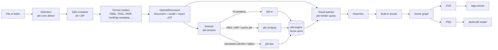
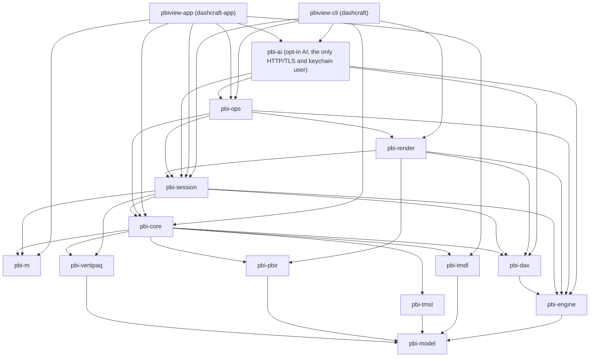
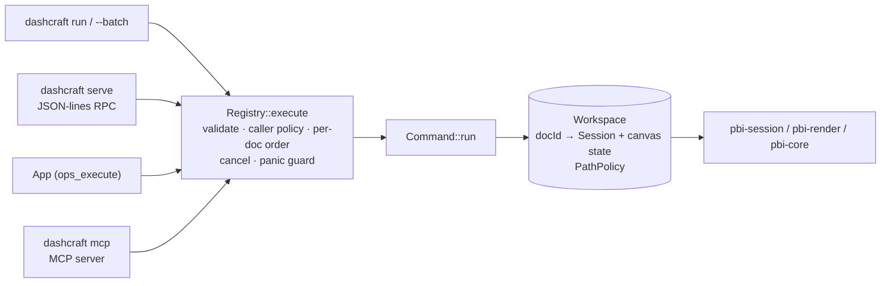

# Architecture

How DashCraft turns a Power BI file into a model, data and rendered pages, which crate owns what, which design choices keep the door open for a Power BI Desktop-style editor, and where to extend it. Decisions and their alternatives are in the [ADRs](adr/README.md); this document describes the code as it is.

## Pipeline

1. **Detection and containers** (`pbi-core::detect`, `pbi-core::container`). The format is recognised from content: ZIP entry names, JSON keys, `$schema` URLs, XML namespaces, byte signatures and encodings. Inputs open through the `Container` trait (`DirContainer`, `ZipContainer`, `MemContainer`, `SubContainer`), which normalizes entry names, refuses absolute, `..` and drive-letter paths, never follows symlinks, and caps entry count, sizes and compression ratios. Nothing is extracted to disk.
2. **Readers** (`pbi-core::reader`) dispatch per format and build an `OpenedDocument`: a `pbi_model::Document` (semantic model, reports, diagnostics, source info), the container, the parsed sources needed to save or load data later (TMDL CST, typed PBIR files, ABF storage map), redacted metadata parts, and a `FormatOutline` for formats that are neither model nor report (VPAX statistics, RDL, mashups, custom visuals, connectors). Every recoverable problem becomes a `Diagnostic` with an origin (file plus line or JSON pointer).
3. **Session** (`pbi-session`). `Session::open` wraps the document; every model table exists, empty. `Session::refresh` loads data on a private copy of the engine and commits at the end:
   - M partitions run in `pbi-m` concurrently on blocking threads, with shared expressions and parameters in scope. `AzureStorage.Blobs` goes through a `BlobResolver` (offline: `blob-map.json`). Results are projected onto the model's `sourceColumn`s and typed per the model.
   - PBIX, `.abf` and Power Pivot data is decoded by `pbi-vertipaq`; a PBIP's `.pbi/cache.abf` is decoded the same way and mapped onto the model by name.
   - Calculated columns and tables run in `pbi-dax` in dependency order (a topological sort of their DAX references).
   - Session-derived columns ("Parse people field", DAX expressions, fixed arrays) are re-applied.
   A failed table keeps its previous data and reports `unsupported`, a hint and whether a CSV can stand in; dependants are skipped with the reason. Progress is reported through events, and cancellation leaves the session unchanged.
4. **Engines.** `pbi-engine` is the storage engine: Arrow record batches per table, case-insensitive dictionaries, relationship indexes, filter-context propagation (one → many, many → one for bidirectional and one-to-one relationships, one path per table pair, "no path, no effect"), scans, group-by and aggregates, plus DataFusion for the grid's SQL filters. `pbi-dax` is the formula engine: row and filter context, context transition, `CALCULATE` modifiers, BLANK semantics, 294 functions, `EVALUATE` queries, `FORMAT` strings; it asks the storage engine for visible row sets ([ADR-0002](adr/0002-arrow-datafusion.md)).
5. **Visual queries** (`pbi-render::query`). For each visible visual: report, page and visual filters, other slicers' selections and another visual's selected points (per `visualInteractions`) are intersected into a filter context; the projections become `EVALUATE SUMMARIZECOLUMNS(…)`; post-processing applies visual-level measure filters, sorting, row/category/series limits, totals and formatting. The result is a Power BI-shaped `DataView` (`single`, `categorical`, `table`, `matrix`), or a `VisualQueryError` with the failing measure's DAX. Queries run on one immutable engine snapshot per page and can be cancelled.
6. **Layout, theme and text** (`pbi-render::layout`, `theme`, `text`). Page scaling, paint order, groups and container chrome from `visualContainerObjects`; theme resolution with Power BI's precedence; text shaped and measured with `cosmic-text` over the bundled Selawik faces only.
7. **Visuals → scene** (`pbi-render::visuals`, `scene`). `render_visual` dispatches on `visualType`; each built-in visual draws its content into a retained scene graph (groups with transforms, clips, opacity and hit ids; rects, paths, lines, laid-out text lines, data-URI images). Unknown types draw a placeholder. Nothing panics.
8. **Output** (`pbi-render::svg`, `png`). The scene serializes to deterministic SVG (sorted attributes, rounded numbers, sequential clip ids, XML-escaped text, `data-hit` attributes) and rasterizes to PNG through `usvg`/`resvg`/`tiny-skia` with only the bundled fonts and `data:` images, so the same inputs give the same bytes on every OS.
9. **Front ends.** Every front end is an adapter over the command registry (`pbi-ops`, below). The CLI (`pbiview-cli`, binaries `dashcraft` and its `pbiview` alias) drives the session and renderer on a blocking Tokio runtime for its classic subcommands and runs registry commands for `run`, `serve` and `mcp`. The app (`pbiview-app`, binary `dashcraft-app`, Tauri 2) holds one `pbi_ops::Workspace`; documents, refresh, grid pages, DAX, measures and the interactive canvas (per page `InteractionState` and view state, [ADR-0006](adr/0006-interaction-state.md)) run through one generic `ops_execute` IPC command → `Registry::execute`. Canvas renders return SVG, which the Svelte front end sanitizes with `DOMParser` before inserting it, then maps pointer events on `data-hit` groups back to `canvas.click`, `canvas.scroll` and `canvas.tooltip` commands.

## Crate graph

Taken from the crates' `Cargo.toml` files (normal dependencies). Every crate except `pbi-m` also depends on `pbi-model` directly (edges omitted for readability). `pbi-core` uses `pbi-dax` and `pbi-m` to parse DAX and M (linter, mashup readers) and `pbi-vertipaq` to read model schemas from ABF backups; `pbi-render` uses `pbi-core` only in tests. Since the app runs every domain operation through the registry, it depends on `pbi-ops` for documents, data, DAX, measures and the canvas, and directly only on `pbi-core` and `pbi-model` (the app-only views), `pbi-session` (`SessionOptions` for the workspace's open hook), `pbi-m` (the swappable `BlobResolver`), `pbi-tmdl` (the TMDL view) and `pbi-ai` (its registry is `pbi_ai::catalog()`, the core commands plus the opt-in `ai.*` commands, and it installs the AI host with the app's `ai.json` and the OS keychain); it no longer uses `pbi-render` or `pbi-engine` directly. `pbi-ai` registers the `ai.*` commands into the registry (an allowed same-layer edge); its HTTP/TLS and keychain crates reach only `pbi-ai` and the two front ends that depend on it.

## Crate responsibilities

| Crate | Owns | Key entry points |
|---|---|---|
| `pbi-model` | TOM-like model (tables, columns, measures, partitions, relationships, expressions, hierarchies, roles, cultures, perspectives, query groups, annotations), format-agnostic report AST with typed filters and field references, `ObjectId`s, `Document`, `Command`/`History`, case-insensitive names | `Document`, `Model`, `Report`, `Command`, `History` |
| `pbi-tmdl` | Lossless TMDL CST, model mapping, Desktop-style writer | `parse_file`, `load_model`, `write_model` |
| `pbi-tmsl` | TMSL JSON (`model.bim`, PBIT `DataModelSchema`) ↔ model, layout-preserving | `read_bim`, `read_data_model_schema`, `write_bim`, `write_data_model_schema` |
| `pbi-pbir` | PBIR, PBIR-Legacy and PBIX `Layout` types (lossless: unknown fields, key order and number spellings kept), report AST conversion, themes and `ThemeDataColor` | `read_pbir`, `write_pbir`, `read_legacy_layout`, `to_report_ast` |
| `pbi-core` | Detection, containers, readers, redaction, PBIP/PBIT writers, linter | `open_path`, `open_bytes`, `save_as_pbip`, `export_pbit`, `lint` |
| `pbi-m` | M lexer, parser, printer, lazy evaluator, standard library, connectors | `Engine`, `parse_document`, `BlobResolver`, `library_names` |
| `pbi-engine` | Arrow storage, relationship graph, filter propagation, storage-engine operations, DataFusion SQL | `Engine`, `EngineSnapshot`, `FilterContext` |
| `pbi-dax` | DAX lexer, parser, printer, formula engine, function library, format strings | `evaluate_measure`, `EvalContext`, `format_value`, `supported_functions` |
| `pbi-vertipaq` | XPress9 and Xpress (MS-XCA) decompression, ABF container, `metadata.sqlitedb` and legacy XML metadata, VertiPaq column decoding to Arrow | `open_pbix_datamodel`, `load_model`, `open_pbix_data` |
| `pbi-session` | Open → refresh → query façade: M refresh, VertiPaq and cache loading, calculated objects, CSV loading, derived columns, measures, grid pages, statistics, SQL, DAX queries, filter specs, CSV/Parquet/model-doc exports | `Session`, `RefreshOptions`, `FilterSpec` |
| `pbi-render` | Theme, layout, text, visual queries, DataView, built-in visuals, scene, SVG, PNG, golden-image comparison | `query_page_data`, `render_report_page`, `render_interactive_page`, `svg::to_svg`, `png`, `golden` |
| `pbi-ops` | Command registry: every capability as a typed, JSON-Schema-described command (`doc.open`, `measures.values`, `render.page`, `canvas.click`, …) shared by the CLI, the RPC server, the app and agents; workspace of open documents, path policy, batches, JSON-lines RPC; the shared `inspect`/`detect` JSON schemas | `Registry`, `Command`, `Workspace`, `Ctx`, `OpError`, `PathPolicy`, `rpc::serve` |
| `pbi-ai` | Opt-in AI layer ([ADR-0008](adr/0008-ai-layer.md)): `ai.*` registry commands, provider adapters (OpenAI-compatible, Azure OpenAI, Ollama), settings, per-provider consent, keychain-only keys; the only crate with network and keychain access | `register`, `ai_catalog`, `store_api_key` |
| `pbiview-cli` | The `dashcraft` binary (and its `pbiview` alias, [ADR-0009](adr/0009-naming-dashcraft.md)) and its stable JSON schemas; `src/lib.rs` holds the program (`run_main`), `src/bin/` the two entry points | `inspect`, `lint`, `refresh`, `measures`, `export`, `render`, `commands`, `run`, `serve`, `mcp`, `ai`, … |
| `pbiview-app` | Tauri back end (`dashcraft-app`): the `ops_execute` / `ops_cancel` bridge to the registry, app-only views and DTOs, recent files, blob map | `ops.rs`, `commands.rs`, `views.rs` |

## Command registry

Every capability is also a **command** of the `pbi-ops` registry ([ADR-0007](adr/0007-command-registry.md); generated reference in [COMMANDS.md](COMMANDS.md)): a stable dotted id (`doc.open`, `data.refresh`, `render.page`, `canvas.click`, …), a `#[serde(deny_unknown_fields)]` parameter type and a result type, both with generated JSON Schemas (draft 2020-12), and static metadata (category, `mutates_document`, `long_running`, `agent_safe`, `writes_files`, `invokes_other_commands`, examples).

- `Registry::execute(&Workspace, id, params, &Ctx)` is the single entry point: parameters are validated before anything runs, `Agent` callers only reach `agent_safe` commands, commands that mutate a document run one at a time per `docId`, cancellation of the `Ctx` token ends the run with `cancelled`, and a panic becomes an `internal` error.
- The `Workspace` keeps open documents by `docId` with their `Session`, a data generation and the canvas state of each page (ADR-0006 semantics, adapted from the app). Data commands load a document's data on first use.
- Every file path goes through the workspace's `PathPolicy` (unrestricted for the CLI; read/write roots with symlink and `..` escape checks for agents and `dashcraft serve --read-root/--write-root`).
- Errors are `OpError { code, message, data }` with stable string codes mapped to JSON-RPC codes and CLI exit codes.
- Surfaces: `dashcraft commands`, `dashcraft run` (single commands and batches with `${name.field}` interpolation), `dashcraft serve` (JSON-RPC 2.0 over stdin/stdout with progress notifications and `$/cancel`), `dashcraft mcp` (the agent-safe commands as MCP tools, [MCP.md](MCP.md)) and the app (`ops_execute`, with a TypeScript client generated from the schemas). All are thin adapters (ADR-0007).
- Metadata drives the adapters: for example `invokes_other_commands` (set on `commands.batch`) makes the MCP server give a command the union of the reachable tools' hints instead of its own.

## Desktop-ready design points

DashCraft is read-only, but the core types are built for an editor ([ADR-0004](adr/0004-desktop-ready-architecture.md)):

- **Lossless readers and writers.** TMDL re-emits byte-for-byte from its CST; PBIR files re-serialize JSON-identical (key order and number spellings included); TMSL preserves its layout. Unknown properties live in `extra` bags and are written back. `save_as_pbip` and `export_pbit` already write PBIP and PBIT (`dashcraft convert`). PBIX is never written: it would need XPress9 and ABF encoders.
- **Stable identity.** Every object has an `ObjectId` assigned on load that survives renames; the app, diagnostics and commands use it.
- **Command layer.** Edits are `Command`s whose `apply` validates first and returns the exact inverse; `History` provides undo, redo and dirty tracking; `ChangeEvent`s tell a UI what changed. Implemented: `SetMeasureExpression`, `SetDescription`, `SetVisualPosition`, `RenameTable`/`RenameColumn`/`RenameMeasure` (rewriting structured references: relationships, role permissions, report fields, `queryRef`s, filters and formatting selectors; DAX and M text are not rewritten yet), `CommandGroup` and `ReplaceObjects`. The CLI and app do not mutate model structs directly.
- **Async, cancellable engines.** Refresh, DAX queries and visual queries take cancellation tokens; the app cancels superseded renders and refreshes.
- **Desktop-shaped UI.** The app mirrors Power BI Desktop's ribbon, views and panes, with editing commands present but disabled, so editing features can land in their Desktop locations ([desktop-ui-reference.md](../app/docs/desktop-ui-reference.md)).
- **View state vs document state.** Slicer selections, cross-filters, scroll positions and expansion are view state held per page by the app, not document edits ([ADR-0006](adr/0006-interaction-state.md)); a future "save selections" or bookmark feature would turn them into commands.

## Security boundaries

- `pbi-core` is the boundary between untrusted bytes and parsers: containers enforce caps and path rules; detection reads at most 32 MiB of a single file with a bounded JSON scanner; the RDL reader refuses DTDs and caps nodes.
- Every parser and decoder returns `Result`, uses checked arithmetic on sizes read from files and caps allocations; the workspace denies `unsafe` code; clippy flags `unwrap`/`expect` outside tests (warnings are errors in CI). 14 `cargo-fuzz` targets cover the parsers and decoders ([ci.md](ci.md#fuzz-targets)).
- M has no file, database or network access; the only external data path is the `BlobResolver`. DAX has no I/O.
- Metadata is redacted before it is stored; connection strings in RDL files are always redacted.
- The app's webview has no file system, shell or HTTP plugins; all file access happens in Rust commands; report SVG is generated by pbi-render and still sanitized in the front end.

## Extension points

| To add | Where | Notes |
|---|---|---|
| A file format | `pbi-core::detect` (signals) and a module in `pbi-core::reader` | Produce a `Document` and, if needed, a `FormatOutline` variant; add a row to [FORMATS.md](../FORMATS.md), a fixture and a fuzz seed |
| A visual type | `pbi-render::visuals` (`render_visual` dispatch) and, if its roles differ, the role mapping in `pbi-render::query` | Draw into the content box; use `common` helpers for text, errors and values; add hit ids for interaction; document it in [VISUALS.md](VISUALS.md) |
| A DAX function | `pbi-dax` function library | Add a row to `FUNCTIONS.md` and a test in `tests/functions.rs` (both checked by tests) |
| An M library function | `pbi-m::stdlib` | Registered by name; data-access functions stay unsupported by design |
| A data source for M | `pbi_m::BlobResolver` / connectors | Real Azure access (SAS or az token from the OS keychain) is planned behind the same trait |
| An editing feature | a `Command` in `pbi-model::command` | Must return its exact inverse and emit `ChangeEvent`s; save through the PBIP writers |
| A lint rule | `pbi-core::lint` | Document it in `RULES.md`; findings carry an origin and an optional suggestion |
| A capability (CLI `run`/`serve`/`mcp`, app, agents) | a `Command` in `pbi-ops/src/commands/<category>.rs`, registered in `commands::catalog()` | Typed params (`deny_unknown_fields`, camelCase) and output deriving `JsonSchema`, metadata with at least one example, a test through `Registry::execute`; regenerate `docs/COMMANDS.md` (`dashcraft commands --markdown`) and the app's `ops.gen.ts` (`npm run gen:ops`) |
| A CLI command | `pbiview-cli/src/cmd/<name>.rs`, registered in `cmd::Command` | JSON outputs carry `schemaVersion`; within a version fields are only added |
| An app-only command (UI projections the registry does not model) | `app/src-tauri/src/commands.rs` + `specta_builder()` | Prefer a registry command; regenerate `app/src/lib/bindings.ts` with `npm run bindings` |
| Custom visuals (future) | a sandboxed host fed by the same `DataView`s | v1 reads `.pbiviz` metadata only and never executes it ([ADR-0005](adr/0005-rust-svg-renderer.md)) |
| Remote (Fabric) mode (future) | a `pbi-session` data source trait | Device-code auth, credentials only in the OS keychain |
