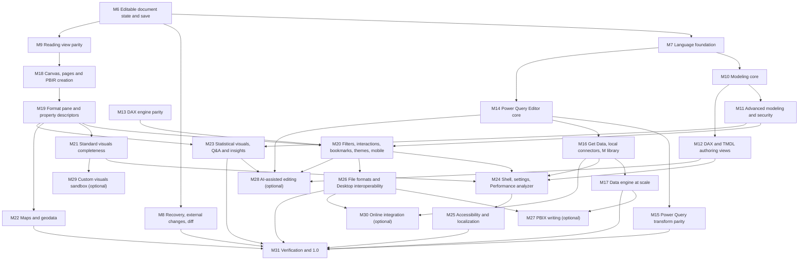

# Desktop plan: from viewer to a Power BI Desktop equivalent

The end-to-end milestone plan that takes DashCraft from the read-only viewer of M0–M5 to a
clean-room, offline, cross-platform equivalent of Power BI Desktop, as foreseen by
[ADR-0004](adr/0004-desktop-ready-architecture.md). Milestones continue the numbering of the
[roadmap](ROADMAP.md) (M6 to M31). Each one builds on the ones it depends on and ends with a
product that can ship.

This is a plan, not a status report. The status lives in [GAPS.md](GAPS.md) (scores per area),
[ROADMAP.md](ROADMAP.md) (done items), [CHANGELOG.md](../CHANGELOG.md) and [DEVLOG.md](DEVLOG.md).
Read [AGENTS.md](../AGENTS.md) first; its golden rules win over anything here.

Contents: [Purpose](#purpose) · [Baseline](#current-baseline) · [Principles](#guiding-principles) ·
[Conventions](#conventions) · [Output contract](#output-contract) ·
[Coverage inventories](#coverage-inventories) · [Dependency graph](#dependency-graph) ·
[Summary](#summary-table) · [New ADRs](#new-adrs-required) ·
[Workstreams](#cross-cutting-workstreams) · [Non-goals](#explicit-non-goals) · milestones
[M6](#m6-editable-document-state-and-save) to [M31](#m31-verification-and-10) ·
[GAPS mapping](#gaps-rows-to-milestone-steps) · [Keeping the plan current](#keeping-the-plan-current)

## Purpose

- Give every agent and maintainer one ordered list of the work between today's viewer and a full
  Desktop-style editor: modeling, DAX and M authoring, Power Query, report authoring, the Desktop
  shell, file-format interoperability, and the release work around them.
- Make each step small enough to pick up in a wave, testable on the committed fixtures (the
  synthetic Acme Outfitters example and the MIT Microsoft samples), and traceable to a
  [GAPS.md](GAPS.md) row.
- Name the decisions that need a new ADR before code is written, and the items that wait for a
  human (a Windows machine with Power BI Desktop, signing certificates, legal clearance).

The feature checklist comes from Microsoft Learn's descriptions of Desktop's behaviour (Report,
Table, Model, DAX query and TMDL views, Power Query Editor, Get Data, Options, Performance analyzer,
bookmarks, drillthrough, field parameters, visual calculations, PBIP and Git integration,
publishing). Only behaviour is described here: no text, code, icons or images are copied
(golden rule 1, [ADR-0003](adr/0003-vertipaq-xpress9-cleanroom.md) clean-room rules).

## Current baseline

What exists after M0–M5 (`v0.1.0`, `v0.2.0`) and the unreleased work, from [GAPS.md](GAPS.md)
(scores as of 2026-10-23, 0 = nothing, 5 = complete and verified) and the
[CHANGELOG](../CHANGELOG.md).

| Area | What exists | GAPS avg |
|---|---|---|
| File formats | Content detection and safe containers; readers for PBIP (TMDL or `model.bim`, PBIR and PBIR-Legacy), PBIX (report, model, VertiPaq data), PBIT, `.abf`, `.pbi/cache.abf`, Power Pivot, VPAX, RDL outline, mashups, `.pbiviz`/`.mez`/`.pqx` metadata; writers: TMDL (byte-identical), TMSL, PBIR, `save_as_pbip`, `export_pbit`. No PBIX writer, bookmarks and report-level measures only kept | 3.1 |
| M | Full grammar, lazy evaluator, 336 library names, `AzureStorage.Blobs` offline through the blob map; every other data source unsupported by policy | 3.1 |
| DAX | Parser, printer, evaluator with filter and row context, context transition, BLANK; 294 functions (271 supported, 23 partial); calculation groups; security functions; no differential testing | 3.3 |
| Engine | Arrow store, DataFusion SQL, one-to-many, one-to-one and limited many-to-many relationships, filter propagation, RLS "View as", calculation groups, one-pass group-by, cancellable refresh | 3.4 |
| Visuals | Text box, shapes, buttons, cards, KPI, slicers, table, matrix, pie/donut, bar/column variants, line/area/combos, scatter, funnel, gauge, treemap, waterfall; conditional formatting of tables, matrices and chart colors; dynamic format strings. Placeholders for image, maps, ribbon, AI and custom visuals | 2.1 |
| Interactions | Slicers, cross-filter per `visualInteractions`, tooltips, navigation and clear-all buttons, scrolling, matrix expand; no highlight, drill, drillthrough, bookmarks, synced slicers | 1.6 |
| Rendering fidelity | Deterministic SVG and PNG with bundled fonts, render snapshots of every Acme page, 39 card values asserted; no golden images | 3.2 |
| Performance | `cargo xtask perf`, eight scenarios P01–P08, all within target | 4.9 |
| Registry, MCP, AI | `pbi-ops` with 47 commands, `run`, `serve`, `mcp`; opt-in `pbi-ai` with 9 `ai.*` commands; no editing commands | 2.7 |
| App UX | Desktop-style shell: ribbon, view rail, panes, Report (interactive reading), Table, Model (read-only diagram), DAX query, TMDL (read-only) views, View as, opt-in AI; editing commands shown disabled | 1.4 |
| Platform and packaging | CI on macOS, Windows, Linux; dmg, msi, nsis, AppImage, deb; unsigned; no auto-update | 2.7 |
| Security and fuzzing | No `unsafe`, caps and zip-slip guards, 14 fuzz targets, `cargo-deny`; legal review of ADR-0003 pending | 3.1 |

Editing foundation already in the libraries but not exposed: `pbi-model` commands
(`SetMeasureExpression`, `SetDescription`, `SetVisualPosition`, `RenameTable`/`RenameColumn`/
`RenameMeasure` with structured-reference rewriting, `CommandGroup`, `ReplaceObjects`), `History`
with undo, redo and a save point, `ChangeEvent`s, and the PBIP and PBIT writers.

The document state is held in several places today: `OpenedDocument::document` (what the reader
returned, with the TMDL CST and typed PBIR sources the writers consume), `Session::base_model` (a
copy of the model), the session model with derived columns, the engine snapshots (and a second
engine under "View as"), and the `pbi-ops` `DocEntry` with a data generation and a per-document
lock. M6 replaces this with one revisioned state ([ADR-0010](#new-adrs-required)).

## Guiding principles

1. **Clean-room.** Behaviour from public documentation, permissive references with attribution,
   and black-box observation of Desktop on synthetic inputs. No decompiling or debugging of
   Microsoft binaries, no copied text, code, icons or themes (golden rule 1).
2. **Offline-first, no telemetry.** Nothing leaves the machine by default. Every feature that
   needs the network (AI, network connectors, the service, update checks) is opt-in, lives in an
   opt-in layer-5 plugin crate, and needs an accepted ADR that updates AGENTS.md, ARCHITECTURE.md
   and `cargo xtask layers` in the same change (golden rule 5, [ADR-0008](adr/0008-ai-layer.md)).
3. **Registry first.** Every capability is a `pbi-ops` (or plugin) command with typed parameters
   and output, metadata and a test through `Registry::execute`; the CLI, RPC, MCP and the app are
   thin adapters ([ADR-0007](adr/0007-command-registry.md), golden rule 8).
4. **Respect the layers.** Dependencies point down; orchestration lives in `pbi-session` or
   `pbi-ops`; UI toolkits only in `dashcraft-app`; network and keychain crates only in their
   designated crates (golden rule 9).
5. **One document state, edits as transactions.** Every change is a `pbi-model` `Command` with an
   exact inverse, applied atomically to one revisioned document state; view state stays out of the
   document ([ADR-0004](adr/0004-desktop-ready-architecture.md),
   [ADR-0006](adr/0006-interaction-state.md)).
6. **Output follows the [output contract](#output-contract).** A no-op save is byte-identical,
   without exception; unchanged regions of edited files are byte-stable; generated content matches
   Desktop's canonical form; unmodelled content is preserved from the input; every other
   difference must be on a bounded, approved deviation list; what DashCraft writes, Desktop opens.
7. **Never execute embedded content** (scripts, R/Python, custom visuals, connectors) unless an
   accepted ADR defines a sandbox for it (golden rule 6).
8. **Never commit real data.** Tests, fixtures, docs and examples use only the Acme Outfitters
   example and licensed public samples (golden rules 2–4).
9. **Determinism.** Same inputs, same bytes on every OS: bundled fonts, no wall clock in output.
   Generated identifiers come from an injectable generator: fixed sequences in tests and
   cross-writer comparisons, random values in use (ADR-0012).
10. **No panics, bounded resources, fuzzed parsers and writers** (golden rule 7).
11. **Performance budgets only get stricter** (golden rule 12); each milestone adds the scenarios
    for what it introduces.
12. **Accessible from the first editing surface.** Every UI milestone meets the
    [accessibility checklist](#w5-accessibility), including a screen-reader smoke test on each
    webview engine.
13. **Measured against inventories.** Coverage is reported against pinned public inventories with
    semantic tests, not counts of what happens to exist ([Coverage inventories](#coverage-inventories)).
14. **Shippable increments.** Each milestone ends with the gates of AGENTS.md section 7 green, docs
    and the CHANGELOG updated, and a tagged release.

## Conventions

- **Steps** are numbered `M<n>.<k>` and written as checklists so they can be ticked in place.
- **Sizes**, in agent waves (one wave = one coordinated round of parallel agents plus
  integration, AGENTS.md section 6): **S** one wave, **M** two or three, **L** four to eight,
  **XL** more than eight or several parallel tracks. Broad milestones that were not split are
  sized XL.
- **Dependencies.** "Depends on" lists the direct predecessors, exactly the incoming edges of the
  [dependency graph](#dependency-graph); transitive ones are implied. M6 and M13 have no
  predecessor.
- **Command ids** follow the existing style (`doc.open`, `model.measures`, `security.viewAs`,
  `canvas.click`): `<area>.<object>.<verb>` in camelCase segments, for example
  `model.measure.create`, `report.visual.move`. Ids proposed here are provisional until the command
  ships; after a release they are a public contract (ADR-0007). New categories proposed: `edit`
  (document lifecycle, history), `model`, `report`, `query` (Power Query), `language`
  (completion, diagnostics, formatting), `settings`, `insights`.
- **Ground-truth sessions** `GT-1` to `GT-6` are defined under
  [Testing and ground truth](#w1-testing-and-ground-truth). "Blocked by GT-n" means only the
  named acceptance criterion waits; the rest of the milestone proceeds.
- **Releases.** The unreleased work ships first (as `v0.3.0`, the version the `ai.*` commands
  declare in `since`). Each milestone then ends with a minor release; `v1.0.0` is tagged at the end
  of M31. The optional milestones M27–M30 are not required for 1.0.
- **Fixtures.** "Acme" means `reference/examples/acme-outfitters/` and its expected values
  ([EXPECTED.md](../reference/examples/acme-outfitters/EXPECTED.md)); "the samples" means
  `reference/samples/microsoft/` ([README](../reference/samples/microsoft/README.md)). Where a step
  needs new cases, the generator `scripts/examples/gen_acme.py` gains them and records their
  expected values; nothing is hand-edited.

## Output contract

The oracle for every writer (TMDL, TMSL, PBIR, themes, `diagramLayout.json`, PBIT, conversions).
ADR-0012 makes it binding and fixes the file that records the per-field classification and the
deviation list (proposed: a machine-readable contract file next to the writer tests, checked by
them). Every field or file a writer emits belongs to exactly one category:

| Category | Rule | Checked by |
|---|---|---|
| **Byte-stable** | Files and regions DashCraft did not change are re-emitted byte for byte. A no-op save is byte-identical for every file of the project, with no deviation entries ever. In an edited file, every byte outside the edited objects' spans is unchanged | Save round-trips on Acme, the samples and every Desktop-saved fixture |
| **Canonical** | Content DashCraft generates for new or edited objects matches Desktop's form for the same construct (ordering, indentation, quoting, escaping, number spelling, file and folder layout), byte for byte after identifier normalization, once GT-4 has recorded that construct | Cross-writer tests against GT-4 recordings |
| **Value-equal** | JSON content whose Desktop form is not recorded yet, compared as JSON values. Temporary: a field stays here only through an entry on the deviation list, and moves to Canonical when its recording exists | Value comparison plus the deviation list |
| **Identifier-normalized** | Generated identifiers (`lineageTag`, page, visual and bookmark names, folder names derived from them, other GUIDs). Tests inject a fixed identifier sequence into DashCraft's generator; identifiers in Desktop recordings are mapped to the same sequence by object path before comparison. In use, identifiers are random per ADR-0012 | Cross-writer tests with injected identifiers |
| **Preserved-from-input** | Everything DashCraft does not model: `extra` bags, unknown properties and annotations, unknown files, `.pbi/` content, security bindings, sensitivity-label parts. After any edit, save or conversion that keeps the container kind, they equal the input (bytes for files, values for JSON properties) | Preservation tests with structurally representative synthetic fixtures |

**Approved deviation list.** A committed, reviewed list of the only differences allowed against
Desktop's output: each entry names the field path, its category, the reason, the Desktop release it
was recorded against and the approver. Tests fail on any difference not on the list and on entries
that no longer match anything. The list is capped (proposal: at most 20 entries at 1.0), only
shrinks between releases unless a new Desktop release introduces new constructs, and never contains
no-op-save or Preserved-from-input entries.

## Coverage inventories

Coverage is measured against pinned public inventories (names and documented behaviours are facts;
no text is copied). Each inventory is a versioned file (proposed folder: `docs/inventories/`) with
its source, the date or Desktop release it was pinned at, and one status per entry:
**implemented** (with the semantic evidence below), **partial** (what is missing), **planned**
(the owning step), **non-goal** (the policy reason). [GAPS.md](GAPS.md) scores summarize these
inventories; acceptance evidence of a milestone does not by itself raise a score.

| Inventory | Pinned source | Evidence for "implemented" | Created in |
|---|---|---|---|
| DAX functions | The public DAX function reference index, including visual-calculation functions | Success vectors (inputs and expected output, including BLANK cases) and error vectors per function, plus the existing one-test-per-function rule | M13.1 |
| M library | The public Power Query M function reference index | Success and error vectors per function | M16.7 |
| Power Query editor features and connectors | Desktop's documented Power Query Editor ribbons, dialogs and the Get Data connector list, versioned per Desktop release | A command test and a preview-result test per feature; a load test per connector | M14.1 (connector rows completed in M16.12) |
| Formatting properties | The pinned PBIR visual-container, page, report and theme JSON schemas, plus formatting objects seen in Acme and the samples | Per property family (title, data labels, axes, legend, …) a render or behaviour assertion (a measurable change in the scene or interaction), not only serialization | M19.1 |
| Visual types | Desktop's built-in visual list | DataView tests, render snapshots and, where goldens exist, SSIM | M21.10 (maps M22, statistical and AI visuals M23) |
| Desktop UI elements | The GT-1 dump of ribbons, panes, dialogs and shortcuts | An app test per element or a non-goal reason | M24.1 |
| Registry commands | The generated catalog ([COMMANDS.md](COMMANDS.md)) | A test through `Registry::execute` (existing rule) | exists |

## Dependency graph

An edge `A --> B` means B builds on A; each milestone's "Depends on" lists exactly its incoming
edges. After M6, several tracks run in parallel: language and modeling (M7, M10, M11, M12), DAX
engine parity (M13, independent from the start), Power Query and data (M14 to M17), reports
(M9, M18 to M23), then the shell (M24, M25) and interoperability (M26). M27 to M30 are optional and
not needed for 1.0.

## Summary table

| Milestone | Name | Goal | Size | Depends on | Blocked by |
|---|---|---|---|---|---|
| M6 | Editable document state and save | One revisioned document state, atomic undoable edits through the registry (CLI, RPC, MCP, app), Save and Save As PBIP | XL | none; ADR-0010, 0011, 0012, 0013 | GT-4, GT-6 (Desktop-compatibility criteria only) |
| M7 | Language foundation | DAX, M and TMDL language services and formatters; formula bar with IntelliSense | L | M6 | none |
| M8 | Recovery, external changes and semantic diff | Autosave and recovery, safe handling of files changed by other tools, a model and report diff | M | M6; ADR-0011 | none |
| M9 | Reading view parity | Every reading-view interaction and report feature of existing reports works | XL | M6 | GT-3 (golden criterion only) |
| M10 | Modeling core | Create and edit tables, columns, measures, hierarchies and relationships in the Model and Table views | XL | M7 | GT-4, GT-6 (canonical and Desktop-open criteria only) |
| M11 | Advanced modeling and security | Calculation groups, field and what-if parameters, roles with RLS and OLS, perspectives, translations, synonyms, user-defined functions | L | M10 | GT-2 (differential criterion), GT-4 (M11.11) |
| M12 | DAX and TMDL authoring views | DAX query view and TMDL view that edit the model, dependency views, quick measures | M | M10 | GT-4 (tab persistence formats) |
| M13 | DAX engine parity | Pinned DAX inventory, the remaining functions and semantics, `INFO` functions, visual-calculation engine, differential testing | L | none | GT-2 (differential criterion) |
| M14 | Power Query Editor core | Feature matrix, queries pane, applied steps, preview, profiling, core transforms, parameters, Close & Apply | L | M7 | GT-5 (differential criterion) |
| M15 | Power Query transform parity | Every remaining transform, merges and appends, fuzzy matching, Column from Examples, query diagnostics | L | M14 | GT-5 (differential criterion) |
| M16 | Get Data, local connectors and M library | Local CSV, Excel, JSON, XML, Parquet and folder connectors, privacy levels, cultures, M library inventory | L | M14; ADR-0015, 0016 | GT-5 (firewall criterion) |
| M17 | Data engine at scale | Compressed, multithreaded storage for 10M+ rows, local data cache, incremental refresh, aggregations | XL | M16; ADR-0017, 0018 | none |
| M18 | Report authoring: canvas, pages and PBIR creation | Build pages from scratch: canvas editing, pages, insert, field wells, Selection pane, new PBIR files | L | M9; ADR-0019 | GT-4, GT-6 (canonical and Desktop-open criteria only) |
| M19 | Format pane and visual property descriptors | Every formatting property of every supported visual editable and behaviour-tested | XL | M18 | GT-6 (Desktop-open criterion) |
| M20 | Report authoring: filters, interactions, bookmarks, themes, mobile | Author filters, interactions, bookmarks, drillthrough, sync slicers, actions, themes, mobile layout, visual calculations | L | M19, M11, M13 | GT-4 (mobile format), GT-6 (Desktop-open criterion) |
| M21 | Standard visuals completeness | Ribbon chart, Analytics pane, small multiples, sparklines, newer slicers, conditional formatting everywhere, chart polish | L | M19 | GT-3 (golden criterion only) |
| M22 | Maps and geodata | Shape, filled and bubble maps offline with bundled geodata and geocoding | M | M19; ADR-0020 | GT-3 (golden criterion only) |
| M23 | Statistical visuals, Q&A and insights | Decomposition tree, key influencers, smart narrative, offline Q&A and its setup, Analyze insights, all local | L | M11, M19 | GT-3 (golden criterion only) |
| M24 | Desktop shell: ribbon, settings, Performance analyzer and documents | Every in-scope ribbon command, Options, Performance analyzer, Optimize, shortcuts, documents, export, update checks | L | M12, M16, M20, M21; ADR-0027 | GT-1 (shell comparison criterion) |
| M25 | Accessibility and localization | Canvas and visual accessibility, screen-reader semantics of rendered visuals, high contrast, localization | L | M24; ADR-0021 | none |
| M26 | File formats and Desktop interoperability | Output contract verified against Desktop, PBIT parity, upgrades, compatibility levels, sensitivity-label preservation | L | M20 | GT-4, GT-6 |
| M27 | PBIX writing (optional) | Staged research, prototype and per-encoding validation of PBIX writing, outside the default build | XL | M17, M26; ADR-0022 | Affirmative legal clearance (enabling and shipping); GT-6 |
| M28 | AI-assisted editing (optional) | DAX and M writing, descriptions, page suggestions, narratives and provider-assisted Q&A on `pbi-ai`, with consent and review | L | M12, M14, M20, M23; ADR-0026 | Owner-supplied provider accounts (real-provider criterion) |
| M29 | Custom visuals sandbox (optional) | Run `.pbiviz` visuals in an OS-sandboxed out-of-process host when the user allows it | XL | M21; ADR-0023 | Owner decision on ADR-0023 |
| M30 | Online integration (optional) | Network connectors, remote models, publish and download, opt-in | XL | M16, M26; ADR-0024, 0025 | ADR decisions; a test tenant with synthetic content |
| M31 | Verification and 1.0 | Ground truth, goldens, differential suites, perf at scale, fuzzing, independent accessibility audit, signing, update installs, 1.0 | L | M8, M15, M17, M22, M23, M25, M26 | Windows with Desktop (GT-1 to GT-6), signing certificates, legal review, trademark search |

## New ADRs required

Proposals, numbered from the next free number; each is written (Status, Context, Decision,
Alternatives considered, Consequences) and accepted before the step in "Needed by" starts.
**Network exceptions** (ADR-0024, ADR-0025, ADR-0027): the change that accepts one also updates
the network rules of [AGENTS.md](../AGENTS.md) (golden rules 5 and 9, the layer map), the crate
graph in [ARCHITECTURE.md](ARCHITECTURE.md) and the network rule in `cargo xtask layers`
(`xtask/src/layers.rs`), so the allowed set of network crates is never wider than the documents
say.

| ADR | Title | Decision to make | Needed by |
|---|---|---|---|
| ADR-0010 | Editable document state, transactions and history | One authoritative, revisioned document state per open document that replaces today's copies: an immutable revision (`Document`, writer sources such as the TMDL CST and typed PBIR files, the derived session model) swapped atomically under the per-document lock; how engine snapshots, the "View as" engine and writer sources are derived from a revision and its change set (never from a separate model copy); atomic transactions (multi-command edits, undo and redo apply to a working copy and commit as one new revision or not at all); concurrent queries capture one revision and report it; no-op edits (no revision, no history entry, not dirty); data generation versus document revision; which editing commands are `agent_safe` (proposal: in-memory edits, undo, redo and saves inside write roots are; recovery commands are not) and how MCP exposes them | M6.1 |
| ADR-0011 | Save, autosave, recovery and external changes | In-place PBIP save (changed files only, atomic per file, unknown files kept), Save As targets, the conflict policy when files changed on disk (reload, keep mine, compare), autosave journal location (user data folder, never the project) and recovery flow; history is not persisted across sessions | M6.1 (save), M8.1 (recovery) |
| ADR-0012 | Canonical serialization, output contract and identifiers | Makes the [output contract](#output-contract) binding: per-field categories, the contract and deviation-list files and their cap, how new TMDL objects and PBIR pages and visuals are written, the `$schema` and compatibility-level matrix, an injectable identifier generator (fixed sequences in tests, random in use) | M6.1 |
| ADR-0013 | Accessibility target and verification | WCAG 2.2 AA as the target; the [checklist](#w5-accessibility) every UI milestone meets; the screen reader and webview engine pairs for smoke tests; the independent audit before 1.0 | M6.1 |
| ADR-0014 | Ground-truth recordings from Power BI Desktop | The black-box protocol (synthetic inputs only, outputs only, no binaries inspected); what may be committed (values, JSON and text produced from synthetic inputs) and what stays local (images); where recordings live and how they are refreshed per Desktop release | The first ground-truth session (whichever GT-n runs first); every criterion blocked by a GT session waits for it |
| ADR-0015 | Local file data sources in M | Generalize `BlobResolver` into a data-source resolver that reads local files through the path policy; per-source permissions and privacy levels; still no network; extends golden rule 5 for local files only | M16.1 |
| ADR-0016 | Cultures and regional settings | Culture handling in M parsing and formatting, DAX `FORMAT` and typed conversions; model culture versus UI locale versus regional settings; CLDR-derived data and its licence | M16.8 |
| ADR-0017 | Columnar storage, compression and the local data cache | In-memory encodings (dictionary, value, bit-packing, run-length, segments) under the Arrow-facing API; threading model; memory budgets; a DashCraft-owned cache for PBIP data (format, location, invalidation), never written as `.pbi/cache.abf` | M17.1 |
| ADR-0018 | DirectQuery, Direct Lake, composite models and automatic page refresh | Confirm that live execution stays out of scope; how such models open (read-only with a notice, imported partitions usable); automatic page refresh unavailable as a consequence; what would change the decision | M17.8 |
| ADR-0019 | Report editing model and visual property descriptors | PBIR as the edit target (legacy layouts upgraded on save or kept), per-visual descriptors (roles, objects, properties, defaults) authored clean-room as data, pane-based versus on-object formatting, clipboard format | M18.1 |
| ADR-0020 | Offline maps and geodata | Bundled public-domain boundaries and basemap, an offline gazetteer and its licence, binary-size limits, the optional geodata crate, behaviour for unknown locations; online tiles only through ADR-0024 | M22.1 |
| ADR-0021 | UI localization | Message catalogs for the app, codes and arguments for Rust messages, the pilot locale, translation workflow, right-to-left readiness | M25.4 |
| ADR-0022 | PBIX writing | Whether DashCraft writes PBIX at all (XPress9, ABF, `metadata.sqlitedb` and VertiPaq encoders), drafted from the M27.1 research; outside the default build; enabling and shipping only after affirmative written legal clearance of the ADR-0003 UNVERIFIED rows and of encoding; would supersede ADR-0003 decision 2 for encoders | M27.2 |
| ADR-0023 | Custom visuals sandbox | Whether `.pbiviz` code may run: an out-of-process host with OS sandboxing, a minimal message protocol, no inherited file or network handles, memory and CPU limits, kill on timeout, approvals pinned by package hash, headless behaviour; R and Python visuals stay out; amends golden rule 6 for this one opt-in | M29.1 |
| ADR-0024 | Network data sources and credentials | Network exception for M data sources: an opt-in layer-5 crate, consent per source, keychain-only credentials, privacy levels enforced, no background access, the connector priority list, how ODBC drivers would be isolated or excluded | M30.1 |
| ADR-0025 | Power BI service and Fabric integration | Network exception for the service: sign-in flow, token storage in the keychain, which APIs (read remote models, publish, download), consent and a preview of what will be uploaded; offline stays the default | M30.1 |
| ADR-0026 | AI-assisted editing and new exposure classes | New capabilities (DAX queries, M, descriptions, page suggestions, narratives, Q&A interpretation), an `aggregates` exposure class (bounded visual-level results), AI output applied only through reviewed, undoable commands | M28.1 |
| ADR-0027 | Update checks and release channels | Network exception for update checks: a dedicated opt-in layer-5 plugin crate (not the app), off by default, `app.update.preview` shows the exact request and `app.update.check` sends it with no identifier (no installation id, no usage data), signed manifests, channels; installing updates needs code signing (M31.11) | M24.11 |

## Cross-cutting workstreams

### W1. Testing and ground truth

- **Ground-truth sessions** on a Windows machine with Power BI Desktop, black-box only (ADR-0014),
  synthetic inputs only, screenshots and icons never committed. Each session is scripted so it can
  be repeated for a new Desktop release.

  | Session | What is recorded | Used by |
  |---|---|---|
  | GT-1 | Shell facts: ribbon tabs, groups, buttons, tooltips and keytips (UI Automation dump as text), Options pages, dialog fields, keyboard shortcuts, screen-reader names of visuals | M24, M31 |
  | GT-2 | DAX differential corpus: curated and generated `EVALUATE` queries over the Acme model, results from Desktop's local engine | M11, M13, M31 |
  | GT-3 | Golden images: exports of every Acme page and of synthetic one-visual pages per visual type, into the gitignored `reference/golden/` | M9, M21, M22, M23, M31 |
  | GT-4 | Canonical output: Desktop-saved PBIP and PBIT after scripted edits on copies of Acme (create a measure, rename a column, add a page, add a visual, …), recorded with their identifiers mapped per the [output contract](#output-contract); Desktop-saved fixtures with synthetic content (a PBIR-Legacy PBIP, a real `.pbi/cache.abf`, a Power Pivot workbook, a VPAX, an RDL, a file with a sensitivity label) | M6, M10, M11, M12, M18, M20, M26, M31 |
  | GT-5 | Power Query differential corpus: M expressions, transforms, culture conversions and privacy-firewall cases over synthetic files | M14, M15, M16, M31 |
  | GT-6 | Desktop opens DashCraft output: each file DashCraft writes is opened in Desktop; recorded: opens without repair, warnings, values of the Acme cards equal | M6, M10, M18, M19, M20, M26, M27, M31 |

- **Fixture growth.** New behaviour gets new synthetic cases in `scripts/examples/gen_acme.py`
  with expected values computed independently in the generator: highlight values, drill levels,
  a drillthrough page, bookmark states, a sync group, a field parameter, an OLS role, a second
  culture, synonyms and Q&A questions, a visual calculation, an aggregation table, an incremental
  refresh policy, alternative source files (JSON, XML, XLSX), per-step row counts of the queries,
  an Enter-data table, and a structurally representative sensitivity-label part with synthetic
  values.
- **Test kinds** added across the plan: command tests through `Registry::execute` for every new
  command; transaction tests (edit, query, save, reopen, undo; queries racing edits); apply/undo
  property tests (random edit sequences, undo of everything restores equality); output-contract
  tests (no-op byte identity, byte-stable regions, cross-writer comparisons with injected
  identifiers, preservation); rebuild tests (recreate Acme objects from scratch through commands
  and compare with the committed files); render snapshots for every new page and visual;
  expected-value asserts; semantic vectors per inventory entry; differential tests (DashCraft
  against GT recordings; fast paths against general paths); app tests through the mock runtime;
  the accessibility checklist.

### W2. Performance

New scenarios join `perf/budgets.toml` with the milestone that introduces the code path. Targets
below are proposals; [perf.md](perf.md) rules apply (targets describe what users should get,
`max_ms` only goes down).

| Proposed id | Name | Milestone | Proposed target / max (ms) |
|---|---|---|---|
| P09 | `edit-measure-requery` (change an Acme measure, re-render the Executive Summary page) | M6 | 50 / 150 |
| P10 | `save-pbip-acme` (one edit, save) | M6 | 100 / 300 |
| P11 | `refresh-acme-end-to-end` (open, refresh from CSVs, first page) | M6 | 1000 / 3000 |
| P12 | `dax-complete` (completion p95 on a synthetic 2,000-measure model) | M7 | 20 / 50 |
| P13 | `tooltip-page-render` (p95) | M9 | 16 / 33 |
| P14 | `query-step-preview` (first 1,000 rows of a step over a 100k-row CSV) | M14 | 100 / 300 |
| P15 | `query-profile-100k` (column profile over 100k rows) | M14 | 300 / 1000 |
| P16 | `xlsx-100k` (load a 100k-row sheet) | M16 | 1000 / 3000 |
| P17 | `import-csv-10m` (10M rows into compressed storage) | M17 | 20000 / 60000 |
| P18 | `dax-measures-10m` (P04 at 10M rows) | M17 | 200 / 1000 |
| P19 | `page-cold-10m` (first render of an Acme-shaped page over 10M fact rows) | M17 | 1000 / 3000 |
| P20 | `cache-open-10m` (reopen from the local data cache) | M17 | 2000 / 6000 |
| P21 | `canvas-drag-frame` (move a visual, one frame, in the webview) | M18 | 16 / 33 |
| P22 | `app-open-first-page` (launch to the first rendered Acme page) | M24 | 2000 / 5000 |

Baselines are recorded on macOS first; Windows and Linux baselines are added in M31.5.

### W3. Security and fuzzing

- Every new parser or writer gets a fuzz target in `fuzz/`: writer round-trips (parse, write,
  parse again, equal) for TMDL, PBIR, TMSL, `diagramLayout.json` and the M printer; the DAX and M
  language services on arbitrary text; step editing on arbitrary M; connectors (XLSX container,
  XML, JSON, Parquet); theme JSON; bookmark JSON; images; the PBIX encoders (decode of encode
  equals input) if M27 happens.
- Registry parameter fuzzing over every command (M6.11), including random edit sequences.
- Threat-model updates with each opt-in surface (connectors, sandbox, service, update checks) and a
  `SECURITY.md` (M31.9); network-deny tests prove that features which are off make no connection.
- Untrusted input stays bounded: preview row caps, profile caps, import memory budgets, caps on
  images and theme files, no XML DTDs, size-capped messages to any sandboxed host.

### W4. Documentation

Each milestone updates, in the same change: [COMMANDS.md](COMMANDS.md) (regenerated),
[CLI.md](CLI.md), [MCP.md](MCP.md) when agent tools change, [USER-GUIDE.md](USER-GUIDE.md),
[FORMATS.md](../FORMATS.md), [VISUALS.md](VISUALS.md),
[FUNCTIONS.md](../crates/pbi-dax/FUNCTIONS.md), the inventories, [ARCHITECTURE.md](ARCHITECTURE.md)
when crates or edges change, [desktop-ui-reference.md](../app/docs/desktop-ui-reference.md)
(disabled entries flip to implemented), the [GAPS.md](GAPS.md) rows, the CHANGELOG `[Unreleased]`
section, the [DEVLOG](DEVLOG.md), and this plan's checkboxes.

### W5. Accessibility

ADR-0013 sets the target (WCAG 2.2 AA). Every milestone that adds or changes UI lists, in its
acceptance criteria, the surfaces that must pass this checklist:

| Item | Criterion |
|---|---|
| A1 Keyboard | Every new control is operable with the keyboard alone; no keyboard trap; shortcuts documented |
| A2 Focus order | Focus follows a logical order; the focus indicator is visible (at least 2 px, contrast at least 3:1) |
| A3 Names and roles | Every control, pane and dialog exposes a name and role; an automated checker with a permissive licence reports no serious or critical violation |
| A4 Contrast | Text at least 4.5:1 (3:1 for large text), UI components at least 3:1, in every shell theme available at that milestone |
| A5 Reduced motion | No non-essential animation when the OS asks for reduced motion |
| A6 Screen-reader smoke test | A scripted task on the new surface completes with VoiceOver on WKWebView (macOS), Narrator and NVDA on WebView2 (Windows) and Orca on WebKitGTK (Linux); results recorded in a checklist file |

The first editing surface (M6: Save, Undo and Redo, the formula bar, Properties edits) is the
first to meet it. M25 adds the semantics of the canvas and rendered visuals; M31.8 is the
independent audit.

### W6. Architecture, layers and dependencies

- **No new upward edges**, anywhere in the plan. Work in M6–M26 lands as new modules in existing
  crates, with two exceptions: the optional geodata crate (layer 1, data only, ADR-0020) and the
  opt-in update-check plugin crate (layer 5, ADR-0027). The optional milestones add an online
  crate (layer 5, ADR-0024, ADR-0025); the custom-visual host is a second binary target of
  `dashcraft-app`, so UI-toolkit crates stay there (ADR-0023). Each new crate gets its
  `cargo xtask layers` entry and an ARCHITECTURE.md update in the change that adds it.
- Candidate third-party crates (file watching, spreadsheet reading, decimal arithmetic, a
  data-parallel thread pool, PDF from SVG, XLSX writing, OS sandboxing helpers) are requested from
  the orchestrator, pass `cargo deny`, and get THIRD_PARTY_NOTICES entries; none is assumed
  accepted here.

### W7. Clean-room and data policy

Feature checklists come from Microsoft Learn read for behaviour; Desktop's own output is observed
only through GT sessions on synthetic inputs; DashCraft's themes, icons, help and hover text and
built-in visual descriptors are original. Every milestone runs the staged-file scan of AGENTS.md
section 8.

## Explicit non-goals

| Non-goal | Reason |
|---|---|
| DirectQuery, Direct Lake and live composite models | No live connections (offline-first); models with such partitions open read-only with a notice (ADR-0018, M17.8) |
| Automatic page refresh | Only meaningful for DirectQuery sources, which are a non-goal; the Page refresh settings are kept in files and shown as unavailable |
| Running R or Python (visuals or Power Query steps) | Executes embedded code and needs local runtimes (golden rule 6); shown as placeholders or unsupported steps |
| Executing custom connectors (`.mez`, `.pqx`) | Embedded code with network and credential access; listed only |
| Dataflow authoring | Not part of Desktop; consuming dataflows is a connector (M30.3) |
| Power Apps, Power Automate and paginated-report visuals | Hosted by online services; placeholders with an explanation |
| An XMLA endpoint or Desktop's External tools integration through a local Analysis Services port | Implementing that protocol surface is out of scope; `dashcraft serve` and `dashcraft mcp` are the automation surfaces |
| Rendering or authoring paginated reports (RDL) | A different product; RDL stays an outline |
| Service-only features: dashboards, apps, subscriptions, alerts, scheduled refresh, deployment pipelines, metrics, reviewing questions readers asked Q&A in the service | Not part of Desktop or need service usage data; at most reachable through the optional M30 |
| Applying or enforcing sensitivity labels | Needs a tenant and Microsoft's protection SDK; labels in files are preserved and shown read-only (M26.8) |
| Telemetry, usage data, crash uploads | Never (golden rule 5); local logs only |
| Microsoft branding, the Copilot name, Power BI icons or built-in theme files | Trademark and clean-room policy (AGENTS.md section 10); DashCraft ships its own AI features and themes |
| Pixel-identical rendering | Text and anti-aliasing differ; the bar is SSIM at least 0.85 per region and page |
| Query folding and native database queries | No live sources by default |
| Real-time co-authoring | Single-user desktop design ([ADR-0004](adr/0004-desktop-ready-architecture.md)) |
| Writing Power Pivot workbooks or `.abf` backups | No user need; data saves as PBIP (and PBIX only through the optional M27) |
| A web or mobile app | Outside this plan; DashCraft authors mobile layouts but is a desktop app |

## M6: Editable document state and save

**Goal.** Every edit runs as an atomic, undoable registry command on one revisioned document state,
and every document can be saved as a PBIP under the output contract.

**User-visible outcome.** Open the Acme project, change a measure's DAX in the formula bar, rename
a column, move a visual, undo and redo with Ctrl+Z / Ctrl+Y, see the unsaved marker, save (Ctrl+S)
and find only the touched lines changed in `git diff`; open a sample PBIX and save its model and
report as a PBIP project. The same edits work from `dashcraft run`, `serve` and MCP agents (inside
their write roots).

**Scope**

- [ ] **M6.1 Decisions.** ADR-0010 (document state, transactions, history, agent safety),
  ADR-0011 (save and conflicts; recovery parts used in M8), ADR-0012 (output contract,
  identifiers) and ADR-0013 (accessibility target) accepted.
- [ ] **M6.2 One revisioned document state.** Per ADR-0010, `OpenedDocument::document`,
  `Session::base_model`, the session model and the engine's model become views of the current
  revision; writer sources (TMDL CST, typed PBIR files, metadata parts) belong to a revision;
  engine snapshots (including the "View as" engine) are derived from a revision and its change
  set; queries capture one revision and report it.
- [ ] **M6.3 Transactions and history.** Each `DocEntry` owns a `History`; every editing command
  is a transaction on a working copy that commits one new revision or nothing; `doc.applyEdits`
  groups edits into one transaction and one undo step; undo and redo are transactions; no-op edits
  return `changed: false` without a revision, history entry or dirty flag; results carry the
  revision, the dirty flag and the `ChangeEvent`s; `serve` and `mcp` emit `doc/changed`
  notifications.
- [ ] **M6.4 Invalidation and incremental recalculation.** Change events drive the session: a
  measure edit re-evaluates only measure results; a calculated column or table edit recomputes it
  and its dependants in dependency order without an M refresh; the visual cache and canvas state
  stay valid where the change does not reach them.
- [ ] **M6.5 Core editing commands.** Measures: create, update (expression, format string,
  description, display folder), delete; descriptions of any object; rename of tables, columns and
  measures; visual move and resize; and the `pbi-model` create and delete commands with exact
  inverses and dependency reports for tables, columns, hierarchies and relationships, exposed as
  registry commands with basic validation (editors and Desktop's full validations in M10).
- [ ] **M6.6 Save and Save As under the output contract.** `doc.save` writes a PBIP in place:
  only changed files, each atomically (temporary file and rename), Byte-stable and
  Preserved-from-input content untouched, new objects per ADR-0012 with the injectable identifier
  generator, refusing when newer external changes exist unless forced. `doc.saveAs` writes a PBIP
  project from any readable source (PBIP, PBIX, PBIT, `model.bim`) or a PBIT file. Saving a PBIX or
  PBIT source in place offers Save As PBIP; embedded VertiPaq data cannot be carried over (no
  encoder; a PBIT has none) and the dialog says so.
- [ ] **M6.7 DAX- and M-aware rename.** Renames rewrite DAX text references (measures, calculated
  columns and tables, calculation items, format string expressions, RLS filters, report-level
  measures) at token level, keeping formatting and comments; renaming a query or parameter rewrites
  M identifier references; a preview lists every affected object.
- [ ] **M6.8 App wiring.** Quick Access Toolbar Save, Undo and Redo with labels from the history;
  Ctrl+S, Ctrl+Z, Ctrl+Y; unsaved marker in the title; prompt on close and quit; the formula bar
  edits measure expressions (plain editor; IntelliSense in M7.5); the Properties pane edits
  description, format string and display folder; File, Save and Save as enabled.
- [ ] **M6.9 Agent editing over MCP.** The `agent_safe` editing set decided in ADR-0010 is exposed
  as MCP tools in a new `edit` category (`--allow edit`), saves only inside write roots,
  [MCP.md](MCP.md) updated. AI-assisted editing is a separate, optional milestone (M28).
- [ ] **M6.10 CLI as registry wrappers.** `detect`, `inspect` and `lint` become thin wrappers
  over `Registry::execute` with byte-identical output (ADR-0007 migration plan); `dashcraft run`
  gains `--save` for edit batches.
- [ ] **M6.11 Registry fuzzing.** A fuzz or property target calls every command with
  schema-derived and mutated parameters, and runs random edit, undo and redo sequences: no panic,
  undo of everything restores an equal document, saved output parses back to an equal model.

**Crates and layers.** `pbi-model` (commands, revisions), `pbi-session` (state derivation,
invalidation, recalculation), `pbi-core` (save in place, minimal-diff writes, identifier
generator), `pbi-tmdl` and `pbi-pbir` (writers for created objects), `pbi-dax` and `pbi-m`
(reference rewriting), `pbi-ops` (commands, history, transactions, notifications), `dashcraft-cli`,
`dashcraft-app` (UI only). No new crate or edge.

**New registry commands.** `doc.save`, `doc.saveAs`, `doc.status`, `doc.reload`, `doc.undo`,
`doc.redo`, `doc.history`, `doc.applyEdits`, `model.measure.create`, `model.measure.update`,
`model.measure.delete`, `model.table.create`, `model.table.delete`, `model.column.create`,
`model.column.delete`, `model.hierarchy.create`, `model.hierarchy.delete`,
`model.relationship.create`, `model.relationship.delete`, `model.object.rename`,
`model.object.setDescription`, `model.dependencies`, `report.visual.move`, `report.visual.resize`.

**Writers.** In-place PBIP save with per-file change tracking; TMDL emission of new objects per
ADR-0012; PBIR visual position edits.

**Acceptance criteria**

1. A no-op `doc.save` of a copy of Acme, and of a PBIP saved from each sample, leaves every file
   byte-identical.
2. Updating `Total Sales` and saving changes exactly the measure's lines in
   `tables/Orders.tmdl`; undo then save restores byte-identical files.
3. After the edit, `measures.values` returns the new values without re-evaluating any M
   partition (no M progress events).
4. Renaming `Orders[Line Amount]` rewrites every DAX reference; after a refresh, all values of
   `expected.json` still pass (with the new name).
5. Structural conversion: `doc.saveAs` to PBIP from each committed sample (three PBIX, one PBIT)
   reopens with an equal model and report structure (normalized model and report trees equal,
   `doc.inspect` equal apart from source information).
6. Value equality after conversion only where a synthetic source exists: Acme saved as PBIT and as
   PBIP, reopened and refreshed from its CSVs through the blob map, passes every value of
   `expected.json`. The samples' converted projects carry no data (their sources are not
   available offline); keeping loaded PBIX data is deferred to the local data cache (M17.4) and to
   PBIX writing (M27).
7. Transaction sequence: edit, query (sees the edit), save, reopen in a second workspace (equal
   document), undo in the first workspace (previous revision, dirty against the save point, a
   query sees the old value), save again (the original bytes).
8. Concurrency: a long query started at revision N while an edit commits N+1 returns the results
   of N and reports N; a query started afterwards sees N+1; a property test with random
   interleavings finds no mixed-revision result.
9. No-op edits (for example setting an expression to its current text) report `changed: false`
   and change neither the revision, the history nor the dirty flag.
10. 10,000 random edit, undo and redo steps on Acme end, after undoing everything, in a document
    equal to the original; no panic.
11. An MCP agent edits and saves inside its write roots; a save outside them fails with
    `pathDenied`.
12. P09, P10 and P11 within target; P01–P08 do not regress.
13. Accessibility checklist A1–A6 passes for Save, Undo and Redo, the formula bar and the
    Properties pane edits.
14. New-object TMDL matches Desktop's under the output contract (GT-4).
15. Desktop opens each saved Acme project without repair and shows the same card values (GT-6).

**Tests.** Command and transaction tests through `Registry::execute`; concurrency property
tests; property tests of edit sequences; output-contract tests on Acme and the samples; rename
tests with comment and formatting preservation; app tests for the Save, Undo and Redo wiring;
CLI snapshot tests unchanged; MCP tests with write roots.

**Depends on.** none (baseline); ADR-0010, ADR-0011, ADR-0012, ADR-0013. **Blocked by.** GT-4
for criterion 14, GT-6 for criterion 15. **Size.** XL.

**Risks and unknowns.** The state refactor touches every reader of the model (session, render,
ops, app views); memory of keeping revisions (structural sharing needed); Desktop's exact TMDL for
new objects; reference rewriting inside M strings and comments must not change them.

## M7: Language foundation

**Goal.** Shared language services for DAX, M and TMDL (completion, diagnostics, formatting,
navigation) that every editor in later milestones uses.

**User-visible outcome.** Type a measure in the formula bar with completion, signature help and
red squiggles; format it with one key; get the same help in any external editor through an
optional language server.

**Scope**

- [ ] **M7.1 DAX language service.** In `pbi-dax`: completion (functions with signatures, tables,
  columns, measures, variables, keywords, user-defined functions), signature help, hover with
  DashCraft-written one-line descriptions, diagnostics (syntax, unknown references, unsupported
  functions, type hints), semantic tokens, go to definition, find references; incremental and
  cancellable.
- [ ] **M7.2 DAX formatter.** Deterministic and idempotent, keeps comments, options for line
  width and casing.
- [ ] **M7.3 M language service and formatter.** In `pbi-m`: completion of library functions,
  queries, steps and parameters (names supplied by the caller), diagnostics, hover, formatting.
- [ ] **M7.4 TMDL language service.** In `pbi-tmdl`: structure validation, completion of
  properties and object references, formatting that matches the writer.
- [ ] **M7.5 Formula bar with IntelliSense** for measures, calculated columns and tables,
  calculation items, format string expressions and RLS filters; commit and cancel; multi-line.
- [ ] **M7.6 Optional `dashcraft lsp`.** A Language Server Protocol adapter over the same
  commands for `.dax`, `.m` and `.tmdl` files in external editors.

**Crates and layers.** `pbi-dax`, `pbi-m`, `pbi-tmdl` (services, layer 1 and 2, no new edges),
`pbi-ops` (commands), `dashcraft-cli` (`lsp`), `dashcraft-app` (editor integration).

**New registry commands.** `dax.complete`, `dax.signatureHelp`, `dax.hover`, `dax.diagnostics`,
`dax.format`, `dax.tokens`, `dax.references`, `m.complete`, `m.hover`, `m.diagnostics`,
`m.format`, `tmdl.complete`, `tmdl.diagnostics`, `tmdl.format`.

**Writers.** None.

**Acceptance criteria**

1. The DAX formatter is idempotent and parse-preserving (formatted text parses to an equal tree)
   on every DAX expression in Acme and the samples; the M formatter likewise on every M
   expression.
2. Diagnostics on every Acme and sample expression report no false errors.
3. Completion p95 within P12's target.
4. The language-service fuzz targets run in the nightly job without findings.
5. Accessibility checklist A1–A6 passes for the formula bar with completion lists and squiggles.

**Tests.** Language-service tests on synthetic and Acme models; formatter property tests; fuzz
targets; app tests of the formula bar; LSP protocol tests with a scripted client.

**Depends on.** M6. **Blocked by.** none. **Size.** L.

**Risks and unknowns.** Completion latency on very large models; incremental parsing of
error-heavy text; hover texts must be original.

## M8: Recovery, external changes and semantic diff

**Goal.** Unsaved work survives crashes, and files changed by other tools (Git, editors, Desktop)
are detected, compared and reconciled safely.

**User-visible outcome.** After a crash, reopen and restore unsaved edits; when a pull changes the
project, see a notification, compare the changes object by object, and reload or keep the in-app
version; compare two versions of a project.

**Scope**

- [ ] **M8.1 Autosave and recovery.** A periodic journal of unsaved transactions in the user data
  folder (never in the project); on the next open, a recovery prompt (restore, open saved,
  discard); Options, Auto recovery settings (interval, location shown, off).
- [ ] **M8.2 External changes.** Watch the open project's files; a notification bar offers Reload,
  Keep mine or Compare; `doc.status` reports changes for headless callers; Save refuses to
  overwrite newer external changes unless forced.
- [ ] **M8.3 Semantic diff.** `doc.diff` between the in-memory revision and the files on disk, or
  between two documents or folders: objects added, removed and changed, with TMDL and PBIR
  snippets; the Compare view in the app.

**Crates and layers.** `pbi-ops` (journal, watcher, commands), `pbi-core` (diff), `dashcraft-app`.

**New registry commands.** `doc.recovery.list`, `doc.recovery.restore`, `doc.recovery.discard`,
`doc.diff`, `doc.externalChanges`.

**Writers.** The recovery journal (internal, versioned).

**Acceptance criteria**

1. A process killed after unsaved edits offers recovery on the next open, and restoring gives the
   edited document at the same revision content.
2. A TMDL file changed on disk while open is reported within two seconds; Reload picks it up;
   Save without force refuses to overwrite it.
3. The diff of two Acme variants lists exactly the objects changed by the script that made them.
4. Accessibility checklist A1–A6 passes for the recovery prompt, the notification bar and the
   Compare view.

**Tests.** Recovery tests with simulated crashes; watcher tests with simulated file events
(including event storms during saves); diff tests; app tests.

**Depends on.** M6; ADR-0011. **Blocked by.** none. **Size.** M.

**Risks and unknowns.** File watching differs per OS (network folders, event coalescing);
journal compatibility across versions.

## M9: Reading view parity

**Goal.** Every interaction and report feature a reader meets in Desktop's reading view or the
service works on existing reports.

**User-visible outcome.** On the Acme reports, a click on a chart highlights the other charts
instead of filtering them where the report says so; drill down the Date hierarchy; right-click a
store to drill through to its detail page; hover a chart to see the Store Tooltip page; apply the
Stores report's bookmarks from buttons or the Bookmarks pane; drag a range slider; open a visual
in focus mode or as a table and export its data; see images and report-level measures.

**Scope**

- [ ] **M9.1 Highlight interactions.** `HighlightFilter` produces highlight values in categorical
  DataViews (like the visuals API), charts draw the highlighted part over the dimmed total, tables
  and matrices filter as Desktop does; selecting inside the source visual highlights it.
- [ ] **M9.2 Drill down and up.** Hierarchies and several fields on an axis or in rows: drill mode,
  drill down on a point, drill up, go to the next level, expand all one level, for charts and
  matrices; drill state is view state (ADR-0006).
- [ ] **M9.3 Report-page tooltips.** Tooltip pages (page type and binding) render inside the hover
  tooltip with the hovered point's filters, at the tooltip page's size; automatic tooltip pages
  bound by fields.
- [ ] **M9.4 Drillthrough.** Drillthrough pages and their fields, Drill through on the context
  menu and from buttons, "keep all filters", the back button, and cross-report drillthrough between
  reports open in the same workspace.
- [ ] **M9.5 Bookmarks.** Read `bookmarks/*.bookmark.json` and groups; apply data, display and
  current-page parts and "selected visuals only"; Bookmarks pane in view mode with a slideshow;
  bookmark buttons; bookmark and page navigators drawn as lists of buttons.
- [ ] **M9.6 Synced slicers.** `syncGroup` (field and filter sync), slicers synced from other
  pages including hidden ones; `selfFilter`.
- [ ] **M9.7 Range and relative slicers.** Dragging range sliders, typing numeric and date bounds,
  relative date and time slicers with their pickers.
- [ ] **M9.8 Visual header and context menus.** Focus mode, show as table (visual plus data),
  sort by and sort direction from the menu (view state), spotlight, copy value and copy selection,
  export data (summarized and underlying, CSV first), context menu on data points (the Analyze
  entries arrive with M23.7).
- [ ] **M9.9 Report-level measures, images and legacy themes.** Measures from
  `reportExtensions.json` evaluate in visuals; `RegisteredResources` images draw as `image`
  visuals, page backgrounds, wallpapers and button images (PNG, JPEG, GIF first frame, sanitized
  SVG, size-capped); PBIX `Layout` and PBIR-Legacy reports use their themes in `render.*` and the
  CLI.
- [ ] **M9.10 Remaining filter semantics.** Relative date and time, Top N and measure filters at
  report and page level; the Apply button and query-reduction behaviour of the filter pane and
  slicers.
- [ ] **M9.11 Persist reading state.** On save, the current slicer selections and filter states
  are written to the report as Desktop does, through document transactions (the step foreseen by
  ADR-0006), honouring the "persistent filters" setting.

**Crates and layers.** `pbi-render` (query, DataView highlights, drill and drillthrough filters,
tooltip pages, bookmarks, images), `pbi-pbir` (bookmark and extension types already kept),
`pbi-model` (report-level measures in the report AST), `pbi-session` (query model with report
measures), `pbi-ops` (`canvas.*`), `dashcraft-app`.

**New registry commands.** `report.bookmarks`, `canvas.applyBookmark`, `canvas.drill`,
`canvas.drillthrough`, `canvas.back`, `canvas.tooltipPage`, `canvas.setRange`,
`canvas.setRelativeDate`, `canvas.focus`, `canvas.showAsTable`, `canvas.sortVisual`,
`canvas.contextMenu`, `export.visualData`, `report.state.persist`.

**Writers.** Persisted selections in PBIR filter and slicer state (M9.11); export of visual data
(CSV; XLSX once a writer dependency is approved).

**Acceptance criteria**

1. Acme cases added to the generator (highlight values of one interaction, a drill path on the
   Date hierarchy, a drillthrough binding on the Store Detail page, the two Stores bookmarks'
   states, the Store Tooltip page values, a sync group) pass in DataViews and on rendered pages.
2. Every page of every committed sample renders with its bookmarks applied in turn without errors.
3. The app shows none of the "not available" messages for highlight, bookmarks, drillthrough,
   drill or tooltip pages.
4. Images in the samples' and Acme's resources render; `image` is no longer a placeholder type.
5. P13 within target; P01–P08 do not regress.
6. Accessibility checklist A1–A6 passes for the Bookmarks pane, header and context menus, focus
   mode, show as table and the slicer pickers.
7. Where local golden images exist, pages with applied bookmarks reach SSIM at least 0.85 (GT-3).

**Tests.** Synthetic DataView tests for highlights and drill; `canvas.*` command tests; render
snapshots of new Acme pages and states; expected-value asserts; image decoder robustness tests and
a fuzz target for image headers; app canvas tests.

**Depends on.** M6 (M9.11 needs saving; M9.1–M9.10 can start at once). **Blocked by.** GT-3 for
criterion 7. **Size.** XL.

**Risks and unknowns.** Exact highlight semantics for measures that ignore filters; drill state
combined with cross-filter; bookmark JSON variations across PBIR versions; cross-report
drillthrough outside the service (DashCraft extends it to the open workspace).

## M10: Modeling core

**Goal.** The Model view, Table view, Data pane and Properties pane create and edit every core
semantic-model object, with Desktop's validations.

**User-visible outcome.** Add a calculated column to Orders, a calculated table, an Enter-data
table (and edit it again later), a hierarchy and a measure in a display folder; change data types,
formats, categories, summarization and sort-by columns; draw a relationship in the diagram, set its
cardinality and cross-filter direction, and get a clear error for an ambiguous path; arrange
tables in saved layouts; see edits immediately in visuals and the grid.

**Scope**

- [ ] **M10.1 Editors over the M6.5 commands.** Desktop's validations and dependency-aware delete
  (dependants listed, cascade or cancel) for every core object kind.
- [ ] **M10.2 Tables.** New calculated table; Enter data: create a static table and edit an
  existing Enter-data table again (the Create Table grid reopened from the table or its source
  step), written as Desktop writes it (ADR-0012, GT-4); properties (name, description, hidden);
  Mark as date table with Desktop's validation (unique, contiguous dates).
- [ ] **M10.3 Columns.** New calculated column; properties: data type (data converted in the
  engine), format string with presets (currency, percent, thousands separator, decimals, date
  formats), data category (address, city, country, postal code, latitude, longitude, web URL,
  image URL, barcode), summarize by, sort by column (refused when not one-to-one, as Desktop),
  hidden, display folder, description, key.
- [ ] **M10.4 Measures.** Every measure property: home table, format presets, display folder,
  description, dynamic format string, KPI settings.
- [ ] **M10.5 Hierarchies and folders.** Create, edit, reorder and delete hierarchies and levels;
  nested display folders; multi-select property edits.
- [ ] **M10.6 Relationships editor.** Create, edit and delete; cardinality (one-to-one,
  one-to-many, many-to-one, many-to-many), cross-filter direction, active flag, security filter in
  both directions; validation of ambiguous active paths and of cardinality against the data;
  the Manage relationships dialog editable; auto-detect on demand and as an option on load.
- [ ] **M10.7 Model view editing.** Drag tables, drag column to column to create a relationship,
  layout tabs (create, rename, delete, add related tables), `diagramLayout.json` written; the
  Model explorer tree (tables, relationships, roles, cultures, perspectives, calculation groups,
  functions, expressions); a `model.diagram` command replaces the app-only diagram view.
- [ ] **M10.8 Groups and bins.** The New group dialog: list groups with an "Other" group, bins by
  size or count for numbers and dates, written as Desktop writes them (GT-4).
- [ ] **M10.9 Auto date/time.** Read and use the hidden local date tables Desktop creates; the
  model option to create or remove them through `model.autoDateTime.set`, matching Desktop's
  shape (GT-4).
- [ ] **M10.10 Table view editing.** Column tools and Table tools enabled; column header menu
  (rename, delete, hide, new column, sort by column); statistics of the filtered rows.
- [ ] **M10.11 Linter after edits.** Broken references and new rules (ambiguous relationships,
  sort-by violations, measures in hidden tables) re-run after each edit, shown in the diagnostics
  panel ([RULES.md](../crates/pbi-core/src/lint/RULES.md)).

**Crates and layers.** `pbi-model`, `pbi-tmdl`, `pbi-tmsl` (writers for new objects), `pbi-core`
(`diagramLayout.json` writer, linter), `pbi-engine` (type conversion, relationship rebuild),
`pbi-session` (recalculation, cardinality checks), `pbi-ops`, `dashcraft-app`.

**New registry commands.** `model.table.update`, `model.table.markAsDate`, `model.enterData`,
`model.enterData.update`, `model.column.update`, `model.measure.move`, `model.hierarchy.update`,
`model.relationship.update`, `model.relationship.validate`, `model.relationship.detect`,
`model.diagram`, `model.diagram.update`, `model.group.create`, `model.group.update`,
`model.autoDateTime.set`.

**Writers.** TMDL and TMSL for every new object kind; a new `diagramLayout.json` writer.

**Acceptance criteria**

1. Rebuild test: starting from Acme with its measures, calculated columns, calculated table,
   hierarchies and relationships removed, recreating them through commands only gives a model
   value-equal to the committed one, and all `expected.json` values pass.
2. Saving the rebuilt model gives TMDL byte-identical to the committed files under the output
   contract (identifiers normalized).
3. Activating the Ship Date relationship while the Order Date one is active is refused with an
   ambiguity error naming both paths; sorting `Date[Month]` by `Month Number` succeeds, sorting by a
   non-matching column is refused.
4. Changing a column's data type converts its loaded data; dependants re-evaluate or report a
   typed error, never a panic.
5. A generator Enter-data table edited through `model.enterData.update` round-trips; layout tabs
   survive save and reopen.
6. Adding a calculated column over 1M rows takes at most 500 ms (new scenario if needed); P09
   stays within target after structural edits.
7. Accessibility checklist A1–A6 passes for the Model view (diagram keyboard navigation and
   relationship creation without a pointer), the Manage relationships and Enter data dialogs, the
   Table view tools and the Properties pane editors.
8. New-object TMDL (Enter data, groups, auto date tables) matches Desktop's under the output
   contract (GT-4); Desktop opens the edited projects and shows the same values (GT-6).

**Tests.** Command apply/undo tests per object kind; rebuild test; TMDL and TMSL writer tests
for new objects; validation tests; layout writer round-trips and a fuzz target; app tests.

**Depends on.** M7 (formula bar for calculated columns and tables; M6 through it).
**Blocked by.** GT-4 and GT-6 for criterion 8. **Size.** XL.

**Risks and unknowns.** Desktop's serialization of Enter-data tables, groups and auto date
tables; cardinality detection cost on large tables; keeping report field references valid when
objects are deleted (report lint flags them; Desktop shows broken visuals).

## M11: Advanced modeling and security

**Goal.** Author the advanced model features: calculation groups, field and what-if parameters,
security roles with row- and object-level security, perspectives, translations, Q&A synonyms and
user-defined functions.

**User-visible outcome.** Edit the Acme `Time Calc` calculation group's items and precedence;
create a field parameter that switches a chart between Total Sales and Units Sold; add a what-if
parameter; manage roles with a DAX or rule-based editor and hide a column from a role; define a
perspective and a second culture and view the model through them; add synonyms; write a DAX
function and use it in measures.

**Scope**

- [ ] **M11.1 Calculation groups editor.** Create groups and items, ordinal, precedence, format
  string expressions, selection expressions (multiple or empty, no selection), the "discourage
  implicit measures" switch Desktop turns on with them.
- [ ] **M11.2 Field parameters.** Create and edit (fields, order, display names), written as
  Desktop writes them; reports that use field parameters query the selected fields (reading
  support in `pbi-render`).
- [ ] **M11.3 Numeric range (what-if) parameters.** Table, value measure and slicer created in one
  transaction.
- [ ] **M11.4 Roles and RLS editor.** Manage roles: create, rename, delete; table filters as DAX or
  a simple rule builder; members kept as text; test with View as (exists). Role filters that read
  another secured table are evaluated under security, closing the gap in GAPS section 4.
- [ ] **M11.5 Object-level security.** Table and column permissions per role; the engine hides
  secured objects from queries under the role (queries that reference them fail as Desktop's do)
  and the Data pane hides them under View as; editor in the roles dialog.
- [ ] **M11.6 Perspectives.** Editor (tables, columns, measures, hierarchies); the Data pane can be
  filtered by a perspective; used by personalize visuals (M20.10).
- [ ] **M11.7 Translations and cultures.** Editor grid for captions, descriptions and display
  folders per culture; "view as culture" applies translated names in the Data pane and visuals.
  Desktop has no such editor (it relies on the TMDL view and external tools); this is a DashCraft
  addition on the same file format.
- [ ] **M11.8 Q&A linguistic schema.** Synonyms per object and the culture's linguistic metadata,
  edited and saved; used by the offline Q&A of M23.5 and its setup in M23.6.
- [ ] **M11.9 User-defined functions.** Model functions created, edited and deleted (Model explorer
  node, TMDL); evaluation semantics completed in M13.2.
- [ ] **M11.10 Model settings.** Discourage implicit measures, compatibility level (raise only, with
  a feature check, M26.4), model culture, default summarization, auto date/time (M10.9).
- [ ] **M11.11 Self-referencing relationships.** Confirm Desktop's behaviour (GT-4); keep the
  `ENG007` diagnostic if Desktop refuses them, else implement.

**Crates and layers.** `pbi-model` (objects exist; new commands), `pbi-tmdl`, `pbi-tmsl`,
`pbi-engine` (OLS enforcement, security evaluation), `pbi-dax` (field parameter and UDF
evaluation), `pbi-session`, `pbi-render` (field parameters in queries, translations), `pbi-ops`,
`dashcraft-app`.

**New registry commands.** `model.calcGroup.create`, `model.calcGroup.update`,
`model.calcGroup.delete`, `model.calcItem.create`, `model.calcItem.update`,
`model.calcItem.delete`, `model.calcItem.move`, `model.fieldParameter.create`,
`model.fieldParameter.update`, `model.whatIf.create`, `security.role.create`,
`security.role.update`, `security.role.delete`, `security.role.setTablePermission`,
`security.role.setObjectPermission`, `model.perspective.create`, `model.perspective.update`,
`model.perspective.delete`, `model.culture.create`, `model.culture.delete`,
`model.translation.set`, `model.synonyms.set`, `model.function.create`, `model.function.update`,
`model.function.delete`, `model.settings.update`; `security.viewAs` gains `culture` and
`perspective` view options.

**Writers.** TMDL and TMSL for every object above (roles, permissions, cultures with linguistic
metadata, perspectives, functions, field-parameter extended properties).

**Acceptance criteria**

1. Recreating `Time Calc` through commands gives TMDL equal to the committed table file and the
   calculation-group expected values pass.
2. New generator cases pass: a field parameter switching a chart's measure (values per
   selection), an OLS role hiding a customer column (queries fail as expected, other values
   unchanged), a second culture with translated captions.
3. The RLS cases of `EXPECTED.md` that carry `knownEngineGap` for cross-table role filters pass.
4. TMDL round-trips stay byte-identical for every Acme file after adding and removing each new
   object kind.
5. Accessibility checklist A1–A6 passes for the calculation group, roles, perspective,
   translation and synonym editors.
6. Differential checks of calculation groups, RLS and OLS against GT-2 recordings pass.
7. M11.11 decided from the GT-4 recording.

**Tests.** Command tests per object; security tests in `pbi-session` and `pbi-engine`; field
parameter query tests; TMDL writer tests; Data pane and View as app tests.

**Depends on.** M10. **Blocked by.** GT-2 for criterion 6, GT-4 for criterion 7. **Size.** L.

**Risks and unknowns.** Exact OLS error behaviour; field-parameter serialization across Desktop
versions; how far "view as culture" should go in visuals; UDF semantics still evolving upstream.

## M12: DAX and TMDL authoring views

**Goal.** The DAX query view and TMDL view edit the model as Desktop's do, with dependency views
and quick measures.

**User-visible outcome.** In the DAX query view, run a query that defines measures and push them
to the model with "update model"; keep query tabs with the project; edit a table in the TMDL view
and apply it as one undoable step after a diff preview; see what a measure depends on and what
depends on it; create a quick measure from a template.

**Scope**

- [ ] **M12.1 DAX query view parity.** IntelliSense (M7.1), format, find and replace, command
  palette; query tabs persisted with the project as Desktop does (GT-4); "update model" for
  `DEFINE MEASURE` blocks; more quick queries (define all measures of a table, define with
  references).
- [ ] **M12.2 TMDL view editing.** Apply scripts with `createOrReplace` semantics as one
  transaction, a diff preview, errors with line and column, script tabs persisted as Desktop does
  (GT-4).
- [ ] **M12.3 Dependency views.** Upstream and downstream dependency graph for measures, columns
  and tables; unused-object finder.
- [ ] **M12.4 Quick measures.** Templates (aggregate per category, filtered value, difference
  from filtered, time intelligence, running total, concatenated list, mathematical operations)
  that generate DAX offline.

**Crates and layers.** `pbi-dax`, `pbi-tmdl` (apply and diff), `pbi-model`, `pbi-ops`,
`dashcraft-app`.

**New registry commands.** `model.applyDaxDefinitions`, `tmdl.diff`, `tmdl.apply`,
`doc.daxQueries.list`, `doc.daxQueries.save`, `doc.tmdlScripts.list`, `doc.tmdlScripts.save`,
`dax.quickMeasure.templates`, `dax.quickMeasure.generate`; `model.dependencies` gains the graph
form.

**Writers.** Persisted DAX query and TMDL script tabs in the project (formats per GT-4).

**Acceptance criteria**

1. Applying the TMDL of any Acme table to itself is a no-op (no revision, no change events);
   applying an edited script gives the same model as the equivalent `model.*` commands.
2. "Update model" with a query defining three measures adds them in one undo step with the
   expected values.
3. Each quick-measure template produces DAX that parses, evaluates on Acme and matches a
   generator expectation.
4. Accessibility checklist A1–A6 passes for the DAX query view, TMDL view, diff preview and
   dependency views.
5. Tab persistence files equal Desktop's under the output contract (GT-4).

**Tests.** Command tests; TMDL apply tests; app tests of both views; output-contract tests for tab
files (skip without recordings).

**Depends on.** M10. **Blocked by.** GT-4 for criterion 5. **Size.** M.

**Risks and unknowns.** `createOrReplace` semantics for objects referenced elsewhere; Desktop's
persistence format for query and script tabs.

## M13: DAX engine parity

**Goal.** The DAX engine covers the pinned public DAX inventory with semantic evidence, including
`INFO` functions and visual calculations, and is checked against Desktop's engine.

**User-visible outcome.** Measures and queries that use financial, statistical, `INFO.*` or
visual-calculation functions evaluate as in Desktop; reports containing visual calculations
render them; differences from Desktop's engine are listed and shrinking.

**Scope**

- [ ] **M13.1 Pinned DAX inventory.** The DAX inventory file (see
  [Coverage inventories](#coverage-inventories)) with every public function categorized, and
  success and error vectors for every implemented function, kept in sync with
  [FUNCTIONS.md](../crates/pbi-dax/FUNCTIONS.md) by a test.
- [ ] **M13.2 Remaining functions and semantics.** Financial functions, `LINEST`/`LINESTX`,
  `TOCSV`/`TOJSON`, `COLUMNSTATISTICS`, `NONVISUAL`, `SUBSTITUTEWITHINDEX`, `SAMPLE`,
  `ALLCROSSFILTERED`, the `ROLLUP` family in `SUMMARIZE`, `EVALUATEANDLOG` (to a log pane), window
  functions without partial notes, UDF `EXPR` parameters, `DEFINE COLUMN`; the known semantic gaps
  of FUNCTIONS.md (exact auto-exist, shadow contexts in iterations, overrides for `RELATED` and
  `SUMMARIZE`, keyless duplicate rows, `nonvisual` subtotals).
- [ ] **M13.3 `INFO` functions.** `INFO.*` and `INFO.VIEW.*` answered from the model.
- [ ] **M13.4 Visual calculations engine.** The visual-calculation functions (`RUNNINGSUM`,
  `MOVINGAVERAGE`, `PREVIOUS`, `NEXT`, `FIRST`, `LAST`, `COLLAPSE`, `COLLAPSEALL`, `EXPAND`,
  `EXPANDALL`, `RANGE`, `ROWS`, `COLUMNS`, `LOOKUP` and related ones) evaluated over a visual's
  result matrix with axes and reset; reports containing visual calculations render them (editor in
  M20.9).
- [ ] **M13.5 Differential testing against Desktop's engine.** A query corpus (curated plus
  generated) over the Acme model, results recorded in GT-2 under ADR-0014 and compared in CI with
  documented tolerances; failures become issues with the query attached.

**Crates and layers.** `pbi-dax` (functions, semantics, visual calculations), `pbi-render`
(visual calculations in queries), `pbi-ops` (no new commands needed; `dax.query` covers them).

**New registry commands.** None; existing `dax.query`, `dax.evaluateMeasure` and the render
commands exercise the new functions.

**Writers.** None.

**Acceptance criteria**

1. Every entry of the pinned DAX inventory has a status; at least 95 percent of the in-scope
   entries are implemented with success and error vectors; the "Not supported yet" list of
   FUNCTIONS.md is empty except entries marked non-goal with a reason.
2. A generator case with `RUNNINGSUM` and `PREVIOUS` in a matrix matches its expected values.
3. P04 and P18 (once M17 adds it) do not regress.
4. At least 2,000 differential queries agree with GT-2 recordings, each deviation documented.

**Tests.** Vector tests per function; visual-calculation DataView tests; the differential suite
(skips cleanly without recordings); fast-path differential tests extended to new shapes.

**Depends on.** none (can start at any time). **Blocked by.** GT-2 (recorded under ADR-0014) for
criterion 4. **Size.** L.

**Risks and unknowns.** Semantics of visual-calculation reset and axis rules; numerical
agreement of financial functions; the public inventory changes with Desktop releases.

## M14: Power Query Editor core

**Goal.** A Power Query Editor that shows, previews, profiles and edits every query through
applied steps and the most common transforms, writes the same M Desktop writes, and applies the
result to the model; tracked against a versioned feature matrix.

**User-visible outcome.** Open Transform data on Acme: see the queries grouped as in the model,
click each applied step to preview its rows, check column quality and distribution, remove and
rename columns, filter rows and change types from the ribbon, edit the M in the Advanced editor,
create a parameter and a function, see query dependencies, then Close & Apply and watch the model
and visuals update.

**Scope**

- [ ] **M14.1 Power Query feature matrix.** A versioned inventory (see
  [Coverage inventories](#coverage-inventories)) of every documented editor item (ribbon commands,
  dialogs, panes, options) and Get Data connector of the pinned Desktop release, each marked
  implemented, planned (with its step) or non-goal (with the policy reason); updated by every
  Power Query step.
- [ ] **M14.2 Query model and Queries pane.** Queries as partition sources and shared
  expressions, groups (`QueryGroup`), parameters and functions; enable-load and
  include-in-refresh flags; PBIX `DataMashup` decoded so PBIX queries list the same way.
- [ ] **M14.3 Applied steps.** A query's `let` shown as named steps; rename, delete, delete until
  end, reorder and insert with dependency checks; step settings dialogs for recognized transforms;
  error and warning marks per step.
- [ ] **M14.4 Step preview.** Lazy evaluation of the selected step with a row cap (1,000 by
  default), cancellation and a cache per step; type icons in headers; cell errors with drill-in.
- [ ] **M14.5 Column profiling.** Quality, distribution and profile over the preview rows or the
  whole dataset (option), bounded and cancellable.
- [ ] **M14.6 Formula bar and Advanced editor** with the M language service (M7.3).
- [ ] **M14.7 Core transforms.** Choose and remove columns, keep and remove rows (top, bottom,
  duplicates, errors, blanks), sort, column filters, rename, change type (with locale), replace
  values, promote headers, custom column; generated steps use Desktop's naming and function forms.
- [ ] **M14.8 Parameters, functions and dependencies.** Manage parameters (type, suggested values,
  current value), create a function from a query and invoke it, the query dependencies diagram.
- [ ] **M14.9 Close & Apply.** Re-evaluate changed queries; map schema changes onto model columns
  (added, removed, renamed, retyped) with the M6.5 commands as one transaction while keeping
  calculated columns, measures and relationships; Apply later with a pending-changes bar; Discard.
- [ ] **M14.10 Errors and undo.** Per-query error summary, keep and remove errors, error drill-in
  steps; undo and redo inside the editor through the document history.

**Crates and layers.** `pbi-m` (step model over the syntax tree, transform builders, printer
style, preview limits), `pbi-session` (query previews, Close & Apply mapping), `pbi-core`
(`DataMashup` decoding), `pbi-model` (query commands), `pbi-ops`, `dashcraft-app`.

**New registry commands.** `query.list`, `query.create`, `query.update`, `query.delete`,
`query.rename`, `query.duplicate`, `query.reference`, `query.move`, `query.steps`,
`query.step.insert` (a typed transform from `query.transforms`), `query.step.update`,
`query.step.delete`, `query.step.rename`, `query.step.move`, `query.transforms`, `query.preview`,
`query.profile`, `query.parameter.create`, `query.parameter.update`, `query.parameter.delete`,
`query.function.create`, `query.function.invoke`, `query.dependencies`, `query.apply`,
`query.discard`.

**Writers.** M text through the `pbi-m` printer in Desktop's style; TMDL for expressions,
partitions, parameters and query groups.

**Acceptance criteria**

1. The feature matrix exists for a named Desktop release, every item has a status, and every
   item marked implemented has its command and preview tests.
2. Every Acme query shows steps whose names equal its `let` identifiers, and each step's preview
   row count equals the generator's per-step expectation.
3. Adding a column in the Orders query and applying adds the model column; undo removes it; all
   expected values still pass.
4. Generated M parses and prints back identically.
5. P14 and P15 within target; P05 does not regress.
6. Accessibility checklist A1–A6 passes for the Queries pane, applied steps, preview grid,
   profiling, Advanced editor and parameter dialogs.
7. Generated M for each core transform is accepted by Desktop and gives the same result (GT-5).

**Tests.** Step-model tests (split and rejoin of `let`), one test per transform builder, preview
and profile tests with caps and cancellation, Close & Apply mapping tests, a fuzz target for step
editing on arbitrary M, app tests of the editor.

**Depends on.** M7 (M language service; editing through M6). **Blocked by.** GT-5 for
criterion 7. **Size.** L.

**Risks and unknowns.** Desktop's exact M for each transform and locale handling; previews of
expensive steps; schema mapping when columns are renamed both in M and in the model.

## M15: Power Query transform parity

**Goal.** Every transform in the feature matrix is implemented or a documented non-goal,
including fuzzy matching, Column from Examples and query diagnostics.

**User-visible outcome.** Split, pivot, unpivot, group, merge (also fuzzily), append and expand
from the ribbon; type example values and let Column from Examples write the M; diagnose a slow
step and read its operation timings.

**Scope**

- [ ] **M15.1 Remaining ribbon transforms.** Keep and remove row ranges, replace errors, split
  column (delimiter, number of characters, positions, case and digit transitions), group by (basic,
  advanced), demote headers, transpose, reverse rows, count rows, fill down and up, pivot and
  unpivot (selected, other, only), format, extract and parse text (JSON, XML), number, date and
  time transforms, rounding, statistics, merge columns, conditional, index and duplicate columns,
  data type detection.
- [ ] **M15.2 Combining queries.** Merge queries (every join kind), append (two or more), expand
  and aggregate nested columns.
- [ ] **M15.3 Fuzzy merge and fuzzy grouping.** Similarity threshold, case and whitespace options,
  maximum matches, transformation tables; an original, documented similarity algorithm whose
  results are compared with GT-5.
- [ ] **M15.4 Column from Examples.** From all columns or a selection: the user types example
  outputs, a local, deterministic synthesizer proposes a transform from the supported M functions,
  shows the M and the preview, and adds it as a step; no network and no model involved.
- [ ] **M15.5 Query diagnostics and Diagnose step.** Start and stop diagnostics, diagnose a single
  step; local per-step and per-operation timings, row counts and errors, presented as diagnostics
  queries in the Queries pane the way Desktop presents them (shapes from GT-5).
- [ ] **M15.6 Matrix closure.** Every editor item of the feature matrix is implemented or marked
  non-goal with its reason (for example R and Python steps, native database queries).

**Crates and layers.** `pbi-m` (transform builders, fuzzy matching, example synthesis,
diagnostics instrumentation), `pbi-session`, `pbi-ops`, `dashcraft-app`.

**New registry commands.** `query.columnFromExamples`, `query.diagnostics.start`,
`query.diagnostics.stop`, `query.diagnoseStep`; transforms go through `query.step.insert` with new
entries in `query.transforms`.

**Writers.** M through the printer in Desktop's style.

**Acceptance criteria**

1. Rebuild test: the Acme queries recreated from `Csv.Document` through `query.step.insert`
   transforms only evaluate to the same tables (row counts and content hashes).
2. Every editor item of the feature matrix has the status implemented or non-goal.
3. Column from Examples finds a transform for each case of a synthetic example set (trimming,
   casing, splitting, date parts, concatenations) and the result matches the examples.
4. Fuzzy merge and grouping over a synthetic set of near-duplicate names give the generator's
   expected matches.
5. Diagnostics of an Acme refresh list every step of every query with timings.
6. Accessibility checklist A1–A6 passes for every new dialog and the diagnostics views.
7. GT-5 comparisons of every transform, fuzzy cases and diagnostics shapes pass or are on the
   documented deviation list of the matrix.

**Tests.** One test per transform builder; fuzzy matching tests; synthesizer tests (including
"no transform found"); diagnostics tests; fuzz target extended to the new builders.

**Depends on.** M14. **Blocked by.** GT-5 for criterion 7. **Size.** L.

**Risks and unknowns.** Desktop's fuzzy and example algorithms are not documented in detail, so
results may differ on edge cases; the deviation list must stay bounded.

## M16: Get Data, local connectors and M library

**Goal.** Load data from local files the way Desktop's Get Data does, with Desktop's privacy and
culture semantics and an M library measured against the public inventory, without any network
access.

**User-visible outcome.** Choose Get Data, pick a CSV, Excel workbook, JSON, XML or Parquet file
or a folder of files, preview items in the Navigator, then Load or Transform data; combine a
folder of files; manage data source settings and privacy levels; parse numbers and dates written
in other cultures; refresh one table at a time.

**Scope**

- [ ] **M16.1 Local data sources (ADR-0015).** A data-source resolver in `pbi-m` (generalizing
  `BlobResolver`) implemented by `pbi-session` with the workspace path policy; per-source
  permissions; Data source settings (list, change source, clear permissions, privacy level).
- [ ] **M16.2 Get Data dialog and Navigator.** Categories and search; local connectors enabled,
  network connectors listed as unavailable with a pointer to M30.3; Navigator with item preview,
  Load and Transform data.
- [ ] **M16.3 Text/CSV, JSON and XML.** Encoding and delimiter detection, quote handling, type
  detection (first 200 rows, whole file, or none, as the Options setting says); `Json.Document`,
  `Xml.Tables`, `Xml.Document` (DTDs refused).
- [ ] **M16.4 Excel workbook.** Sheets, tables and named ranges of `.xlsx` and `.xlsm` (and
  `.xls` if a permissive reader exists), bounded like every container.
- [ ] **M16.5 Parquet, Folder and combine files.** `Parquet.Document`; `Folder.Files` and
  `Folder.Contents`; combine files with the helper queries and sample-file function Desktop
  creates; PDF tables as a stretch item, decided by evidence of demand.
- [ ] **M16.6 Data source files and templates.** `.pbids` opens Get Data for its source; `.pqt`
  imports queries into the current model.
- [ ] **M16.7 M library inventory.** The M library inventory file (see
  [Coverage inventories](#coverage-inventories)) with every public function categorized and
  success and error vectors per implemented function; network data functions stay non-goal by
  default with a pointer to ADR-0024.
- [ ] **M16.8 Cultures (ADR-0016).** Culture-aware `Number.FromText`, `Date.FromText`,
  `Text.From`, typed transforms with a locale, `Csv.Document` cultures, and DAX `FORMAT` with
  cultures, from CLDR-derived tables.
- [ ] **M16.9 Decimal and currency precision.** A decimal type for M's decimal precision and the
  model's fixed decimal (currency) type in the engine and DAX.
- [ ] **M16.10 Privacy levels and the formula firewall.** None, Private, Organizational, Public;
  combining sources follows Desktop's partitioning rules and errors (GT-5), with the "ignore
  privacy levels" option.
- [ ] **M16.11 Refresh control.** Refresh a table or a partition, parallel load limits and the
  Data load options; refresh errors per table with the failing step.
- [ ] **M16.12 Connector rows of the feature matrix.** Local connectors implemented; network
  connector families planned in M30.3 in the priority order recorded there; consuming dataflows
  planned in M30.3; custom connectors non-goal.

**Crates and layers.** `pbi-m` (resolver trait, connectors, library, cultures, decimal),
`pbi-session` (resolver implementation, permissions, refresh control), `pbi-dax` (`FORMAT`
cultures, currency), `pbi-engine` (decimal storage), `pbi-ops`, `dashcraft-app`. No network crate;
`cargo xtask layers` keeps HTTP out of these crates.

**New registry commands.** `getData.connectors`, `getData.navigate`, `getData.createQueries`,
`datasource.list`, `datasource.change`, `datasource.setPrivacy`,
`datasource.clearPermissions`, `doc.importTemplate` (`.pqt`); `data.refresh` gains table and
partition selection.

**Writers.** M source steps in Desktop's form for each connector; data source settings stored
per user (not in the project), privacy levels as Desktop stores them.

**Acceptance criteria**

1. The generator writes Acme's source data also as JSON, XML and XLSX, and a Parquet copy is
   produced by `export.table`; each connector loads rows equal (by hash) to the CSV load.
2. A folder of monthly order files combined through the Folder connector gives the expected
   Orders row count.
3. Every entry of the M library inventory has a status; at least 90 percent of the in-scope
   (non-network) entries are implemented with success and error vectors; culture conversion
   tables (for example `"1.234,5"` in `de-DE`) pass.
4. With agent path roots, a query cannot read outside the roots (path-policy tests).
5. P16 within target; P05 and P11 do not regress.
6. New fuzz targets (XLSX container, XML, JSON, Parquet) run in the nightly job.
7. Accessibility checklist A1–A6 passes for Get Data, the Navigator and Data source settings.
8. Combining a Private and a Public source raises the firewall error unless privacy is ignored,
   matching GT-5.

**Tests.** Connector tests on generated files, vector tests per library function, culture
tables, decimal arithmetic tests, privacy tests, path-policy tests, fuzz targets, app tests of Get
Data and the Navigator.

**Depends on.** M14; ADR-0015, ADR-0016. **Blocked by.** GT-5 for criterion 8. **Size.** L.

**Risks and unknowns.** Licences and robustness of spreadsheet and Parquet readers; type
detection parity; the formula firewall's exact rules.

## M17: Data engine at scale

**Goal.** Models with tens of millions of rows load, refresh, query and render within budget,
with compressed storage, multithreading, a local data cache, incremental refresh and aggregations.

**User-visible outcome.** Import a 10M-row file and slice it as fast as the Acme data; reopen a
large project without refreshing (also a PBIX converted to PBIP keeps its data through the cache);
set an incremental refresh policy and refresh only recent data; add an aggregation table that
answers summary visuals instantly; see per-column memory use.

**Scope**

- [ ] **M17.1 Compressed column store (ADR-0017).** Segments with dictionary, value, bit-packed
  and run-length encodings and per-segment minimum and maximum under the existing Arrow-facing
  API; Arrow arrays materialized on demand for SQL and exports.
- [ ] **M17.2 Multithreaded storage engine.** Parallel scans, filters and aggregations per
  segment with deterministic results and cancellation.
- [ ] **M17.3 Streaming large imports.** CSV and Parquet stream into segments under a memory
  budget with progress; clear errors when the budget is exceeded.
- [ ] **M17.4 Local data cache.** Loaded data saved in a DashCraft-owned cache (format and
  location per ADR-0017, never the project's `.pbi/cache.abf`), invalidated by query text,
  parameters and source file changes; reopen without refresh; a PBIX saved as PBIP (M6.6) keeps
  its decoded data in the cache, linked to the new project.
- [ ] **M17.5 Incremental refresh policies.** Read and edit refresh policies (rolling and
  incremental windows, `RangeStart`/`RangeEnd`, detect data changes); create policy partitions on
  refresh and refresh only the incremental window; the Incremental refresh dialog.
- [ ] **M17.6 Aggregations.** Aggregation tables with column mappings (sum, count, group by,
  minimum, maximum); queries that can be answered from them are; the Manage aggregations dialog;
  answers identical to the detail table.
- [ ] **M17.7 Fast paths and query cache.** More aggregation shapes in one pass (GAPS section 4),
  a per-revision result cache invalidated by change events, high-cardinality relationship keys.
- [ ] **M17.8 DirectQuery and composite models (ADR-0018).** Such partitions open read-only with a
  notice; imported parts keep working; no live execution; automatic page refresh shown as
  unavailable.
- [ ] **M17.9 Model statistics and VPAX export.** Per-table and per-column size, cardinality and
  encoding, and a `.vpax` export for existing analysis tools.
- [ ] **M17.10 Scale scenarios.** P17–P20 with synthetic data generated by seed in the perf
  harness.

**Crates and layers.** `pbi-engine` (storage, threading, result cache), `pbi-session`
(streaming loads, data cache, policies), `pbi-dax` (aggregation-aware queries), `pbi-model`
(policy and aggregation properties), `pbi-core` (VPAX writer), `pbi-ops`, `xtask` and `perf/`.

**New registry commands.** `data.statistics`, `data.cache.status`, `data.cache.clear`,
`model.refreshPolicy.set`, `model.aggregation.set`, `export.vpax`.

**Writers.** The data cache (internal, versioned); TMDL refresh policies and aggregation
mappings; VPAX (a ZIP of JSON parts).

**Acceptance criteria**

1. P17–P20 within their targets on the baseline machine; peak memory for 10M Acme-shaped rows at
   most 1.5 GB (recorded by the scenario).
2. Differential tests: compressed and multithreaded results equal the current engine's on random
   models, and repeated runs give identical bytes.
3. An incremental policy on Acme Orders by order date creates the expected partitions; a second
   refresh evaluates only the incremental window (progress events).
4. A synthetic aggregation table answers monthly Total Sales identically and the query reports
   the aggregation hit.
5. Reopening a 10M-row project from the cache needs no refresh and matches the refreshed values;
   a sample PBIX saved as PBIP reopens with its data from the cache and equal `measures.values`.
6. P01–P08 do not regress.
7. Accessibility checklist A1–A6 passes for the Incremental refresh, Manage aggregations and
   statistics views.

**Tests.** Encoding round-trip property tests and fuzz targets for segment decoding; threading
determinism tests; cache invalidation tests; policy and aggregation tests; perf scenarios.

**Depends on.** M16; ADR-0017, ADR-0018. **Blocked by.** none. **Size.** XL.

**Risks and unknowns.** Memory on 16 GB machines; keeping DataFusion integration cheap over
compressed data; cache invalidation for sources outside the project; licence of any parallelism
dependency.

## M18: Report authoring: canvas, pages and PBIR creation

**Goal.** Build report pages from scratch on the canvas, with every operation undoable and saved as
new PBIR files under the output contract.

**User-visible outcome.** Add a page, insert a clustered column chart, drag Total Sales and
Region from the Data pane into its field wells, resize and align it with the cards, give it a
title, copy it to another page, group visuals, lock the layout, and save; Desktop opens the
result.

**Scope**

- [ ] **M18.1 Decisions and layout descriptors (ADR-0019).** PBIR as the edit target (legacy
  layouts upgraded on save per the ADR); the descriptor format; descriptors for roles and the
  General card (position, size, title, background, border, padding, alt text) of every supported
  visual type. Full formatting descriptors are M19.
- [ ] **M18.2 Canvas editing.** Select (click, marquee, Ctrl+click, tab order), move, resize
  (aspect lock for images), nudge, align and distribute, snap to grid and objects, gridlines,
  group and ungroup, z-order, lock objects, show and hide, delete; all keyboard-operable.
- [ ] **M18.3 Copy, paste, duplicate.** Within and across pages and across reports in the
  workspace, with field references checked against the target model.
- [ ] **M18.4 Pages.** New, duplicate, rename, delete, reorder, hide; page size presets and custom
  sizes; display option; background and wallpaper (colour, image, transparency); page type.
- [ ] **M18.5 Insert.** Visuals from the gallery, text boxes with a rich-text editor (runs, lists,
  links, dynamic values), shapes, buttons, images (added to `RegisteredResources`), page and
  bookmark navigators.
- [ ] **M18.6 Build pane field wells.** Roles from the descriptors; drag from the Data pane to
  wells or to the canvas (with Desktop's visual-type choice) and the keyboard equivalent; reorder,
  remove, rename for this visual, aggregation of implicit measures, show items with no data;
  change the visual type with role remapping.
- [ ] **M18.7 Selection pane editing.** Rename, reorder layers and tab order, show and hide,
  groups.
- [ ] **M18.8 PBIR writers for new artefacts.** New page and visual folders with ADR-0012
  identifiers, `pages.json` order, resource registration, `$schema` versions from the ADR-0012
  matrix.
- [ ] **M18.9 Live editing latency.** Property changes re-render only the edited visual; drag and
  resize at frame rate (P21).

**Crates and layers.** `pbi-pbir` (writers and types), `pbi-model` (report commands),
`pbi-render` (descriptors, re-render of one visual, selection outlines in the scene), `pbi-ops`
(commands), `dashcraft-app` (canvas tools, panes).

**New registry commands.** `report.descriptors`, `report.page.create`, `report.page.update`,
`report.page.delete`, `report.page.move`, `report.page.duplicate`, `report.visual.create`,
`report.visual.delete`, `report.visual.setFields`, `report.visual.changeType`,
`report.visual.align`, `report.visual.distribute`, `report.visual.arrange`,
`report.visual.group`, `report.visual.ungroup`, `report.visual.lock`, `report.visual.duplicate`,
`report.clipboard.copy`, `report.clipboard.paste`, `report.resource.add`;
`report.visual.move` and `report.visual.resize` from M6.

**Writers.** PBIR page, visual, `pages.json`, `report.json` resources; legacy-to-PBIR upgrade
per ADR-0019.

**Acceptance criteria**

1. Rebuild test: the Acme Executive Summary page recreated from an empty page through commands
   only (fields, positions and the General properties the page uses) renders with the same
   DataView values and card values as the committed page.
2. Every edit in a random sequence of 1,000 canvas operations undoes to an equal report.
3. P21 within target; P03 and P07 do not regress.
4. Accessibility checklist A1–A6 passes for the canvas tools (keyboard move, resize, align and
   field assignment), the Build pane, page tabs and the Selection pane.
5. New page and visual files match Desktop's naming and layout under the output contract (GT-4);
   Desktop opens the edited reports and shows the same visuals (GT-6).

**Tests.** Report command tests, PBIR writer tests and a fuzz round-trip target, canvas tool tests
in the app, render snapshots.

**Depends on.** M9 (interaction and selection infrastructure; M6 through it); ADR-0019.
**Blocked by.** GT-4 and GT-6 for criterion 5. **Size.** L.

**Risks and unknowns.** Desktop's clipboard format (copying between DashCraft and Desktop may not
be possible); text box rich-text fidelity; keyboard alternatives for every pointer gesture.

## M19: Format pane and visual property descriptors

**Goal.** Every formatting property of every supported visual type is described, editable in the
Format pane and checked by a render or behaviour assertion.

**User-visible outcome.** Change colours, fonts, data labels, axes, legends, gridlines and
conditional formatting of any visual from the Format pane (or by clicking the element on the
canvas), copy formatting with the format painter, and see each change rendered.

**Scope**

- [ ] **M19.1 Pinned property inventory.** The formatting-property inventory (see
  [Coverage inventories](#coverage-inventories)) for every supported visual type, each property
  implemented, planned or non-goal.
- [ ] **M19.2 Full descriptors** for every supported visual type (objects, properties, types,
  defaults, selectors), original to DashCraft and checked against the pinned schemas.
- [ ] **M19.3 Format pane.** Visual and General tabs generated from the descriptors, typed editors
  for every property (theme colour pickers, fonts, toggles, lists, numbers, text), per-series and
  per-category settings, search, reset to default; page and report-level format (canvas,
  wallpaper, filter pane, filter cards).
- [ ] **M19.4 Conditional formatting dialogs.** The `fx` dialogs (gradient, rules, field value,
  web URL) for every property that supports them, reusing the renderer's semantics.
- [ ] **M19.5 Format painter and on-object formatting.** Format painter across visuals of the same
  type; on-object selection of titles, axes and legends with their format cards.
- [ ] **M19.6 Behaviour tests per property family.** For each family (title, subtitle, data
  labels, axes, legend, gridlines, markers, colours, totals, headers, …) a render or interaction
  assertion that the property changes the output as described.

**Crates and layers.** `pbi-render` (descriptors, property application), `pbi-pbir`,
`pbi-model`, `pbi-ops`, `dashcraft-app`.

**New registry commands.** `report.visual.setProperty`, `report.visual.resetProperty`,
`report.visual.setConditionalFormat`, `report.formatPainter.apply`, `report.page.setProperty`,
`report.setProperty`.

**Writers.** PBIR `objects` and `visualContainerObjects` for every described property.

**Acceptance criteria**

1. Every entry of the property inventory for the supported visual types has a status; at least
   90 percent of the in-scope entries are implemented with a behaviour assertion for their family.
2. For each visual type on the Acme pages, every implemented property can be set, saved, reopened
   and read back unchanged, and render snapshots change only where intended.
3. Accessibility checklist A1–A6 passes for the Format pane, colour pickers, `fx` dialogs and
   on-object formatting.
4. Desktop opens reports with every property family edited and shows them as set (GT-6).

**Tests.** Descriptor coverage tests against the inventory; behaviour tests per family; PBIR
round-trips; app tests of the editors.

**Depends on.** M18. **Blocked by.** GT-6 for criterion 4. **Size.** XL.

**Risks and unknowns.** Hundreds of properties across visual types; defaults that come from themes
versus Desktop's hard-coded ones; on-object UX cost.

## M20: Report authoring: filters, interactions, bookmarks, themes, mobile

**Goal.** Author everything around the visuals: filters, interactions, bookmarks, drillthrough
and tooltip pages, synced slicers, button actions, themes, mobile layouts, visual calculations,
field parameters in visuals and report settings.

**User-visible outcome.** Add a Top N filter to a visual and a relative-date filter to a page;
switch a chart from highlighting to filtering another; record bookmarks with the Selection pane;
set up a drillthrough page and a tooltip page; sync a slicer across pages; customize and export
the theme; lay out the phone view; add a running total as a visual calculation; let readers
personalize visuals.

**Scope**

- [ ] **M20.1 Filters pane editing.** Add fields to visual, page and report filters; basic,
  advanced, Top N, relative date and time, and measure filters; require single selection; hide,
  lock and rename cards; include and exclude from data points; the Apply button and
  query-reduction settings.
- [ ] **M20.2 Edit interactions.** Per source visual, filter, highlight or none on each target,
  written to `visualInteractions`; the default interaction setting.
- [ ] **M20.3 Bookmarks authoring.** Add, update, rename, delete, group and reorder; data, display
  and current-page options; all or selected visuals; visibility from the Selection pane; the
  bookmark navigator's settings.
- [ ] **M20.4 Drillthrough and tooltip setup.** Drillthrough wells with the cross-report and keep
  all filters options; tooltip pages and each visual's tooltip setting (report page, default, off).
- [ ] **M20.5 Sync slicers pane.** Per page sync and visible boxes, advanced groups, written as
  `syncGroup`.
- [ ] **M20.6 Buttons and actions.** Action types (back, bookmark, drillthrough, page navigation,
  Q&A, apply and clear all slicers, web URL shown but never opened), destinations from `fx`, state
  formatting (default, hover, pressed, disabled).
- [ ] **M20.7 Themes.** Customize current theme (name and colours, text, visuals, page, filter
  pane), DashCraft's own theme gallery, import and export of theme JSON validated against the theme
  schema, save current theme; base themes referenced by reports keep working.
- [ ] **M20.8 Mobile layout.** Phone canvas, place, resize and remove visuals, mobile format
  overrides, saved as Desktop saves them (GT-4); `dashcraft render --mobile`.
- [ ] **M20.9 Visual calculations editor.** New visual calculation from a visual, editor with
  IntelliSense and templates (running sum, moving average, percent of parent, versus previous,
  versus first), hidden helper fields, written to the visual's query; evaluated by M13.4.
- [ ] **M20.10 Field parameters and personalize visuals.** Field parameters in wells and slicers;
  reading-mode personalization (visual type, fields, aggregation, perspectives) as view state,
  kept per user locally and resettable.
- [ ] **M20.11 Report settings.** Persistent filters, export data allowed, personalize visuals,
  visual header options, default cross-filter or cross-highlight, page-level settings.

**Crates and layers.** `pbi-pbir` (filters, bookmarks, interactions, themes, mobile layout
writers), `pbi-model`, `pbi-render` (theme resolution, mobile layout rendering), `pbi-ops`,
`dashcraft-app`.

**New registry commands.** `report.filter.create`, `report.filter.update`,
`report.filter.delete`, `report.filter.move`, `report.interactions.set`,
`report.bookmark.create`, `report.bookmark.update`, `report.bookmark.delete`,
`report.bookmark.move`, `report.bookmark.group`, `report.page.setDrillthrough`,
`report.page.setTooltip`, `report.syncGroup.set`, `report.visual.setAction`, `report.theme.get`,
`report.theme.set`, `report.theme.import`, `report.theme.export`, `report.mobile.place`,
`report.mobile.update`, `report.mobile.remove`, `report.visualCalc.create`,
`report.visualCalc.update`, `report.visualCalc.delete`, `report.settings.update`,
`canvas.personalize`, `canvas.resetPersonalization`.

**Writers.** PBIR filters, bookmarks, `visualInteractions`, sync groups, actions, mobile layout,
report settings; theme JSON.

**Acceptance criteria**

1. Recreate test: the Acme generator's filters, interactions, bookmarks, tooltip binding,
   drillthrough binding and sync group recreated through commands on a stripped copy give the same
   expected values and PBIR equal under the output contract.
2. Theme export then import is JSON value-equal; the Acme custom theme applied through commands
   renders snapshot-equal to the committed report.
3. The mobile layout of one Acme page renders with `--mobile` and matches its snapshot.
4. A visual calculation authored on the Acme monthly sales matrix equals the generator's running
   totals.
5. Accessibility checklist A1–A6 passes for the Filters pane editors, Edit interactions mode, the
   Bookmarks, Sync slicers and theme dialogs, the mobile canvas and the visual calculation editor.
6. The mobile layout files match Desktop's form (GT-4); Desktop opens the edited reports with the
   same behaviour (GT-6).

**Tests.** Command tests; PBIR writer round-trips and fuzz targets for bookmarks and themes;
render snapshots; expected values; app tests of each pane and dialog.

**Depends on.** M19, M11 (field parameters, perspectives), M13 (visual calculations engine).
**Blocked by.** GT-4 and GT-6 for criterion 6. **Size.** L.

**Risks and unknowns.** Bookmark capture of complex states; mobile layout format; personalization
storage offline (the service keeps it per user).

## M21: Standard visuals completeness

**Goal.** Every standard built-in visual type and formatting feature renders, interacts and can be
formatted; only maps (M22), statistical and Q&A visuals (M23), policy non-goals and custom visuals
remain placeholders at the end of this milestone.

**User-visible outcome.** Ribbon charts, small multiples, sparklines and the newer slicer types
work; trend, average, percentile and forecast lines show from the Analytics pane; conditional
formatting works on titles, headers, cards and every chart; pie separators, play axes and hover
states look as in Desktop.

**Scope**

- [ ] **M21.1 `ribbonChart`.** Stacked columns joined by ribbons with rank changes.
- [ ] **M21.2 Analytics pane.** Constant, minimum, maximum, average, median and percentile lines;
  trend line; forecast (an original exponential-smoothing implementation with documented
  deviations); error bars; symmetry shading and ratio lines on scatter. Anomaly detection is
  M23.8.
- [ ] **M21.3 Small multiples** for bar, column, line, area and combo charts.
- [ ] **M21.4 Sparklines** in tables and matrices.
- [ ] **M21.5 Newer slicers.** Button, list and text slicers; hierarchy slicers; date slicer
  variants.
- [ ] **M21.6 Cards, KPI and navigators.** Multi-card layouts and reference labels of the new
  card, KPI layout parity, page and bookmark navigator formatting.
- [ ] **M21.7 Conditional formatting completion.** Headers, totals, titles and subtitles, card
  callouts, gauges and KPIs; per-legend chart colours from a measure; line, area, combo, waterfall
  and gauge colours; web URL and image icons; `scopeId` selectors; expression-based titles and
  every other `fx` text property (button text, navigator labels).
- [ ] **M21.8 Chart polish.** Pie and donut slice separators; scatter play axis (animation in the
  app, a frame option in the CLI); visual headers on hover in reading view; button hover and
  pressed states; axis options (log scale, secondary axis, gridlines), data label positions,
  table and matrix layout options (word wrap, stepped layout, banded rows, totals placement, URL
  and image columns).
- [ ] **M21.9 Placeholders that explain.** Paginated report, Power Apps, Power Automate, R and
  Python visuals draw a placeholder that says why (policy non-goals). Custom visuals and unknown
  visual types stay placeholders unless the optional M29 is done and the user approves the
  package.
- [ ] **M21.10 Visual-type inventory and descriptors.** The visual-type inventory (see
  [Coverage inventories](#coverage-inventories)) and M19 descriptors for every new visual.

**Crates and layers.** `pbi-render` (visuals, analytics, small multiples), `pbi-dax` or
`pbi-session` (analytics statistics), `pbi-ops`, `dashcraft-app`.

**New registry commands.** `canvas.playAxis` (frame selection); analytics and formatting go
through `report.visual.setProperty`.

**Writers.** None new beyond descriptor-driven PBIR properties.

**Acceptance criteria**

1. The visual-type inventory marks every type implemented, owned by M22 or M23, non-goal, or
   custom/unknown; VISUALS.md's placeholder list contains only those last three groups plus the
   M22 and M23 types.
2. New generator pages exercise ribbon, small multiples, sparklines, analytics lines (slopes,
   averages and percentiles checked against expected values) and the new slicers.
3. Conditional-format warnings ("not applied") no longer appear for any case in Acme.
4. P07 does not regress; a small-multiples page stays within P03's target.
5. Accessibility checklist A1–A6 passes for the new slicers, the Analytics pane and play-axis
   controls (respecting reduced motion).
6. Where local golden images exist, every new visual type reaches SSIM at least 0.85 (GT-3).

**Tests.** Synthetic DataView tests per visual; analytics numeric tests; render snapshots;
expected values; behaviour tests for the new property families.

**Depends on.** M19. **Blocked by.** GT-3 for criterion 6. **Size.** L.

**Risks and unknowns.** Matching Desktop's forecast closely enough; on-canvas animation cost.

## M22: Maps and geodata

**Goal.** Map visuals render offline with bundled geodata and geocoding, without any network
access.

**User-visible outcome.** The Acme map renders offline; shape maps, filled maps and bubble maps
work from region names or latitude and longitude; unknown locations are listed, never fetched.

**Scope**

- [ ] **M22.1 Decision and data (ADR-0020).** Public-domain boundaries and basemap with verified
  licences, the gazetteer source, size budget, the optional geodata crate.
- [ ] **M22.2 Shape map** with bundled boundaries and custom TopoJSON from the report's resources
  (parsed with caps).
- [ ] **M22.3 Filled and bubble maps and the newer map visual** over the offline basemap.
- [ ] **M22.4 Offline geocoding** from the gazetteer and from latitude and longitude; data
  category hints from M10.3; a list of unresolved locations.
- [ ] **M22.5 Map interactions and descriptors.** Selection, cross-filter, tooltips, zoom and pan
  as view state; M19 descriptors for the map visuals.

**Crates and layers.** Optional geodata crate (layer 1, data only), `pbi-render`, `pbi-ops`,
`dashcraft-app`.

**New registry commands.** `geo.resolve` (diagnostics of location resolution for a visual);
view-state changes through `canvas.*`.

**Writers.** None.

**Acceptance criteria**

1. The Acme map renders without network access (network-deny test) and its regions or bubbles
   carry the expected values.
2. Geocoding a synthetic list of countries, states and cities resolves the documented share and
   lists the rest.
3. The geodata parser fuzz target runs nightly; bundled data stays within the ADR-0020 size
   budget.
4. Accessibility checklist A1–A6 passes for map interaction (keyboard pan, zoom and selection).
5. Where local golden images exist, map pages reach SSIM at least 0.85 (GT-3).

**Tests.** Rendering tests per map type, geocoding tests, network-deny test, fuzz target.

**Depends on.** M19; ADR-0020. **Blocked by.** GT-3 for criterion 5. **Size.** M.

**Risks and unknowns.** Licences and size of geodata; differences from online geocoding.

## M23: Statistical visuals, Q&A and insights

**Goal.** The statistical and natural-language visuals and the Analyze insights work offline,
computed by DashCraft's own local engines, with no language model and no network.

**User-visible outcome.** Use a decomposition tree, key influencers and a smart narrative on
Acme; ask "total sales by region" in a Q&A visual and get a bar chart; teach Q&A a term and set
suggested questions; right-click a data point and ask why it increased or where the distribution
differs.

**Scope**

- [ ] **M23.1 Local statistics engine.** Original implementations of the regressions,
  segmentations, contribution analyses and distribution comparisons the visuals and insights need,
  deterministic, with documented deviations from Desktop.
- [ ] **M23.2 Decomposition tree** with manual and statistical (high and low value) splits;
  expansion state as view state.
- [ ] **M23.3 Key influencers** (key influencers and top segments) on the local engine.
- [ ] **M23.4 Smart narrative** from local templates with dynamic values; reading existing smart
  narrative visuals.
- [ ] **M23.5 Q&A offline.** Reading and rendering existing Q&A visuals and Q&A buttons; a local
  `qna.ask` parser over the model, synonyms and linguistic schema (M11.8) that returns a visual
  definition rendered locally; no provider involved.
- [ ] **M23.6 Q&A setup subset.** Synonyms (from M11.8), teaching terms and phrasings, suggested
  questions, all saved in the model's linguistic metadata; the parts that need service usage data
  (reviewing questions readers asked) are shown as unavailable (non-goal).
- [ ] **M23.7 Analyze insights.** The data-point context menu's Analyze entries: explain the
  increase or decrease, and find where the distribution is different, as local insight commands
  whose results are shown as visuals.
- [ ] **M23.8 Anomaly detection** in the Analytics pane: a local algorithm with documented
  behaviour, or recorded as a non-goal in the inventory with its reason.

**Crates and layers.** `pbi-session` (an `insights` module over the engine), `pbi-render`
(visuals), `pbi-ops` (commands), `dashcraft-app`. No network, no `pbi-ai` involvement.

**New registry commands.** `qna.ask`, `qna.suggestions`, `qna.teach`, `report.narrative`,
`insights.explainChange`, `insights.distributionDifference`, `insights.keyInfluencers`,
`canvas.decompositionTree.split`.

**Writers.** Linguistic metadata (teach terms, suggested questions) in TMDL; PBIR for created
Q&A and insight visuals.

**Acceptance criteria**

1. Fifty synthetic Acme questions answered by `qna.ask` give visuals whose values equal
   `expected.json`, with no provider configured and a network-deny test active.
2. Insights on generator cases (a designed increase driven by one region, a designed distribution
   difference) name the designed cause first.
3. The visual-type inventory marks every built-in type implemented or non-goal, apart from custom
   and unknown types; VISUALS.md's placeholder list contains only policy non-goals and
   custom/unknown types.
4. Accessibility checklist A1–A6 passes for the Q&A input, decomposition tree navigation, key
   influencers and insight results.
5. Where local golden images exist, these visuals reach SSIM at least 0.85 (GT-3).

**Tests.** Statistics engine numeric tests; Q&A parser tests over the linguistic schema; insight
tests on designed data; render snapshots; network-deny tests.

**Depends on.** M11 (synonyms, linguistic schema), M19 (descriptors). **Blocked by.** GT-3 for
criterion 5. **Size.** L.

**Risks and unknowns.** Desktop's statistical methods are only described in outline, so results
can differ; Q&A language coverage beyond English is an open question.

## M24: Desktop shell: ribbon, settings, Performance analyzer and documents

**Goal.** The shell does everything Desktop's shell does apart from accessibility and
localization (M25): every in-scope ribbon command works, with Options, Performance analyzer,
Optimize, shortcuts, several documents, export and opt-in update checks.

**User-visible outcome.** Every ribbon button either works or explains why it is out of scope;
set options per user and per file; record a Performance analyzer session; pause visuals while
editing; open several documents; start a new blank report; export pages to PDF; check for updates
after seeing exactly what would be sent.

**Scope**

- [ ] **M24.1 Ribbon completeness.** The Desktop UI inventory (GT-1) with every tab, group and
  button mapped to a command or a documented non-goal; contextual tabs (measure, column, table,
  format, data and drill tools); Quick Access Toolbar; keytips.
- [ ] **M24.2 Options dialog.** Global pages (data load, Power Query editor, regional settings,
  privacy, security, auto recovery, report settings, preview features, updates, diagnostics as
  local logs, a usage-data page stating that nothing is collected) and current-file pages (data
  load, regional settings, privacy, auto recovery, query reduction, report settings); DirectQuery,
  R and Python pages explain the non-goals; settings persist per user and, for current-file
  options, in the project as Desktop stores them.
- [ ] **M24.3 Performance analyzer.** Start and stop recording, refresh visuals, per-visual
  timings (query, display, other), copy query to the DAX query view, export of the session as
  JSON.
- [ ] **M24.4 Optimize ribbon.** Pause and resume visuals, refresh visuals, apply all slicers, and
  optimization presets (query reduction, interactivity, custom) as explicit commands.
- [ ] **M24.5 View tab.** Gridlines, snap to grid, lock objects, every pane toggle (Filters,
  Bookmarks, Selection, Performance analyzer, Sync slicers), page view, mobile layout.
- [ ] **M24.6 Keyboard shortcuts.** Desktop's documented shortcuts (pane cycling, visual
  navigation, editing shortcuts) and a shortcut reference; canvas and visual navigation semantics
  are M25.1.
- [ ] **M24.7 High DPI and dark mode.** Crisp UI at 100 to 300 percent scaling on each OS; a dark
  shell theme while reports keep their own theme.
- [ ] **M24.8 Documents and windows.** Several documents, every model of a multi-model PBIP,
  single-instance forwarding, cancellable open, File New (blank report and model), File Import
  (templates, Power Query templates, themes; the Power Pivot import entry arrives with M26.6),
  pinned recent files.
- [ ] **M24.9 Export.** Report pages to PDF (deterministic, text selectable), templates, data;
  PowerPoint as a stretch item; print stays out.
- [ ] **M24.10 Offline help.** The user guide bundled and searchable; links shown and copyable,
  never opened automatically.
- [ ] **M24.11 Update checks (ADR-0027).** A dedicated opt-in layer-5 plugin crate registered by
  the front ends (not code in the app), off by default: `app.update.preview` shows the exact
  request, `app.update.check` sends it only when the user turned checks on and sends no
  identifier; signed manifests verified; installing updates waits for code signing (M31.11). The
  change that adds the crate updates AGENTS.md, ARCHITECTURE.md and `cargo xtask layers`.

**Crates and layers.** `dashcraft-app` (most of the work), the update-check plugin crate (layer 5,
new), `pbi-ops` (settings, Optimize and performance commands, timings in `canvas.render`),
`pbi-render` (PDF from the scene), `pbi-session` (cancellable open), `dashcraft-cli`
(`export pdf`).

**New registry commands.** `settings.get`, `settings.set`, `doc.settings.get`,
`doc.settings.set`, `perf.start`, `perf.stop`, `perf.events`, `canvas.pauseVisuals`,
`canvas.resumeVisuals`, `canvas.refreshVisuals`, `canvas.applyAllSlicers`,
`report.optimizationPreset.set`, `doc.new`, `export.pdf`, `app.update.preview`,
`app.update.check`, `app.update.status`; `doc.open` gains cancellation and a model selector.

**Writers.** PDF; current-file settings in the project; settings files per user.

**Acceptance criteria**

1. Every entry of the Desktop UI inventory has a status; [desktop-ui-reference.md](../app/docs/desktop-ui-reference.md)
   lists no disabled element whose feature has landed, and each remaining one names its planned
   step or non-goal.
2. A keyboard-only script opens Acme, adds a measure and a card, formats the title and saves,
   without pointer events.
3. The Performance analyzer lists the 14 visuals of the Executive Summary page with timings whose
   sum is within 10 percent of the page render time.
4. PDF export of the Overview report gives three pages with identical bytes across runs and OSs.
5. With update checks off (the default), a network-deny test passes; with them on,
   `app.update.preview` equals the request actually sent (scripted server) and contains no
   identifier.
6. P22 within target.
7. Accessibility checklist A1–A6 passes for the ribbon, Options, Performance analyzer, Optimize
   controls, document switching and the dark theme (contrast).
8. The GT-1 shell comparison shows no in-scope command missing.

**Tests.** App tests through the mock runtime, PDF determinism tests, settings persistence tests,
scripted-server tests of update checks, network-deny tests.

**Depends on.** M12, M16, M20, M21; ADR-0027. **Blocked by.** GT-1 for criterion 8.
**Size.** L.

**Risks and unknowns.** PDF text fidelity with bundled fonts; the trust impact of any network
feature, even opt-in.

## M25: Accessibility and localization

**Goal.** Reports and the canvas are accessible to keyboard and screen-reader users, and the UI is
localizable, on all three webview engines.

**User-visible outcome.** Tab through visuals in tab order, enter a visual and move across data
points with the arrow keys while a screen reader announces them; use high contrast; switch the UI
to the pilot language.

**Scope**

- [ ] **M25.1 Canvas keyboard navigation.** Visuals in Selection-pane tab order, entering a visual,
  arrow keys across data points, Esc to leave, as Desktop documents.
- [ ] **M25.2 Screen-reader semantics of rendered visuals.** An accessibility tree generated from
  the scene graph's hit ids (visual name, type, alt text, title, data point labels and values),
  attached to the SVG for each webview engine.
- [ ] **M25.3 Alternatives and modes.** Show as table as the accessible alternative of every
  visual, alt text authoring in the General card, a high-contrast shell, reduced motion everywhere.
- [ ] **M25.4 Localization (ADR-0021).** Message catalogs for the app, codes and arguments for Rust
  messages, English plus one pilot locale.
- [ ] **M25.5 Regional formats in the UI** from settings (ADR-0016), separate from the model's
  culture.

**Crates and layers.** `pbi-render` (accessibility tree from the scene), `pbi-ops`
(`report.accessibility`), `dashcraft-app`.

**New registry commands.** `report.accessibility` (the accessible description of a page),
`settings.locale.set`.

**Writers.** Alt text in PBIR (through `report.visual.setProperty`).

**Acceptance criteria**

1. Accessibility checklist A1–A6 passes for the canvas with every Acme page, including the
   screen-reader smoke test on the three webview engines (data points announced with labels and
   values).
2. Automated checks report no serious violation in any view; contrast passes in the light, dark
   and high-contrast shells.
3. The pilot locale covers every UI string (a test fails on missing keys).

**Tests.** Accessibility tree tests per visual type; keyboard navigation tests; localization key
tests; recorded screen-reader walkthroughs.

**Depends on.** M24; ADR-0021. **Blocked by.** none (screen-reader runs need a person on each OS).
**Size.** L.

**Risks and unknowns.** Accessibility differences between WKWebView, WebView2 and WebKitGTK;
translation effort.

## M26: File formats and Desktop interoperability

**Goal.** Everything DashCraft writes satisfies the output contract against Desktop's own output,
Desktop opens it, conversions behave like Desktop's, and unmodelled parts such as sensitivity
labels survive.

**User-visible outcome.** Edit a project in DashCraft and in Desktop in turn without spurious
diffs; export a template that Desktop opens with its parameter prompt; upgrade legacy reports and
`model.bim` projects; import a Power Pivot workbook; see a file's sensitivity label (read-only)
and keep it through saves and conversions.

**Scope**

- [ ] **M26.1 Output contract verified.** For every GT-4 edit script, DashCraft's output is
  compared field by field under the [output contract](#output-contract): Canonical fields byte-equal
  after identifier normalization (injected identifiers on DashCraft's side), Byte-stable and
  Preserved-from-input content equal to the input, Value-equal fields only through entries on the
  approved deviation list; `.platform`, `definition.pbism`, `definition.pbir`, `.pbi/` files and
  `.gitignore` handled as Desktop does.
- [ ] **M26.2 PBIT parity.** `export_pbit` output under the same contract against a Desktop export
  of the same project; Desktop opens it and prompts for parameters.
- [ ] **M26.3 Upgrades and conversions.** PBIR-Legacy to PBIR, `model.bim` to TMDL, PBIX to PBIP
  with the same result as Desktop's equivalents.
- [ ] **M26.4 Compatibility levels and feature gates.** Write the compatibility level a model
  needs, refuse features above the chosen level, keep the `$schema` and version matrix of
  ADR-0012 current per Desktop release.
- [ ] **M26.5 Interoperability matrix.** Desktop-saved fixtures with synthetic content (GT-4: a
  PBIR-Legacy PBIP, a real `.pbi/cache.abf`, a Power Pivot workbook, a VPAX, an RDL) round-trip in
  DashCraft; every DashCraft-written file opens in Desktop (GT-6); the matrix is recorded in
  FORMATS.md.
- [ ] **M26.6 Imports and exports.** Power Pivot workbook to PBIP (Desktop's import of Excel
  workbook contents); save model-only projects as `model.bim`.
- [ ] **M26.7 Writer hardening.** Streaming and atomic writes, bounded memory, fuzz round-trip
  targets for every writer.
- [ ] **M26.8 Sensitivity labels preserved and shown.** A structurally representative synthetic
  fixture of the label parts (located with a labelled synthetic file in GT-4; synthetic label ids
  and names) in PBIX, PBIT and PBIP form; the label shown read-only in the title bar and file
  information; no-op saves and conversions keep the label parts byte for byte (the test also joins
  M6's save suite).

**Crates and layers.** `pbi-tmdl`, `pbi-tmsl`, `pbi-pbir`, `pbi-core` (writers, conversions,
contract checks, label parts), `pbi-ops`, `dashcraft-cli` (`convert` options), `dashcraft-app`.

**New registry commands.** `convert.upgrade` (legacy report, `model.bim`), `doc.importWorkbook`,
`convert.bim`, `doc.compatibility`, `doc.sensitivityLabel` (read-only).

**Writers.** Canonical TMDL and PBIR (verified), PBIT (verified), TMSL `model.bim`.

**Acceptance criteria**

1. For every GT-4 edit script, every field satisfies its output-contract category; the approved
   deviation list has at most 20 entries and no entry for no-op saves or preserved content.
2. Every DashCraft-written Acme variant and converted sample opens in Desktop without repair and
   shows the same card values (GT-6).
3. Upgrades produce output equal to Desktop's upgrade of the same input under the contract (GT-4).
4. The sensitivity-label fixture keeps its label parts byte for byte through a no-op save, an
   edit and save, and each conversion that keeps a label-carrying container; the label is shown.
5. Accessibility checklist A1–A6 passes for the label display and the conversion dialogs.

**Tests.** Contract tests against recordings (skip when absent); fuzz round-trips; conversion
snapshots; label preservation tests; CLI tests.

**Depends on.** M20 (every report-authoring writer; M18 and M19 through it).
**Blocked by.** GT-4 and GT-6 for criteria 1 to 3. **Size.** L.

**Risks and unknowns.** Desktop changes its serialization between releases (recordings and the
matrix must be refreshed); where Desktop stores label parts in each format.

## M27: PBIX writing (optional)

**Goal.** Find out, in gated stages, whether DashCraft can write PBIX files Desktop opens; keep it
out of the default build and out of 1.0 unless affirmative legal clearance exists.

**User-visible outcome.** None in default builds. In a build with the feature enabled after
clearance: Save As PBIX of a project with its data.

**Scope**

- [ ] **M27.1 Research.** From Microsoft Open Specifications, the decoders of ADR-0003 and black-box
  observation of synthetic files only: what an encoder must produce for XPress9, the ABF
  container, `metadata.sqlitedb`, the VertiPaq column files and the PBIX package; the legal
  questions; output is the ADR-0022 draft.
- [ ] **M27.2 Prototype** behind a cargo feature that is never part of a release build, after
  ADR-0022 is accepted as a research decision.
- [ ] **M27.3 XPress9 encoder validation.** Decode of encode equals the input (property and fuzz
  tests); compressed blobs readable by the existing decoder.
- [ ] **M27.4 ABF container validation.** Backup log, virtual directory and file layout written
  and re-read by `pbi-vertipaq`.
- [ ] **M27.5 `metadata.sqlitedb` validation.** Schema written from the model and re-read into an
  equal model.
- [ ] **M27.6 VertiPaq encoding validation.** IDF segments, dictionaries and hash indexes from
  M17's encodings, re-decoded to equal Arrow data.
- [ ] **M27.7 Package assembly.** The PBIX parts (report, data model, metadata, content types)
  with preserved parts kept as found; GT-6 checks that Desktop opens the result.
- [ ] **M27.8 Distribution gates.** Enabling the feature in any distributed build requires
  affirmative written legal clearance of the ADR-0003 UNVERIFIED rows and of encoding (a risk memo
  is not enough), an owner decision recorded in ADR-0022, and a security review; until then the
  feature stays out of the default build and out of 1.0 acceptance.

**Crates and layers.** `pbi-vertipaq` (encoders behind the feature), `pbi-core` (package),
`pbi-ops` (`convert.pbix` behind the feature).

**New registry commands.** `convert.pbix` (only in builds with the feature).

**Writers.** XPress9, ABF, `metadata.sqlitedb`, VertiPaq encoders, PBIX package (feature-gated).

**Acceptance criteria**

1. Each encoder stage passes its decode-of-encode property and fuzz tests on random tables.
2. The Acme PBIX written by the prototype re-reads with identical data hashes.
3. Desktop opens it and shows the same card values (GT-6).
4. Release builds are verified (by a CI check) to contain no encoder code unless M27.8's gate is
   recorded as passed.

**Tests.** Property and fuzz tests per encoder; package round-trip tests; a CI check on release
artefacts.

**Depends on.** M17 (encodings), M26 (canonical writers); ADR-0022. **Blocked by.** Affirmative
legal clearance for enabling and shipping (M27.8); GT-6 for criterion 3. **Size.** XL.

**Risks and unknowns.** The legal outcome; undocumented details of the formats; Desktop's
tolerance of slightly different encodings.

## M28: AI-assisted editing (optional)

**Goal.** AI assistance comparable to Desktop's AI features, built on `pbi-ai`, off by default,
never sending anything without recorded consent, and never changing the document without review.
Basic agent editing over MCP is not part of this milestone (M6.9); everything local (Q&A,
narratives, insights) works without it (M23).

**User-visible outcome.** With AI turned on and consented: ask for a DAX query in the DAX query
view, fix an error with a suggestion, generate descriptions for measures and review them before
they are applied, ask for a page about a topic and accept the proposed visuals, read a
model-written narrative, let a provider interpret a Q&A question the local parser could not,
describe an M transform, and get fixes for linter findings.

**Scope**

- [ ] **M28.1 Decisions (ADR-0026).** New capabilities and an `aggregates` exposure class
  (bounded visual-level results); AI output becomes edits only through reviewable, undoable
  transactions.
- [ ] **M28.2 DAX queries.** Natural language to a DAX query in the DAX query view, run locally;
  explain a query; suggest a fix for an error.
- [ ] **M28.3 Descriptions.** Generate descriptions for measures, columns and tables in bulk,
  reviewed in a list and applied as one undo step.
- [ ] **M28.4 Page suggestions.** A request becomes a proposed set of `report.*` commands
  (visual types, fields, layout) shown before anything is applied.
- [ ] **M28.5 Narratives.** A model-written narrative of a page or visual from aggregates, next to
  the local template narrative of M23.4.
- [ ] **M28.6 Provider-assisted Q&A.** When the local parser (M23.5) cannot interpret a question,
  an optional provider interpretation proposes a visual definition, rendered locally.
- [ ] **M28.7 M generation.** Describe a transform in the Power Query Editor; the generated steps
  are parsed, previewed and applied only on approval.
- [ ] **M28.8 Lint fixes.** Suggestions for linter findings, applied as reviewed edits.
- [ ] **M28.9 Evaluation set.** Prompts over Acme whose answers are checked against
  `expected.json`, for manual runs against real providers; CI uses scripted providers only.

**Crates and layers.** `pbi-ai` (capabilities, prompts, commands), `dashcraft-app`. No network
outside `pbi-ai`.

**New registry commands.** `ai.writeDaxQuery`, `ai.fixDax`, `ai.describeObjects`,
`ai.suggestPage`, `ai.narrate`, `ai.interpretQuestion`, `ai.generateM`, `ai.lintFixes`.

**Writers.** None new; applied suggestions go through existing editing commands.

**Acceptance criteria**

1. With AI off, a network-deny test proves that no command opens a connection, and M23's local
   features still work.
2. `ai.preview` shows the exact request of every new capability; nothing is sent without a
   matching consent.
3. Every generated artefact (DAX, M, commands) is parsed and validated before it is shown;
   nothing is applied without an explicit approval step that is undoable.
4. Accessibility checklist A1–A6 passes for every review dialog.
5. The evaluation set passes against at least one real provider in a manual run (owner accounts).

**Tests.** Mock-provider tests per capability; prompt-injection tests over hostile metadata;
review-and-undo tests.

**Depends on.** M12, M14, M20, M23; ADR-0026. **Blocked by.** Owner-supplied provider accounts
for criterion 5. **Size.** L.

**Risks and unknowns.** Data exposure of aggregates; quality variance between providers; keeping
DashCraft's AI clearly distinct from Microsoft's Copilot branding.

## M29: Custom visuals sandbox (optional)

**Goal.** If ADR-0023 is accepted, run custom visual packages in an out-of-process, OS-sandboxed
host fed by DashCraft's DataViews, with the user's explicit approval per package. If this
milestone is skipped, custom visuals stay placeholders.

**User-visible outcome.** A report with a custom visual shows it after the user approves that
exact package; the visual cannot reach the network, files, other visuals or the app; a visual that
misbehaves is stopped and replaced by a placeholder; headless renders show a placeholder.

**Scope**

- [ ] **M29.1 Decision (ADR-0023).** Isolation model, approvals pinned by package hash, limits,
  what the CLI does; R and Python visuals stay out.
- [ ] **M29.2 Out-of-process host with OS sandboxing.** A second binary target of `dashcraft-app`
  started per report with the platform's sandbox (macOS: a sandbox profile denying file and network
  access; Windows: an AppContainer or restricted token inside a job object; Linux: namespaces,
  seccomp and, where available, Landlock); no inherited file, socket or process handles; memory and
  CPU limits; a watchdog that kills the host on timeout; restart with backoff and disable after
  repeated failures.
- [ ] **M29.3 Minimal message protocol.** Versioned, length-prefixed, size-capped messages over one
  pipe: initialize (package, locale, theme), update (DataView, viewport, formatting), rendered
  output (sanitized SVG or a bitmap frame) and events (selection ids, tooltip and context-menu
  requests, persisted properties); anything else is rejected.
- [ ] **M29.4 Visuals API host contract.** A clean-room host of the public visuals API contract
  (the MIT-licensed API type definitions read for the contract only, with attribution).
- [ ] **M29.5 Data.** DataView mappings from the package's capabilities (categorical, table,
  matrix, single), data reduction limits.
- [ ] **M29.6 Formatting.** The Format pane from the visual's formatting model or capabilities
  objects; persisted properties become document transactions.
- [ ] **M29.7 Interactions.** Selection ids to cross-filter and highlight, tooltips, context menu,
  drill, landing page.
- [ ] **M29.8 Import.** Import a visual from a local file only; no marketplace access.

**Crates and layers.** `dashcraft-app` (host binary, sandbox setup, display), `pbi-render`
(DataView mapping from capabilities), `pbi-core` (package reading exists), `pbi-ops` (approval
commands, not agent-safe). UI-toolkit crates stay in `dashcraft-app`.

**New registry commands.** `visuals.custom.list`, `visuals.custom.approve`,
`visuals.custom.revoke`, `visuals.custom.import`.

**Writers.** Custom visual packages registered in the report's resources as Desktop does.

**Acceptance criteria** (each on macOS, Windows and Linux)

1. A test visual written for this repository renders Acme data through the host.
2. Escape tests are contained: reading or writing files outside the package, opening sockets or
   resolving names, spawning processes, and reaching the app's window or other visuals all fail.
3. Storage tests: nothing persists between sessions and nothing is shared between visuals or with
   the app.
4. Host-bridge tests: malformed, oversized, unexpected and flooding messages are rejected without
   affecting the app.
5. A memory bomb is killed at the limit and a busy loop at the timeout; the app keeps working and
   shows a placeholder with the reason.
6. Restart tests: after a crash the visual restarts; after repeated crashes it is disabled for the
   session.
7. Off by default; without approval, the placeholder is shown; the CLI never runs visual code.
8. Accessibility checklist A1–A6 passes for the approval dialog and the placeholder states.

**Tests.** The hostile-package suite above in CI on all three platforms; protocol fuzz target;
DataView mapping tests; approval tests.

**Depends on.** M21 (descriptors, visual infrastructure); ADR-0023. **Blocked by.** The owner's
decision on ADR-0023. **Size.** XL.

**Risks and unknowns.** Sandbox mechanisms differ per OS and version; display latency of an
out-of-process host; the visuals API surface is large; security review effort.

## M30: Online integration (optional)

**Goal.** If ADR-0024 and ADR-0025 are accepted, offer opt-in network data connectors and service
integration (remote models, publish, download), with offline staying the default.

**User-visible outcome.** After signing in and consenting: load data from a database, web,
SharePoint, OData, Fabric or dataflow source with credentials kept in the keychain; open a report
connected to a remote model and see live values; publish a project to a workspace; download a
report as a project.

**Scope**

- [ ] **M30.1 Decisions and crates.** ADR-0024 and ADR-0025 accepted; an online crate (layer 5,
  opt-in, registered by the front ends); the same change updates AGENTS.md, ARCHITECTURE.md and the
  network rule of `cargo xtask layers`.
- [ ] **M30.2 Network connector framework.** The M data-source resolver (M16.1) gains network
  sources through the online crate: consent per source, credentials only in the keychain, privacy
  levels enforced, timeouts and size caps, no background access.
- [ ] **M30.3 Connector families, in priority order.** Each row of the feature matrix moves from
  planned to implemented as its family lands:

  | Priority | Family | Notes |
  |---|---|---|
  | 1 | SQL Server (and its cloud variants) | The most used relational source; the same protocol serves Fabric warehouse and lakehouse SQL endpoints |
  | 2 | Web | Files and APIs over HTTPS, HTML tables |
  | 3 | Blob and data-lake storage | Live access replacing the offline blob map when the user opts in |
  | 4 | SharePoint | Folders, lists, files |
  | 5 | OData feeds | |
  | 6 | Fabric Lakehouse, Warehouse and OneLake | SQL endpoints through priority 1, files through OneLake APIs |
  | 7 | Power BI and Fabric dataflows | Consuming dataflow outputs; dataflow authoring stays a non-goal |
  | 8 | Dataverse | |
  | 9 | Other common relational databases | PostgreSQL, MySQL and similar, by demand |
  | 10 | ODBC | Loads user-installed native drivers: only through an isolated out-of-process bridge if ADR-0024 allows it, else non-goal |

- [ ] **M30.4 Remote mode for `byConnection` reports.** Read model metadata and run DAX queries
  against a remote semantic model through public APIs, read-only, with rate limits respected.
- [ ] **M30.5 Publish.** Upload the semantic model and report definitions of a PBIP to a chosen
  workspace, showing what will be sent first.
- [ ] **M30.6 Download.** Fetch a report and model definition as a PBIP.
- [ ] **M30.7 Git workflows.** Local only: status of project files and the semantic diff of M8.3
  between commits through a permissive Git library or the user's Git; no service sync.

**Crates and layers.** The online crate (layer 5, new), `pbi-m` resolver (exists after M16),
`pbi-session` remote query source, `dashcraft-cli`, `dashcraft-app`.

**New registry commands.** `service.signIn`, `service.signOut`, `service.status`,
`service.workspaces`, `service.publish`, `service.download`, `remote.open`, `datasource.connect`,
`datasource.credentials.set` (app callers only, like `ai.apiKey.set`), `doc.gitStatus`.

**Writers.** None new; publish sends existing PBIP definitions.

**Acceptance criteria**

1. With the features off, network-deny tests pass for every command.
2. Scripted-server tests cover sign-in, publish, download, remote queries and each implemented
   connector family; credentials never appear in logs, results or errors.
3. Accessibility checklist A1–A6 passes for sign-in, connector, credential and publish dialogs.
4. A manual run against a test tenant with synthetic content publishes Acme and reads it back
   with equal values.

**Tests.** Scripted HTTP and protocol server tests (as in `pbi-ai`), redaction tests, consent
tests, privacy-level tests across network and local sources.

**Depends on.** M16 (resolver, privacy levels), M26 (canonical PBIP for publishing);
ADR-0024, ADR-0025. **Blocked by.** The ADR decisions; a test tenant with synthetic content for
criterion 4. **Size.** XL.

**Risks and unknowns.** API changes and throttling; protocol implementations for databases; the
trust impact of any online feature on an offline-first product; support load for authentication
problems.

## M31: Verification and 1.0

**Goal.** Verify DashCraft against Desktop, harden and sign it, and release 1.0.

**User-visible outcome.** A signed, notarized DashCraft 1.0 on macOS, Windows and Linux (x64 and
ARM64), with opt-in update checks that can install signed updates, whose rendering, DAX and M
results are checked against Desktop and whose accessibility has been independently audited.

**Scope**

- [ ] **M31.1 Ground-truth sessions.** GT-1 to GT-6 run and recorded under ADR-0014 on the Desktop
  release current at that time, scripts committed for re-runs.
- [ ] **M31.2 Differential suites green.** DAX (M13.5) and M (GT-5) corpora pass or document each
  deviation.
- [ ] **M31.3 Golden images.** Every Acme page and every synthetic per-visual page reaches SSIM at
  least 0.85 per region and page; GAPS sections 5 and 7 rescored.
- [ ] **M31.4 Desktop-saved fixtures.** The GT-4 fixtures integrated in tests (M26.5).
- [ ] **M31.5 Performance at scale.** All budgets, including P17–P22, green on macOS, Windows and
  Linux baselines.
- [ ] **M31.6 Fonts.** DIN- and Calibri-metric fonts under a permissive licence if any exist, or
  the gap documented with its measured effect.
- [ ] **M31.7 Fuzzing sweep.** A target for every parser and writer added since M6, a long campaign
  without crashes, registry parameter fuzzing in the nightly job.
- [ ] **M31.8 Independent accessibility audit.** A WCAG 2.2 AA audit of the app by someone outside
  the implementing waves, with fixes.
- [ ] **M31.9 Security.** `SECURITY.md`, an updated threat model, staged-file and secret scanning in
  CI, handle-based path confinement replacing check-then-use.
- [ ] **M31.10 Legal and naming.** Legal review of the ADR-0003 UNVERIFIED rows for PBIX data
  decoding and a trademark search for the name (the project licence, MIT, and the repository,
  `github.com/Jxck-S/dashcraft`, are decided).
- [ ] **M31.11 Signing and distribution.** Apple Developer ID signing and notarization, Windows
  code signing, Windows and Linux ARM64 builds, installing signed updates through the M24.11 plugin,
  upgrade tests.
- [ ] **M31.12 Docs and release.** User guide for every editing surface, migration notes, GAPS at
  4 or more in every in-scope area, the 1.0 CHANGELOG, tag `v1.0.0`.

**Crates and layers.** All; the update-check plugin for installs; CI workflows.

**New registry commands.** `app.update.install` (in the update-check plugin, after signing).

**Writers.** None new.

**Acceptance criteria**

1. Every GT session has recordings for the current Desktop release, and every suite that uses
   them passes.
2. Golden SSIM at least 0.85 everywhere, without exceptions (golden rule 11).
3. Release artefacts are signed and notarized; an update from the previous release installs and
   verifies its signature.
4. No open finding of serious severity from the independent accessibility audit or the fuzzing
   sweep.
5. Every GAPS area in scope averages at least 4, computed from the inventories.
6. The release build contains no PBIX encoder unless M27.8's gate is recorded as passed.

**Tests.** The whole suite; release workflow dry runs; installer and update tests on each OS.

**Depends on.** M8, M15, M17, M22, M23, M25, M26 (and through them every non-optional milestone).
**Blocked by.** A Windows machine with Power BI Desktop (GT-1 to GT-6), signing certificates and
secrets, the legal review and the trademark search. **Size.** L.

**Risks and unknowns.** Desktop releases monthly, so recordings age; certificate costs and
timelines; legal outcomes may remove features from the release.

## GAPS rows to milestone steps

Where each open row of [GAPS.md](GAPS.md) is planned. When a step lands, update the row's
status, score and evidence in the same change; scores summarize the
[inventories](#coverage-inventories).

| GAPS area | Rows and the steps that close them |
|---|---|
| 1. File formats | Several models per project: M24.8. TMDL writer against Desktop: M26.1. Legacy report themes in the CLI: M9.9. PBIX data release: M31.10. PBIX write: M27 (optional). PBIT against Desktop: M26.2. Real cache, Power Pivot and VPAX fixtures: M26.5, M31.4. Mashups refresh: M16. `.pbids`: M16.6. Executing custom visuals: M29 (optional). `diagramLayout.json`: M10.7. Bookmarks: M9.5, M20.3. Report-level measures and images: M9.9. `DataMashup`: M14.2. Fabric remote mode: M30.4 (optional). Sensitivity labels: M26.8. RDL: non-goal |
| 2. M language and library | Evaluator gaps and library breadth: M16.7. Other data sources: M16.3–M16.5 (local), M30.3 (network, optional). Cultures: M16.8. Decimal and currency: M16.9. Query folding: non-goal |
| 3. DAX | Library breadth: M13.1, M13.2. `CALCULATE` gaps and auto-exist: M13.2. `FORMAT` cultures: M16.8. User-defined functions and `DEFINE COLUMN`: M11.9, M13.2. Calculation-group subtotals: M13.2. Differential testing: M13.5, M31.2 |
| 4. Engine features | Relationship overrides: M13.2. Self-referencing relationships: M11.11. RLS cross-table filters: M11.4. Object-level security: M11.5. Translations and perspectives: M11.6, M11.7. Incremental refresh: M17.5. Hierarchy drill: M9.2. Group-by fast paths: M17.7. DirectQuery: M17.8 (non-goal) |
| 5. Visuals | Goldens: M31.3. Image: M9.9. Maps: M22. Ribbon: M21.1. AI visuals: M23 (local), M28.6 (optional provider help). Custom visuals: M29 (optional), else placeholders. Conditional formatting: M21.7. Analytics and small multiples: M21.2, M21.3. Headers and states: M21.8. Navigators: M9.5, M21.6. KPI: M21.6. Scatter play axis: M21.8 |
| 6. Interactions | Highlight: M9.1. Report-page tooltips: M9.3. Bookmarks: M9.5. Drillthrough: M9.4. Drill: M9.2. Synced slicers: M9.6. Range and relative-date slicers: M9.7. Filter pane editing: M20.1. Relative-date and measure filters: M9.10. Header menus: M9.8. Q&A: M23.5. Analyze insights: M23.7. Persisting selections: M9.11 |
| 7. Rendering fidelity | Golden images: M31.3. DIN text: M31.6 |
| 8. Performance | App open: P22 (M24). End-to-end refresh: P11 (M6). Canvas latency in the webview: P21 (M18) |
| 9. Command registry, MCP, AI | Editing commands: M6.5 and every later milestone. MCP editing: M6.9. CLI wrappers: M6.10. Parameter fuzzing: M6.11. Path policy confinement: M31.9. AI features: M28 (optional). App-only views as commands: M10.7 and as needed. RPC over TCP: not planned |
| 10. App UX | Report editing: M18, M19, M20. Table view: M10.10. Model view: M10.7. Modeling: M10, M11. DAX query view: M12.1. TMDL view: M12.2. Power Query Editor: M14, M15. Save: M6.6. Undo and redo: M6.3, M6.8. Several documents: M24.8. Export: M9.8, M24.9. Get data: M16.2. Panes: M20.3, M20.5, M24.3, M20.8. Settings: M24.2. Keyboard: M24.6, M25.1. Accessibility: W5, M25, M31.8. Localization: M25.4. Cancellable open: M24.8. Publish: M30.5 (optional) |
| 11. Platform and packaging | Signing and notarization, ARM64 builds, update installs: M31.11. Update checks: M24.11. Single-instance forwarding: M24.8 |
| 12. Security and fuzzing | Legal review: M31.10 (and M27.8 for encoders). Staged-file and secret scanning, `SECURITY.md`: M31.9. Registry fuzzing: M6.11. Dedicated fuzz targets: W3, M31.7 |

## Keeping the plan current

- **Tick steps in place** (`[x]`) when the step's code, tests and docs are merged, in the same
  change; add the GAPS row update and the DEVLOG entry with it. A milestone is done when every
  step is ticked or explicitly moved, its acceptance criteria hold (blocked criteria named as
  such) and its release is tagged; then add it to [ROADMAP.md](ROADMAP.md) under done milestones
  and remove it from the roadmap's "Next" list.
- **Link both ways.** Each GAPS row's "Next step" names the plan step (for example "M9.4") and the
  [mapping table](#gaps-rows-to-milestone-steps) above stays in sync; new GAPS rows get a step
  here, new steps that close a gap name the row.
- **Keep the structure consistent.** Moving a step between milestones, splitting a milestone or
  changing a dependency updates, in one change, the [graph](#dependency-graph), the
  [summary table](#summary-table), the milestone's "Depends on" and "Blocked by" lines, the
  "Needed by" column of the [ADR table](#new-adrs-required), the ROADMAP annotations and the
  mapping table. Steps are never deleted silently: mark them "dropped" with the reason, or move
  them to [non-goals](#explicit-non-goals) with the reason.
- **ADRs first.** When a proposed ADR is written, link its file from the
  [ADR table](#new-adrs-required) and from [adr/README.md](adr/README.md) with its status; a
  rejected ADR moves the dependent steps to non-goals or rewrites them.
- **Inventories drive the numbers.** Re-pin an inventory when Desktop changes, record the new
  release in its header, and recompute the affected GAPS rows from it.
- **Re-baseline after ground truth.** After each GT session, re-check acceptance criteria that
  were blocked by it, refresh the approved deviation list, and update the
  [baseline](#current-baseline) table when GAPS is rescored.
- **Desktop moves.** When Desktop gains a feature, add a step to the milestone it belongs to (or a
  new milestone at the end) rather than reordering finished ones; numbering is never reused.
