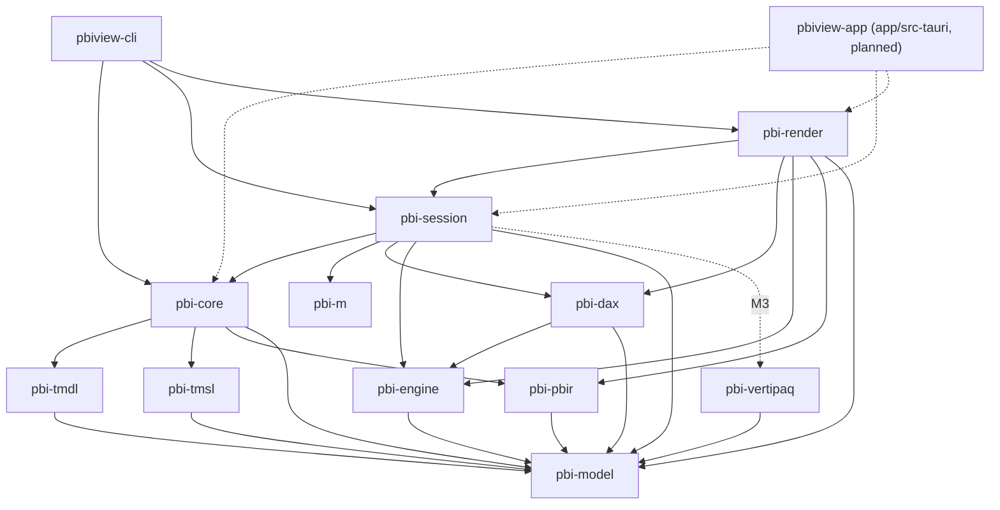

# ADR-0004: Desktop-ready architecture

- Status: Accepted
- Date: 2026-10-21
- Deciders: pbiview maintainers
- Related: [ADR-0001](0001-ui-tauri-svelte.md), [ADR-0002](0002-arrow-datafusion.md), [ADR-0005](0005-rust-svg-renderer.md)

## Context

v1 of `pbiview` is a read-only viewer (Phase 1 Data Explorer, Phase 2 Report Renderer). Longer term it should be able to grow into a Rust reimplementation of Power BI Desktop: editing models and reports, refreshing, and saving.

A viewer-only design would parse files into read-only DTOs, drop anything it does not understand, and evaluate queries synchronously. That is quicker to build, but it would have to be rewritten later to support editing.

Constraints from the original requirements:

- Keep unknown fields round-trippable. PBIR `$schema` versions vary between files.
- Display names differ from source names.
- Never panic on untrusted input.
- Measures that can't be evaluated show a warning with the DAX text.

## Decision

### 1. TOM-like canonical model (`pbi-model`)

- One canonical, **mutable** semantic model, shaped like the Tabular Object Model: `Model`, `Table`, `Column` (data, calculated, row-number), `Measure`, `Partition` (M, calculated, entity), `Relationship`, `Expression` (shared and parameter), `Hierarchy`, `Role`, `Perspective`, `Culture`, `QueryGroup`, `Annotation`.
- A **report AST** in the same crate: `Report`, `Page`, `Visual`, `Filter`, `Bookmark`, `ThemeRef`. Semantic-query expressions use `SourceRef`, `Column`, `Measure`, `Aggregation`, `In`, `Comparison`, `And`, `Or` and `Not`.
- Every object carries:
  - an **`ObjectId`**: a stable, typed, opaque handle (arena index plus generation). It does not depend on names, so renames don't break references held by the UI, the engine or undo history.
  - a **`lineageTag`**, `description` (TMDL `///`) and **annotations** (`name → value`), preserved exactly.
  - an **`extra` property bag** (`IndexMap<String, serde_json::Value>`, insertion-ordered) for properties we don't model yet. Readers put unknown TMDL properties, TMSL keys and PBIR JSON fields here, and writers emit them back unchanged.
- **Display name vs source name.** A `Column` keeps both its display `name` and its `sourceColumn` (the TOM/TMDL property). Visual projections keep their `displayName` overrides. The UI shows the display name, with the source name in a tooltip.

### 2. Serializers, not just parsers

Each format crate both reads and writes:

| Crate | Read | Write | Round-trip guarantee |
|---|---|---|---|
| `pbi-tmdl` | Lexer → lossless CST (comments, ordering, indentation, quoting, blank lines) → model | Model + CST → TMDL | **Byte-identical** for unedited files. Minimal diff for edited objects. |
| `pbi-tmsl` | `model.bim`, PBIT `DataModelSchema` (UTF-16LE) → model | Model → TMSL JSON | JSON value equality; unknown keys kept in `extra`. |
| `pbi-pbir` | PBIR files, PBIR-Legacy `report.json`, PBIX `Layout` (UTF-16LE, stringified JSON) → report AST | Report AST → PBIR | JSON value equality, using `serde(flatten)` `extra` maps. `serde_json` uses `preserve_order`, `float_roundtrip` and `arbitrary_precision`, so key order and numbers survive. |

**PBIP is the native save format.** Writing PBIX would need XPress9 and ABF *encoders* and is out of scope.

### 3. Document, commands and undo

- `pbi-model::Document` owns the model, the report and their source mapping (which file and CST node each object came from).
- All mutations go through `Command`s. `apply` validates, mutates, and returns the inverse command plus a `ChangeSet` (the affected `ObjectId`s and kinds). The document keeps undo and redo stacks. Compound commands group edits into one undo step.
- `ChangeSet` events drive invalidation: the engine drops affected caches, the renderer re-renders affected visuals, and the UI refreshes affected nodes.
- In v1, commands are used only internally and in tests (for example applying a slicer selection to report state). The UI stays read-only, but the API exists and is tested.

### 4. Real engines with async and cancellation

- `pbi-m` and `pbi-dax` are real language implementations: full grammars, proper semantics (lazy M evaluation; DAX filter context, row context, context transition and `BLANK`) and a growing function library. They are not regex-level subsets.
- An unsupported function returns a typed "unsupported" result that carries the function name and the source expression. The UI and renderer show it as a warning with the source text. It never panics.
- Engine entry points (refresh, DAX query, VertiPaq decode, grid paging) are `async` and take a `tokio_util::sync::CancellationToken`. Long loops check the token. DataFusion streams cancel when dropped. Progress is reported through events.
- The CLI drives the same API with a blocking runtime. The app runs it on Tauri's async runtime and can cancel from the UI.

### 5. Crate dependency direction

`pbi-session` is the façade for load, refresh and query. It exists to break the `pbi-dax` ↔ `pbi-engine` cycle: `pbi-dax` depends on `pbi-engine` for storage and filter propagation, and refresh orchestration (M → calculated columns → calculated tables) needs both, so it lives above them. The CLI and app depend only on `pbi-core`, `pbi-session` and `pbi-render`.

The graph below is taken from the crate `Cargo.toml` files at M0. Dotted edges are planned and not declared yet.

> Status note (Phase 2): the dotted edges now exist, and `pbi-core` also depends on `pbi-vertipaq` (ABF schemas), `pbi-dax` and `pbi-m` (linter and mashup readers); the CLI and app use a few more crates directly. PBIR losslessness is implemented with `pbi-pbir`'s `json_object!` macro rather than `serde(flatten)`, and also keeps key order and number spellings. The rules below still hold. The current graph is in [docs/ARCHITECTURE.md](../ARCHITECTURE.md#crate-graph).



Text form:

```
pbiview-cli ──> pbi-core, pbi-session, pbi-render
pbiview-app ··> pbi-core, pbi-session, pbi-render          (planned, M1)
pbi-render  ──> pbi-session, pbi-dax, pbi-engine, pbi-pbir, pbi-model
pbi-session ──> pbi-core, pbi-m, pbi-dax, pbi-engine, pbi-model
            ··> pbi-vertipaq                               (planned, M3)
pbi-core    ──> pbi-tmdl, pbi-tmsl, pbi-pbir, pbi-model
pbi-dax     ──> pbi-engine, pbi-model
pbi-engine  ──> pbi-model
pbi-tmdl    ──> pbi-model
pbi-tmsl    ──> pbi-model
pbi-pbir    ──> pbi-model
pbi-vertipaq──> pbi-model
pbi-m       ──> (no internal deps; produces Arrow tables via its own value model)
pbi-model   ──> (no internal deps)
```

Rules:

- Dependencies point downward only. `pbi-model` is the root.
- `pbi-m` stays independent of the model so it can be fuzzed and tested in isolation. `pbi-session` maps M results to model tables.
- Crates add dependencies only through `[workspace.dependencies]` in the root `Cargo.toml`.

### What changes compared with a viewer-only design

| Concern | Viewer-only design | Desktop-ready design (chosen) |
|---|---|---|
| Model | Read-only DTOs per format | One mutable TOM-like model with `ObjectId`s |
| Unknown data | Dropped | Kept in `extra` bags and annotations; written back |
| TMDL | Parse to AST, drop trivia | Lossless CST; byte-identical writer |
| PBIR | Deserialize the fields we render | Full serde round-trip with `extra`; writer |
| Identity | Names | Stable `ObjectId` plus `lineageTag`; names are editable properties |
| Mutation | None | `Command` + undo/redo + `ChangeSet` events |
| Engines | Synchronous helpers, partial semantics | Async, cancellable; real M and DAX semantics |
| Refresh | Ad hoc in the CLI | `pbi-session` orchestrates dependency order |
| Save | Not possible | PBIP (TMDL + PBIR) writers exist from M1 |
| Tests | Snapshot of parsed output | Round-trip (byte or value equality) on every fixture, plus command apply/undo tests |

## Alternatives considered

| Option | Why not chosen |
|---|---|
| Viewer-only DTOs, refactor later | Cheapest now, but lossless round-trip, identity and undo are hard to add after many call sites depend on read-only types. |
| Use JSON (`serde_json::Value`) as the model | Lossless for free, but untyped. Every consumer re-parses, and there are no stable IDs or invariants. |
| Event-sourced or CRDT document | Strong for collaboration, but more complexity than a single-user desktop needs. Commands with inverses cover undo and can be extended later. |
| Synchronous engine API | Simpler, but the UI would freeze on refresh and couldn't cancel. Retrofitting async later changes every signature. |

## Consequences

- M1 costs more: the CST, `extra` bags, IDs and writers are built up front, and round-trip tests must pass on every fixture file.
- Every new field must be either modelled or left in `extra`. Reviewers check that readers never silently drop data.
- The UI and CLI never mutate model structs directly. They use `Document` commands.
- Async signatures and cancellation tokens appear throughout the engine APIs, even in v1.
- Future editing, saving to PBIP, and a model or report designer can be added without changing core types.
